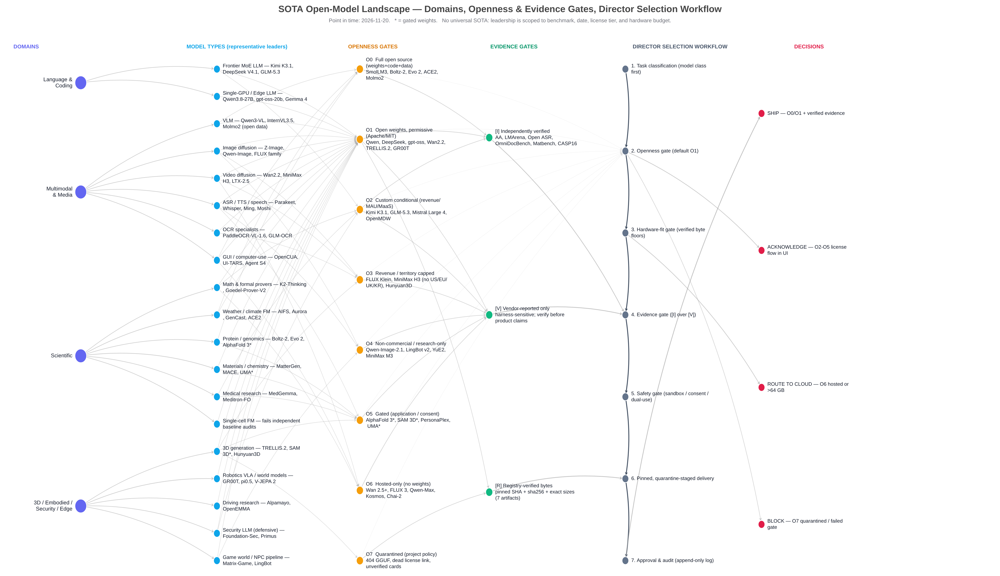

# The SOTA Open-Model Landscape — Synthesis Report

**Point in time: 2026-11-20.** Every claim in this document is dated or inherits the 2026-11-20 compile date of its source report; the open-model landscape moves on a weekly cadence, so treat this as a snapshot, not a standing reference.

**Evidence labels (used inline throughout):**

- **[V]** — vendor- or author-reported (model card, lab blog, self-run benchmark; not independently reproduced)
- **[I]** — independently measured (Artificial Analysis, LMArena/Arena, Vals, LiveBench, HF Open ASR Leaderboard, OmniDocBench, GameWorld Score, Matbench Discovery, academic audits)
- **[R]** — registry-verified metadata (exact repo ID, pinned commit SHA, byte sizes, LFS sha256 — verified live against the Hugging Face API on 2026-11-20; no weights downloaded, no code executed)

**Source inputs (provenance, not bibliography):** this report synthesizes six workspace artifacts — `sota_language_coding_models.md`, `sota_multimodal_media_models.md`, `sota_scientific_models.md`, `sota_3d_embodied_security_models.md` (each compiled 2026-11-20 from ≥6 web-research rounds plus primary-source reads), `.work/reviewed_models.json` (machine-checked HF registry snapshot, 2026-11-20T04:51Z), and `local_desktop_orchestration_research.md` (director-led desktop orchestration architecture and model-delivery policy). Factual claims cite the source section inline; primary papers are cited at the point of claim. There is deliberately no end bibliography.

---

## Executive Summary

1. **There is no universal SOTA, and this report does not manufacture one.** Leadership is scoped to a benchmark, a date, a license tier, and a hardware budget. The strongest independently measured open-weight language model as of late October 2026 — Kimi K3.1 Pro, Artificial Analysis Intelligence Index v5 = 46 — still ranks only around #17 overall against closed frontier models (~92.8/100 on the same comparative scale) (sota_language_coding_models.md §1, §2.1, [I] 2026-10-27 / [I] benchlm 2026-11-19).

2. **"Open" is an eight-position spectrum, not a binary.** The landscape spans fully open-source pipelines (weights + training code + data: SmolLM3, OLMo 3, Boltz-2, Evo 2, ACE2, Molmo2, OpenCUA) through permissively licensed open weights (Apache-2.0/MIT: Qwen3.x, DeepSeek V4, gpt-oss, Wan2.2, TRELLIS.2, GR00T) to conditional community licenses (Kimi K3.1: extra terms above $20M revenue / 100M MAU), revenue-capped licenses (LTX-2.5: paid license ≥$10M), non-commercial defaults (MiniMax M3; Qwen-Image-2.1 research-only), territory-excluding licenses (MiniMax H3/H3-Image and Hunyuan3D 2.1 exclude EU/UK/Korea and other jurisdictions), gated downloads (AlphaFold 3 weights, SAM 3D, NVIDIA PersonaPlex), and hosted-only models (Wan 2.5/2.6/2.7, FLUX 3, Qwen3.8-Max, Chai-2, Kosmos) (all four domain surveys, inline sections below).

3. **The license–quality relationship inverts by domain.** In image and video generation, the strongest open weights of November 2026 carry non-permissive terms — MiniMax H3-Image leads the open-weights arena (Elo 1066) but excludes US/EU/UK/KR use, and Qwen-Image-2.1 (Elo 1047) is research-only — while the strongest *unconditionally permissive* image stack (Z-Image Turbo, Qwen-Image-2512/Edit-2511, FLUX.2 [klein] 4B, all Apache-2.0) sits ~100–230 Elo lower (sota_multimodal_media_models.md §2, [I] AA open-weights boards, Nov 2026). The opposite holds in OCR and English ASR, where permissive sub-1.5B specialists top the independent boards outright: PaddleOCR-VL-1.6 (Apache-2.0, 0.9B) scores 96.34 on OmniDocBench v1.6 versus 89.78 for the 235B Qwen3-VL generalist, and NVIDIA Parakeet TDT 0.6B v3 leads the HF Open ASR Leaderboard at 6.34% average WER (sota_multimodal_media_models.md §7, §4, [I]).

4. **Sparse MoE is the default frontier architecture, and memory footprint tracks *total* parameters.** Active/total ratios now run 3–9% (DeepSeek V4-Pro 49B/1.6T; Kimi K3 104B/2.8T; gpt-oss-120b 5.1B/117B), so serving cost is set by total weights: GLM-5.3 ≈ 515 GB at Q4_K_M, Kimi K3 ≈ 1.5 TB (8×B200 minimum), DeepSeek V4.1-Flash ≈ 511 GB (sota_language_coding_models.md §2.8, [V]). Desktop-viable capability concentrates in the 3B–35B band: Qwen3-Coder-30B-A3B at Q4_K_M has a verified 16.75 GiB weight floor and runs on a 24 GB GPU (.work/reviewed_models.json, [R]).

5. **Evidence asymmetry is the central reading skill.** Vendor self-reports dominate coding-agent, GUI-agent, image-editing, TTS-latency, and music claims; headline numbers that lack independent reproduction include DeepSeek-V4.1-Flash's 90.6 Terminal-Bench 2.1 (self-harnessed [V]), GLM-5.3's gains (a single independent datapoint), Beam's 80.9 SWE-bench Verified (unreproduced), and GUI-Owl-1.5's 56.5% OSWorld-Verified (self-reported) (sota_language_coding_models.md §4; sota_multimodal_media_models.md §8). Known negative results are equally load-bearing: single-cell foundation models do not consistently beat simple baselines in seven-plus independent audits (sota_scientific_models.md §8, [I]), and protein *design* models are validated for binding, not function — a 2025 controlled challenge produced zero neutralizing hits among >1,000 designs (sota_scientific_models.md §6, [I]).

6. **Open weights transfer the safety burden to the deployer.** Multi-turn jailbreak attack success rates of 25.9%–92.8% across eight major open-weight LLMs (arXiv:2511.03247, Nov 2025, via sota_3d_embodied_security_models.md §6.4), model-file supply-chain attacks (malicious pickle deserialization; scanner evasion up to 63% in a 2026 preprint), and runtime CVEs (e.g., SGLang `torch.load` RCE CVE-2026-15976; Ollama path-traversal RCE fixed in 0.35.0) make pinned-revision, hash-verified, quarantine-staged delivery the documented baseline (local_desktop_orchestration_research.md §9, §11).

7. **Model selection is a gated workflow, not a leaderboard lookup.** The defensible path runs task classification → openness gate → hardware-fit gate → evidence gate → license acknowledgment → pinned/quarantined delivery → human approval, embedded in the Director-led desktop orchestration architecture (local_desktop_orchestration_research.md §4, §9–§10; workflow in §7 below; conceptual map in Figure 1). A dedicated **AI Open-Model Researcher** role owns this evidence layer; its charter is reproduced in §8 and saved at `scientific-research-library/agents/ai-open-model-researcher.md`.

---

## 1. The Openness Spectrum — Definitions and Classification

These tiers are used throughout the report. An artifact's tier can differ for its code, weights, and data; the classification below records the *most restrictive relevant component* and notes splits explicitly.

| Tier | Name | Definition | Representative artifacts (as of 2026-11-20) |
|---|---|---|---|
| O0 | **Full open source** | Weights + training code + training data open under permissive terms | SmolLM3-3B, OLMo 3 7B (language) (sota_language_coding_models.md §2.7); Molmo2 (VLM, open training data), OpenCUA (MIT incl. AgentNet data) (sota_multimodal_media_models.md §1, §8); Boltz-1/2, BoltzGen, Evo 2 (incl. 8.8T-bp OpenGenome2), ACE2, AIFS (CC-BY weights + Apache Anemoi), Biomni (sota_scientific_models.md §6–§7, §3, §10) |
| O1 | **Open weights + open code, permissive** | Apache-2.0/MIT-class; data/recipe undisclosed | Qwen3.5/3.6/3.8 line, DeepSeek V3.2/V4.x (MIT), gpt-oss-120b/20b, GLM-5.3-Flash (MIT), Gemma 4, Mistral Small 4 (sota_language_coding_models.md §1); Qwen3-VL, Z-Image Turbo, Qwen-Image-2512, Wan2.2, Qwen3-ASR/TTS, PaddleOCR-VL-1.6, GLM-OCR (MIT) (sota_multimodal_media_models.md §1–§7); TRELLIS.2 (MIT), TripoSR, openpi π0/π0.5, OpenVLA, GR00T N-series, Matrix-Game, V-JEPA 2 (sota_3d_embodied_security_models.md §1, §3–§4) |
| O2 | **Open weights, custom conditional license** | Permissive-style but with revenue/MAU/MaaS triggers or security-review clauses | Kimi K3.1 Pro (extra terms >$20M rev or >100M MAU), GLM-5.3 ($10B-revenue MaaS security review), Mistral Large 4 (Ecosystem OWL; MaaS needs separate license), Muse Spark Open (>$20M/yr API providers), NVIDIA OpenMDW-1.1 artifacts (Nemotron 3 Ultra, VoiceChat) (sota_language_coding_models.md §1; sota_scientific_models.md §5 note) |
| O3 | **Revenue-capped / territory-restricted community** | Free below a revenue threshold or excluded jurisdictions | FLUX 3 Image Klein (free <$5M), LTX-2.5 (paid ≥$10M), SD3.5 (<$1M), MiniMax H3 / H3-Image (**exclude US/EU/UK/KR**; >$20M or >$1M authorization), Hunyuan3D 2.1 (excludes EU/UK/South Korea; 1M-MAU cap; no training non-Hunyuan models on outputs) (sota_multimodal_media_models.md §2–§3; sota_3d_embodied_security_models.md §1.2) |
| O4 | **Non-commercial / research-only** | No commercial use of weights (outputs may vary) | MiniMax M3 (non-commercial by default), Qwen-Image-2.1 (Qwen Research License), FLUX.2 [dev] & [klein] 9B, YuE2 (CC BY-NC 4.0), Breeze TTS 2, LingBot-World 2.0 (CC BY-NC-SA), Nucleotide Transformer v1/v2, XTTS v2, Holo4-27B (sota_language_coding_models.md §1; sota_multimodal_media_models.md §2, §3, §5; sota_scientific_models.md §7; sota_3d_embodied_security_models.md §3.2) |
| O5 | **Gated** | Download requires application, license acceptance, or consent flow | AlphaFold 3 weights (academic/non-commercial, non-redistributable), Meta UMA (FAIR Chemistry License application), AlphaGenome weights, SAM 3D Objects/Body (license-acceptance gate), NVIDIA PersonaPlex-7B, Pocket TTS cloning repo (consent terms), Chandra OCR 2 (modified OpenRAIL-M) (sota_scientific_models.md §4, §6–§7; sota_3d_embodied_security_models.md §1.3; sota_multimodal_media_models.md §5, §7) |
| O6 | **Hosted-only (no weights)** | API/service access only | Wan 2.5/2.6/2.7 (verified no weights 2026-10-05), FLUX 3, Qwen-Image-3.0, Qwen3.8-Max / Qwen4-Max, MiniMax M3 API tiers, UI-TARS-2, Chai-2, Kosmos, Google AI Co-Scientist, AlphaEvolve, AlphaProof/AlphaGeometry 2 (sota_multimodal_media_models.md §2–§3; sota_language_coding_models.md §3; sota_scientific_models.md §1, §10; sota_multimodal_media_models.md §8) |
| O7 | **Quarantined (project policy)** | Verified-uninstallable or unverifiable artifacts that must not ship | From `reviewed_models.json` excluded list: nonexistent official GGUF (`Qwen/Qwen3-Coder-30B-A3B-Instruct-GGUF` → HF 404); valid-but-not-selected community quant (unsloth conversion lacking pinned `.src_sha` provenance) [R]. From orchestration policy: the needs-re-verification list (Qwen3-TTS, Qwen-Image 2.1, FLUX 3 [klein], Qwen3.5/3.8, Gemma 4, SAM 3D, Devstral Small 2) "must not ship until card-level verification"; TripoSR and TRELLIS.2 are reference-only under current no-remote-code policy (local_desktop_orchestration_research.md §10.3) |

**Synthesis.** Three structural facts follow. First, *full open source (O0) is rare and concentrated*: language (two small models), scientific computing (weather, proteins, genomics), and one VLM family — no frontier-scale LLM discloses training data (sota_language_coding_models.md preamble). Second, *the sharpest 2026 fault line is O3/O4*: the best-scoring open image and video weights are largely unusable for US/EU commercial products, which makes the permissive tier, not the arena leaderboard, the operative frontier for most builders (sota_multimodal_media_models.md, cross-cutting conclusion 2). Third, *quarantine is a first-class tier, not an oversight*: the project's own registry demonstrates exclusion-by-policy of exactly-verified artifacts (wrong provenance, dead license links, remote-code requirements) — the standard other selectors should adopt (.work/reviewed_models.json verification rules, [R]).

---
## 2. Domain Landscape I — Language, Reasoning, and Coding

The language stack stratifies into four usable tiers: datacenter-frontier MoE (0.5–2.8T total params), server-class "small" MoE (100–400B total), single-GPU dense/MoE (8–35B), and edge (≤4B). Selection should start from the tier your hardware allows, then compare within it — cross-tier benchmark comparisons are mostly meaningless for procurement.

| Tier / role | Representative leaders (2026-11-20) | License tier | Headline evidence | Hardware reality |
|---|---|---|---|---|
| Frontier MoE, general + agentic | Kimi K3.1 Pro (2.8T/104B); Kimi K3 | O2 custom | AA Intelligence Index v5 = 46, top open weight [I, 2026-10-27]; K3: GPQA-D 93.5, FrontierSWE 81.2 [V, Jul 2026] | ~1.5 TB weights; 8×B200 minimum [V] (sota_language_coding_models.md §1, §2.8) |
| Frontier MoE, coding | DeepSeek-V4.1-Flash (552B+196B "Engram"); GLM-5.3 (753B/40B) | O1 MIT / O2 custom | TB 2.1 90.6 [V, self-harnessed, unreproduced]; LiveBench agentic-coding #1 [I, Nov 2026]; GLM-5.3 AA idx 45 #1-of-112 open [I, 2026-09-07] | ~511 GB (V4.1-Flash); GLM-5.3 ≈515 GB Q4 [V] (§1, §2.8) |
| Server "small" | Mistral Small 4 (119B/6.5B); Qwen3.5-397B-A17B | O1 Apache | AA idx 11 with reasoning, ties/beats Large 3 at ~⅓ price [I, 2026-10-14]; Qwen3.5: 76.2% SWE-bench Verified [V, Feb 2026] | ~72 GB Q4 (Small 4) (§1, §3) |
| Single-GPU coding | **Qwen3.8-27B** (dense); Qwen3.6-35B-A3B; Devstral 2 | O1 Apache | SWE-bench Pro 61.7, TB 2.1 73.0 [V, 2026-08-14]; ~81% SWE-bench Verified per Vals [I, Sep 2026] | 24–48 GB cards (§2.3, §2.7) |
| Edge / on-device | Gemma 4 E2B/E4B (audio-native), 26B-A4B MoE; gpt-oss-20b; Qwen3.5-0.8–9B; Phi-4-mini; LFM3-1.7B; MiniCPM5-2B | O1 (Apache/MIT) | Gemma 4 31B: MMLU-Pro 85.2, AIME'26 89.2 [V; arXiv:2607.02770]; gpt-oss-20b ≈ o3-mini class [V]; LFM2.x 2× faster CPU prefill/decode than Qwen3 [V] | 4–16 GB; E2B ~1.5 GB Q4 fits phones (§2.7; sota_3d_embodied_security_models.md §7) |
| Reasoning specialists | GLM-5.2 (MIT): AIME'26 99.2 [V]; DeepSeek-V3.2 (arXiv:2512.02556); Nemotron 3 Nano 30B (AIME'25 99.2 w/ tools [V]) | O1 | Verbosity tax: GLM-5.3 burned 210M output tokens on the AA index vs 120M median [I] — price/quality rankings invert when token spend is counted (§2.2, §4) | Nano 30B/4B targets Jetson/DGX Spark (§2.7) |
| Long context (1M standard) | Kimi K3 line, DeepSeek V4, GLM-5.2/5.3, MiniMax M3, Mistral Large 4, Llama 4 Scout (10M advertised) | mixed | Independent long-context reliability lags marketing (AA-LCR: Kimi K3 74.7) [I]; treat max context as capacity, not recall (§2.5) | KV-cache cost dominates; Llama 4 Scout's 10M is "enormous" at full fill (§2.5) |

**Cross-cutting synthesis (language).** (a) *SWE-bench Verified is saturated at the frontier* — discriminating signal has moved to SWE-bench Pro, FrontierSWE, DeepSWE v1.1, and Terminal-Bench 2.1–4.0 (§2.3). (b) *Open still trails closed on the hardest agentic tasks*: Kimi K3's FrontierSWE 81.2 vs Claude Fable 5's 86.6 [V] (§2.3). (c) *Benchmark strength decouples from formal reasoning*: DeepSeek-V3.1 scored worst-in-class on formal spec generation (7.93%) despite 66.0 SWE-bench Verified (§2.3). (d) *Permissiveness regressed at the top of one family*: Mistral Large 4 moved from Apache-2.0 to a custom OWL with a MaaS clause, while Gemma 4 moved the other way (custom → Apache-2.0) (§3). (e) *Ecosystem lag is real for new architectures*: V4.1-Flash lacks llama.cpp/GGUF support; Kimi K3's MXFP4 needs recent vLLM/SGLang (§4.6).

## 3. Domain Landscape II — Multimodal, Media, and Document Intelligence

The media stack's central 2026 finding is that **specialists beat generalists wherever a focused benchmark exists**: sub-1.5B OCR models out-parse 235B VLMs, and 0.6B ASR models top English transcription. Giant multimodal models earn their footprint only on cross-modal reasoning.

| Sub-domain | Permissive leader(s) (O1/O0) | Restricted-but-stronger | Evidence anchor | Key caveat |
|---|---|---|---|---|
| Vision-language understanding | Qwen3-VL-235B-A22B & 2B–32B line (Apache); InternVL3.5; Molmo2 (O0, open data, best video-pointing 38.4 F1 [V]) | — (closed Gemini/GPT still top general reasoning) | Qwen3-VL tech report arXiv:2511.21631 [V] + independent FlagOS rerun (MMMU 70.4/OCRBench 91.8) [I] | Vendor headline evals; ScreenSpot-Pro trails GUI specialists (§1) |
| Image generation | Z-Image Turbo (Elo 937), Qwen-Image-2512 (best text rendering), FLUX.2 [klein] 4B | H3-Image #1 (1066, US/EU/UK/KR-excluded), Qwen-Image-2.1 (1047, research-only), FLUX 3 Klein (1041, <$5M cap) | AA open-weights T2I/editing boards [I, Nov 2026] | Closed leaders sit ~200+ Elo above best open; Qwen-Image-Edit is a published jailbreak target (arXiv:2610.23909) — deploy with moderation (§2) |
| Video generation | Wan2.2 family (Apache; TI2V-5B does 720p24 in <9 min on one consumer GPU [V]) | MiniMax H3 (T2V Arena ~1238–1240, territory-excluded, one-pass video+audio), LTX-2.5 (sync audio+video, $10M cap) | Official Wan2.2 README efficiency table [V]; Arena I2V open Elo 1171 [I, Nov 2026] | ~5s clips; Wan 2.5+ is hosted-only; no mandatory watermarking — C2PA/SynthID is the deployer's job (§3) |
| ASR | Parakeet TDT 0.6B v3 (CC-BY; 6.34% avg WER [I]); Whisper large-v3 (MIT, 99 langs); Qwen3-ASR (Apache, 52 langs, streaming) | Nemotron streaming (OpenMDW) | HF Open ASR Leaderboard [I] | Clean-audio WER understates accents/noise; Whisper hallucinates in silence (documented) (§4) |
| TTS / voice | Ming-3.0-tts (MIT, Elo 1188 — best freely-shippable [I]); Qwen3-TTS (Apache, 3s cloning) | Fish Drama 3 (1245, <$500k cap), Breeze TTS 2 (1215+, research-only) | AA Voice/TTS Elo [I, Oct–Nov 2026] | Chatterbox retired Aug 2026; Kokoro unmaintained; cloning raises consent duties — Pocket TTS gates cloning behind consent terms, Chatterbox embeds a Perth watermark (§5) |
| Speech-to-speech | Moshi (7B, code MIT + CC-BY weights) | PersonaPlex-7B (gated), VoiceChat 11B (OpenMDW) | Big Bench Audio: open 4–27% vs ~90% closed [I/V] | Honest ceiling: production voice agents still run ASR→LLM→TTS cascades (§5) |
| Audio/music | ACE-Step 1.5 (MIT, <4GB VRAM); Qwen3-Omni-30B-A3B (Apache; open SOTA on 32/36 audio benchmarks per tech report arXiv:2509.17765 [V]) | YuE2 (CC BY-NC), MiniMax Music 3.0 (>$20M) | Independent arXiv:2604.24954 shows Nemotron 3 Nano Omni edging Qwen3-Omni on DailyOmni/WorldSense [I] | Music licensing is the main trap; MusicGen weights are CC-BY-NC (§6) |
| OCR / documents | PaddleOCR-VL-1.6 (Apache, 96.34), GLM-OCR (MIT, 95.22), OvisOCR2 (Apache, 96.47), DeepSeek-OCR-2 (Apache, token-efficiency play) | OXR-1.0 (#1, 97.03, Apache + $2M terms), MinerU2.5-Pro (>100M MAU/$20M clauses) | OmniDocBench v1.6 leaderboard [I, checked Oct–Nov 2026] | Top scores within noise of each other; test on your own documents (§7) |
| GUI / computer-use agents | OpenCUA-72B (MIT incl. data; OSWorld-V 45.0% [I, Oct 2025]); UI-TARS-1.5-7B (Apache); Agent S3/S4 framework (Apache; lifts Qwen3.8-27B 5.6%→21.3% on OSWorld 2.0 at $1.10/task [V/arXiv, Oct 2026]) | GUI-Owl-1.5 (MIT but 56.5% self-reported — verify), Holo4 (metric ambiguity), Mano-P (vendor board) | OSWorld version caveat: 2024 ≠ Verified ≠ 2.0 — not comparable (§8) | `--enable_local_env` executes arbitrary code — sandbox (e.g., Cua VM); screen-content prompt injection is an open risk (§8) |

**Cross-cutting synthesis (media).** (a) *Sub-10B models cover most production media workloads* — OCR, ASR, TTS, 4B image, 5B video — on 8–24 GB GPUs; 235B VLMs and 33B video models remain datacenter items (§cross-cutting 4). (b) *Territorial exclusions are the newest license weapon*: MiniMax H3/H3-Image and Hunyuan3D 2.1 exclude major Western markets, making "open-weight" unusable there regardless of technical merit (§2–§3; sota_3d_embodied_security_models.md §1.2). (c) *Maintenance status is part of fitness*: Chatterbox (retired), Kokoro (unmaintained since Jan 2025), UI-TARS repo quiet since Nov 2025, FireRed-OCR inactive since Mar 2026 — a stale repo is a supply-chain and support risk (§5, §7, §8).

## 4. Domain Landscape III — Scientific Models

Scientific AI is the domain where openness is deepest (several O0 full-open pipelines) and where the vendor-vs-independent gap is most instructive (single-cell foundation models fail independent baselines outright).

| Field | Reference open artifacts | Openness | Evidence anchor | High-stakes restriction |
|---|---|---|---|---|
| Math — informal | Kimi K2 Thinking (AIME'25 99.1% w/ tools [V], top open in registry as of Nov 2026 [I]); gpt-oss-120b/20b; DeepSeek-V3.2; GLM-4.7 (MIT) | O1/O2 | AIME registry (ai-tldr.dev) [I] | Tool-augmented scores ≠ pure reasoning (§1) |
| Math — formal (Lean 4) | DeepSeek-Prover-V2 (MIT); Goedel-Prover-V2 (Apache; 8B matches 671B at 84.6% miniF2F [V]) | O1 | Papers, 2025 | Lowest-risk domain: outputs are machine-checkable (§1) |
| Physics | Walrus (MIT, code+weights+The Well data — O0); GPhyT; AION-1; TORAX (Apache) | O0–O1 | arXiv:2511.15684; NeurIPS 2025 | Research surrogates — not validated for reactor control or engineering sign-off (§2) |
| Climate/weather | **AIFS (ECMWF; operational since Feb 2025)**, Aurora (MIT; Nature 2025: beats IFS HRES on 92% of combos [V/journal]), GenCast (97.2% of 1,320 targets vs ENS, Nature 2024), ACE2 (Apache, O0), NeuralGCM, NOAA AIGFS/AIGEFS (operational Dec 2025/Jan 2026) | O0–O1 | ECMWF/NOAA operational scorecards [I-operational] | **Most operationally validated domain**, but open models are decision-support, not certified warning systems; known biases in extremes, precipitation, TC intensity (§3) |
| Materials | MatterGen (MIT, Nature 2025; TaCr₂O₆ synthesized); MACE-MP-0 (MIT); ORB; MatterSim | O1 | Matbench Discovery [I]; independent probes find OOD skew in generated candidates (2026) | Generated candidates are hypotheses for DFT + lab validation, not certified materials (§4) |
| Chemistry | Uni-Mol2 (1.1B; verify non-commercial-leaning terms); IBM FM4M/SMI-TED (Apache, O0-class); ChemDFM-R | O1–O4 | ChemEval (partially self-built) [V] | Dual-use: institutional biosafety/chemsafety review before any wet-lab use; no operational protocols (§5) |
| Protein structure/design | **Boltz-2 (MIT, fully open; ~AF3-level, CASP16 affinity winner)**, BoltzGen, Protenix, OpenFold3, RFdiffusion3, ProteinMPNN; **AlphaFold 3 = gated** | O0/O1 vs O5 | Nature 2024 (AF3); bioRxiv 2025 (BoltzGen); CASP16 [I] | Design validated for binding, not function (Adaptyv 2025: 0/>1,000 neutralizing [I]); IBC review + sequence screening before physical realization (§6) |
| Genomics | **Evo 2 (Apache — weights + code + 8.8T-bp OpenGenome2; Nature 2026)**, one of the largest fully open models in any domain; HyenaDNA; GENA-LM; Nucleotide Transformer (CC BY-NC-SA); AlphaGenome (gated) | O0 vs O4/O5 | Nature 2026; Nature Methods 2025 | Eukaryotic viruses deliberately excluded from Evo 2 training (biosafety); variant interpretation is research-grade, not diagnostic (§7) |
| Single-cell | scGPT, Geneformer, scFoundation, UCE, SCimilarity, TranscriptFormer | O1 | **Seven-plus independent audits (Genome Biol 2025; Nat Methods 2025; VCBench 2026): FMs do NOT consistently beat HVG/PCA/linear baselines [I]** | Mandatory baseline controls; never report FM-only results (§8) |
| Medical | MedGemma 4B/27B (Gemma terms; Nature Medicine 2026; ReXVQA 83.84 vs 77.27 best radiology resident [I]); Med42-v2 (Llama license); Meditron-FO (first fully open pipeline) | O2/O5 | Peer-reviewed + independent evals | **None is a medical device** (<20 FDA-cleared LLM devices as of May 2026); research use only; 81% of MedGemma CXR reports rated equal/superior overall but only 49% for abnormal studies (§9) |
| Discovery agents | Biomni (Apache; LAB-Bench DbQA 74.4% ≈ expert humans [V/journal]); Sakana AI Scientist, OpenEvolve, RD-Agent (open) | O1 | BioML-bench: agents underperform human baselines on average [I]; ScienceAgentBench/PaperBench <20% full replication [I] | Biomni executes LLM-generated code with full privileges — sandbox; Kosmos/AI Co-Scientist/AlphaEvolve are hosted-only (§10) |

**Cross-cutting synthesis (science).** (a) Weather/climate and protein structure are the two domains where open models are *operationally* ahead or at parity — ECMWF and NOAA run open AI models in production; Boltz-2 removes the last structural reason to need gated AF3 for most work (§3, §6). (b) Gating concentrates exactly where commercial value concentrates: AF3 weights, UMA potentials, AlphaGenome, MedGemma terms (§4–§9). (c) The single-cell caution generalizes: whenever a "foundation model" claim lacks an independent baseline audit, assume the baseline wins until shown otherwise (§8).

## 5. Domain Landscape IV — 3D, Embodied, Gaming, Security, and Edge

| Sub-domain | Reference open artifacts | Openness | Evidence anchor | Key caveat |
|---|---|---|---|---|
| Image-to-3D | **TRELLIS.2-4B (MIT; 1536³ voxel, ~3s@512³ on H100 [V])**; SAM 3D Objects/Body (SAM License, gated); TripoSR (MIT, ~6 GB, fast drafts); Hi3D (geometry-only refinement) | O1/O5 | arXiv:2512.14692; no independent apples-to-apples vs Hunyuan3D exists | Hunyuan3D 2.1 is stronger in pipeline (PBR paint) but EU/UK/KR-excluded; TRELLIS.2 needs ≥24 GB, Linux, and its render deps carry separate NVIDIA terms (§1) |
| Blender/graphics | No "Blender foundation model" exists — SOTA is a **pipeline**: official Blender MCP (2026 roadmap) + TRELLIS.2/Hunyuan3D generation + UniRig/SOMA-X rigging | O1 tools | blender.org Jan 2026 announcement; BlenderRAG arXiv:2605.00632 | MCP means arbitrary `bpy` execution — treat connected LLMs as code-execution agents (§2) |
| Game world models | Matrix-Game 3.0/4.0 (Apache; 720p@40fps real-time; GameWorld Score open benchmark); LingBot-World v1 (Apache) | O1 | v1 beat Oasis/MineWorld on all GameWorld Score dims [V/paper, Jun 2025] | LingBot-World **2.0 flipped to CC BY-NC-SA** — a mid-family license regression that blocks game-studio embedding (§3.2) |
| NPC stack | Pipeline, not a model: Qwen3-8B/Gemma 4 26B-A4B + Qwen3-TTS + lip sync; Mantella mod (2,500 NPCs) as canonical example | O1 | Community/secondary | Fish Speech 1.5 weights are CC-BY-NC-SA — prototyping only (§3.3) |
| Robotics VLA | **GR00T N1.7-3B (Apache; GR-1 language-following 46.6%→93.3% across N1→N1.5 [V])**; openpi π0/π0.5 (Apache; ALOHA 77.1% real-robot [paper]); OpenVLA-OFT (MIT; LIBERO 97.1% [paper]) | O1 | GR00T 2 white paper reports +236 Elo over π0.5 in paired evals [V, pre-release, Nov 2026] | π0.5's open repo lacks the RECAP/memory capabilities; OpenVLA authors warn base models "may or may not work" on other robots (§4) |
| World models (planning) | V-JEPA 2/2.1 (MIT; ~16s/action planning vs ~4 min for latent-diffusion planning [V]); NVIDIA Cosmos (Open Model License; ~20M-hours training data not open) | O1/O2 | arXiv:2506.09985 | Independent analysis: latent world-model planning reliability degrades beyond ~5–10 control steps [I, Sep 2026] (§4.4) |
| Autonomous driving research | Alpamayo 1 / R1-10B (open weights, teacher-model framing) + AlpaSim + 1,700 h open driving data; OpenEMMA (fully open EMMA reproduction); TIER IV Autoware E2E (deployment-oriented, Nov 2026) | O1 | nuScenes open-loop evals [V/paper] | Explicitly **not** a deployable driving stack; closed-loop safety is the integrator's responsibility; open-loop eval only for OpenEMMA (§5) |
| Cybersecurity (defensive) | Foundation-Sec-8B(-Instruct/-Reasoning; Llama+Apache dual license; matches Llama-3.1-70B/GPT-4o-mini on several security tasks at 8B [V]); Llama-Primus family + ODC-BY datasets; SecureBERT 2.0; Aikido Altar 1 (GLM-5.3-based; vendor benchmarks only) | O1/O2 | CTIBench/CyberMetric [V]; CyberSecQwen-4B +8.7 pts CTI-MCQ at half params [V-derivative] | Open models trail frontier closed widely on offensive tasks (top open ~19.5% vs 59% NYU CTF Bench [SECONDARY, Apr 2026]); outputs need analyst verification (§6; orchestration §10.2) |
| Edge inference | gpt-oss-20b (16 GB); Gemma 4 E2B (1.5 GB Q4); LFM2/2.5/3 (2× CPU speed vs Qwen3 [V]); runtimes: llama.cpp, MLX (20–87% faster than llama.cpp <14B [V]), vLLM/SGLang, ExecuTorch, Lemonade | O1 | Vendor + community measurements | Q4_K_M ≈ 0.65 GB/B params at ~97–98% FP16 quality for ≥7B; below Q3 degrades sharply (2026 consensus) (§7) |

**Cross-cutting synthesis (3D/embodied/security).** (a) Genuine open foundation models now exist in 3D (TRELLIS.2), robotics (GR00T, π0.5), and driving research (Alpamayo) — but Blender and NPC work remain composable pipelines, and pretending otherwise produces bad architecture (§cross-domain 1). (b) Robotics/AV evidence is the least independent in this report: GR00T 2's "2× leading VLAs" claim is a pre-release vendor evaluation; treat accordingly (§4.1). (c) Security posture: the standout systemic finding is 26–93% multi-turn jailbreak success across eight major open-weight LLMs (arXiv:2511.03247, Nov 2025), and Australian Cyber Security Centre guidance (Nov 2026) states the deployer owns all safeguards — fine-tuned/quantized derivatives may not retain original alignment (§6.4).

---
## 6. Evaluation Matrix — Which Benchmarks Still Discriminate

| Domain | Benchmark (status) | Independent yardstick? | Reading guidance |
|---|---|---|---|
| General language | AA Intelligence Index v5 (methodology changed Oct 2026 — cross-date comparisons invalid); LMArena Elo | Yes [I] | Index-scale changes break longitudinal claims (sota_language_coding_models.md §2.1) |
| Coding | SWE-bench Verified = **saturated at frontier**; use SWE-bench Pro, FrontierSWE, DeepSWE v1.1, Terminal-Bench 2.1/3.0/4.0 | Partial (LiveBench agentic-coding [I]; Vals SWE reruns [I]) | Harness-sensitive: Moonshot ran in Claude Code harness; DeepSeek self-harnessed; cross-vendor tables are one party's run (§2.3, §2.4) |
| Reasoning/math | AIME 2025/2026, GPQA Diamond, HLE | Registry (ai-tldr.dev) [I] | Tool-augmented scores are not pure reasoning; watch output-token cost (§2.2) |
| Long context | AA-LCR, RULER/NoLiMa | Yes [I] | Advertised windows (1M–10M) overstate reliable recall (§2.5; orchestration §10.2) |
| VLU | MMMU(-Pro), MathVista, OCRBench; tech reports | Partial (FlagOS reruns [I]) | General VLMs lose to OCR specialists on documents (§3 of this report) |
| Image gen/edit | AA open-weights T2I / editing Elo | Yes [I] | Strongest open weights carry non-permissive licenses (§3) |
| Video | Arena I2V Elo; vendor efficiency tables | Partial | No open mandatory watermarking; ~5s clip ceiling (§3) |
| ASR | HF Open ASR Leaderboard (8-dataset avg WER) | Yes [I] | Clean-audio WER understates real-world error (§3) |
| TTS | AA Voice/TTS Elo (blind listening) | Yes [I] | Vendor latency claims on unnamed GPUs (§3) |
| OCR/documents | OmniDocBench v1.6 end-to-end; olmOCR-Bench (self-reported) | Yes (OmniDocBench) [I] | Top of board within noise; v1.5 saturated — real-document testing decisive (§3) |
| GUI/computer use | OSWorld (2024) ≠ OSWorld-Verified (Jul 2025) ≠ OSWorld 2.0 (Jun 2026) — **scores not comparable across versions** | Partial | Framework lifts (Agent S4) beat raw model swaps at ~1/65 the cost of closed models per task [V/arXiv] (§3) |
| Proteins | CASP16 affinity challenge; FEP+ Pearson | Yes [I] | Binding ≠ function (§4) |
| Materials | Matbench Discovery; LeMat-GenBench OOD probes | Yes [I] | uMLIPs underestimate soft modes; generative outputs are hypotheses (§4) |
| Weather/climate | ECMWF/NOAA operational scorecards | Yes [I-operational] | The only domain with production-grade open-model validation (§4) |
| Single-cell | HVG/PCA/linear baselines are the yardstick | Yes [I] — and FMs fail it | Never report FM-only results (§4) |
| Robotics | GR-1, LIBERO, ALOHA real-robot; Dexter-50 | Mostly vendor [V]; paired Elo evals (GR00T 2) are a positive example | Pre-release vendor evals flagged; open-loop AV evals do not transfer to closed loop (§5) |
| World models (games) | GameWorld Score (open benchmark) | Partial | Vendor Genie-3-parity claims unreplicated (§5) |
| Security LLMs | CTIBench, CyberMetric, SecBench, FAITH harness | Partial | Defensive triage yes; offensive tasks route to frontier closed (§5) |

## 7. Hardware, Runtime, and Delivery Implications

**Rule one: MoE memory = total params, not active params.** A 2.8T/104B model is a ~1.5 TB download even though only 104B fires per token (sota_language_coding_models.md §2.8, [V]). Frontier open LLMs (Kimi K3, DeepSeek V4 family, GLM-5.3, Mistral Large 4) are 8×H200/B200-class items; do not promise them locally (orchestration §10.4).

**Rule two: verified byte floors beat estimates.** The machine-checked registry gives exact required-set sizes for the downloadable tier [R, 2026-11-20]:

| Artifact | Pinned repo @ revision | Exact bytes (floor) | License [R] | Install friction |
|---|---|---|---|---|
| Qwen3-8B Q4_K_M (entry director brain) | `Qwen/Qwen3-8B-GGUF` @ `7c41481` | 5,027,783,488 (4.68 GiB) | Apache-2.0 | None: non-gated, no remote code, sha256 published |
| Qwen3-Coder-30B-A3B-Instruct Q4_K_M (coding agent) | `ggml-org/Qwen3-Coder-30B-A3B-Instruct-GGUF` @ `ef85c7f` | 17,988,419,552 (16.75 GiB) | Apache-2.0 | None; `.src_sha` pins base-model provenance (Qwen publishes no official GGUF — 404 verified) |
| Qwen3-Coder-Next Q4_K_M (high-tier coder) | `Qwen/Qwen3-Coder-Next-GGUF` @ `b82fb73` | 48,410,992,032 (45.09 GiB, 4 shards) | Apache-2.0 **declared only** — no LICENSE file ships; card license_link dead | Needs very recent llama.cpp (`qwen3-next` hybrid arch) |
| Foundation-Sec-8B-Reasoning (security triage) | `fdtn-ai/Foundation-Sec-8B-Reasoning` @ `63c930c` | 16,078,180,729 (14.96 GiB, bf16 safetensors) | Dual: Llama 3.1 Community (base) + Apache-2.0 (Cisco mods) | Format + license conditions; review NOTICE.md |
| FLUX.1-schnell (image) | gated repo | 33.7 GB | Apache-2.0 | Gated: sha256 masked for anonymous clients — hash-verify only after the user's own authenticated download |
| TripoSR (3D drafts) | `stabilityai/TripoSR` | 1.7 GB | MIT | Remote-code required → reference-only under current policy |
| TRELLIS.2-4B (3D generation) | `microsoft/TRELLIS.2-4B` | 16.2 GB | MIT (deps: gated DINOv3; nvdiffrast terms) | Remote-code required → reference-only under current policy |

(Compiled from `.work/reviewed_models.json` [R] and orchestration §10.1–10.3. Floors exclude context/KV/framework overhead by design.)

**Rule three: plan by tier, measure on target.** Planning tiers (orchestration §10.4): 8 GB VRAM → 3B–8B Q4 LLMs, FLUX.1-schnell GGUF, TripoSR; 16–24 GB → 30B-A3B coders, Mistral Small 24B, gpt-oss-20b, Qwen-Image FP8, FLUX.2 [klein] 4B, TRELLIS.2; 32–64 GB → Qwen3-Coder-Next Q4, Hunyuan3D full pipeline (geo-check first); >64 GB → route to cloud APIs. Quantization consensus: Q4_K_M ≈ 0.65 GB/billion params at ~97–98% of FP16 quality for ≥7B; below Q3 degrades sharply (sota_3d_embodied_security_models.md §7.4). Runtime routing: llama.cpp/GGUF for breadth, MLX for Apple Silicon (20–87% faster <14B [V]), vLLM/SGLang for production serving and agentic patterns, ExecuTorch for mobile (§7.4).

## 8. Safety, Licensing, and Compliance Synthesis

- **Alignment does not survive the packaging.** Multi-turn jailbreak ASR of 25.9%–92.78% across eight open-weight LLMs (2×–10× single-turn rates) (arXiv:2511.03247, via sota_3d_embodied_security_models.md §6.4); fine-tuned/quantized/merged derivatives may not retain original alignment (ACSC guidance, Nov 2026, §6.4).
- **Model files are supply-chain artifacts.** Pickle deserialization executes arbitrary code; HF scanning marks rather than blocks and has been bypassed (four PickleScan CVEs in 2025, three CVSS 9.8; up to 63% scanner evasion in a 2026 preprint); deleted HF namespaces are re-registerable — hence pinned revisions, sha256 verification, GGUF/safetensors-first, and `trust_remote_code=False` as the delivery policy (local_desktop_orchestration_research.md §9.3, with primary/secondary citations; SGLang `torch.load` RCE CVE-2026-15976 as cautionary example, §6.4).
- **Agent runtimes expand the blast radius.** MCPTox measured 36.5% average (up to 72.8%) tool-poisoning success across 45 live MCP servers; one 2025 evaluation found 82.4% of 17 models executed malicious commands when requested by *peer agents*; CaMeL-style control/data-flow separation (77% AgentDojo with provable security vs 84% undefended) is the documented defense pattern (orchestration §11.3).
- **Dual-use domains have institutional gates, not just licenses.** Protein/genomics design outputs require IBC review and sequence screening (IBBIS/SecureDNA-type) before physical realization; Evo 2's own training excluded eukaryotic viruses; chemistry LLM agents carry documented dual-use potential — this report contains no operational bio/chem protocols (sota_scientific_models.md §5–§7).
- **Regulated uses are out of scope for open weights alone.** No surveyed medical model is a medical device (<20 FDA-cleared LLM-based devices as of May 2026); clinical deployment requires FDA/CE-MDR clearance and local validation (§9). Weather models are decision-support; warnings remain the legal responsibility of national meteorological services (§3).
- **Consent and likeness.** Voice cloning (Qwen3-TTS 3-second cloning) creates deepfake duties regardless of license; Pocket TTS gates cloning weights behind consent terms and Chatterbox embedded Perth watermarks — the two mitigations to emulate (sota_multimodal_media_models.md §5, §8).
- **License traps to check at pin time:** sibling splits (FLUX.2 [klein] 4B Apache vs 9B non-commercial; LingBot-World v1 Apache vs v2 CC BY-NC-SA); territorial exclusions (MiniMax H3/H3-Image, Hunyuan3D 2.1); revenue triggers (Kimi >$20M/100M MAU, GLM-5.3 $10B MaaS review, Muse >$20M, LTX-2.5 ≥$10M); dead license links (Qwen3-Coder-Next — Apache declared in card metadata only [R]); dual inheritance (Foundation-Sec: Llama Community base + Apache mods). Read the LICENSE at the pinned revision; this report is informational, not legal advice.

## 9. The Director Selection Workflow

Synthesized from the orchestration architecture (local_desktop_orchestration_research.md §4, §9–§11) and the four domain surveys' evidence rules. The Director owns decomposition and model assignment; the AI Open-Model Researcher (§10) owns the evidence layer; the user owns consent and downloads.

1. **Task classification.** Map the task to a model *class* first: LLM for orchestration/dialogue, tool-using coding LLM for agentic code, diffusion/reconstruction models (via ComfyUI/Diffusers, not the LLM runtime) for image/3D, specialist encoders for OCR/ASR/TTS, VLA for robotics. No "gaming foundation model" or "3D LLM" exists; pipelines, not monoliths (orchestration §10 preamble).
2. **Openness gate.** Default to O1 (Apache/MIT open weights). O0 preferred where it exists. O2–O5 require explicit per-model license acknowledgment with the license text displayed at download time (GPT4All LICENSE-addendum precedent). O6 hosted-only routes to the server-side provider seam. O7 quarantined artifacts are blocked (orchestration §10.2–10.3).
3. **Hardware-fit gate.** Measure the host (nvidia-smi-class probe), then fit by verified byte floor where a registry entry exists, else by tier estimates labeled as estimates. Frontier-MoE tasks route to cloud; never promise >64 GB locally (orchestration §9.1, §10.4).
4. **Evidence gate.** Prefer [I]-verified performance on a discriminating benchmark (§6 matrix) over [V] headlines; require baseline audits where they exist (single-cell); treat context windows as capacity, not recall. Vendor-only scores are admissible only with the [V] label propagated into any downstream artifact.
5. **Safety gate.** Domain-specific: sandboxing for GUI agents and code-executing research agents; moderation for image editing; consent flows for voice cloning; IBC/sequence-screening referral for bio design; "research-grade, not a device" labeling for medical; defensive-only framing for security (§8).
6. **Pinned, quarantine-staged delivery.** Explicit-consent download from huggingface.co at the pinned revision; sha256 verification (post-download for gated repos, whose LFS hashes are masked pre-auth); quarantine staging before activation; no remote model code (orchestration §9.3, §10.1).
7. **Approval and audit.** Every model assignment lands in the append-only event log with its license tier, evidence labels, and revision; the Android client can view/approve/stop but carries no secrets (orchestration §4.1–4.2).

Figure 1 renders this as a conceptual map: domains → model types → openness gates → evidence gates → the Director's decision outcomes.

## 10. Role Charter — AI Open-Model Researcher (summary)

The full charter is saved at `scientific-research-library/agents/ai-open-model-researcher.md`. In brief: the role maintains the evidence-labeled, license-literate model landscape for the Director's selection workflow. Accountable outputs are evidence-labeled surveys with inline citations and point-in-time dates; openness classifications across the O0–O7 tiers; registry-verified download records (pinned SHA, exact bytes, LFS hashes); evaluation matrices; and hardware-fit notes with verified floors versus labeled estimates. Hard gates: never downloads weights or executes repo code itself; never issues operational dual-use, offensive-security, or clinical guidance; excludes rather than guesses when license, revision, or size cannot be verified; and never declares a universal SOTA — every leadership claim stays scoped to benchmark, date, license, and hardware.

## 11. Limitations and Re-Verification Notes

- All benchmark figures inherit their source reports' labels and dates (2026-11-20); leaderboard positions decay within weeks.
- Robotics/AV and image-editing evidence is predominantly vendor-reported; GUI-Owl-1.5, Beam, DeepSeek V4.1-Flash TB-2.1, and GR00T 2 figures await independent reproduction.
- License terms change per revision; the classification here is a snapshot — re-read LICENSE at pin time.
- `reviewed_models.json` metadata was read through a read-only HF API mirror because huggingface.co was unreachable from the build sandbox; SHAs/bytes are HF backend metadata, but downloads use huggingface.co only ([R] rules).
- Re-verify before any adoption decision: license text at pinned revision, independent leaderboard position, llama.cpp/vLLM support for novel architectures, and maintenance activity of the repo.

*Compiled 2026-11-20 from the six source artifacts named above. No model weights were downloaded; no repository code was executed in producing this synthesis.*
