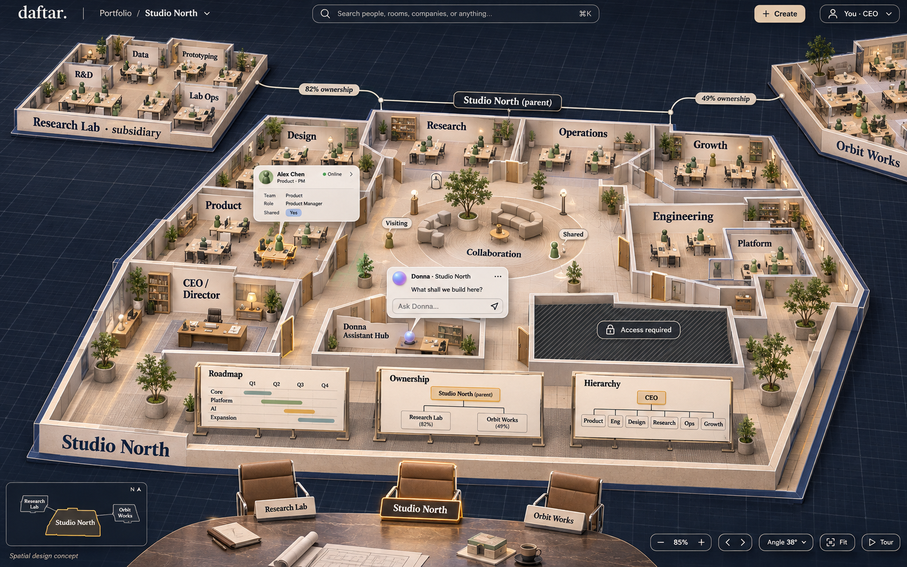
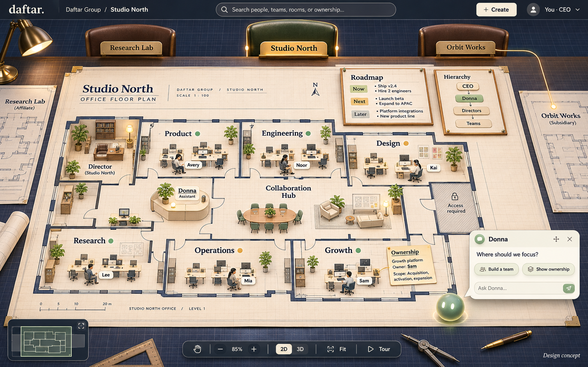
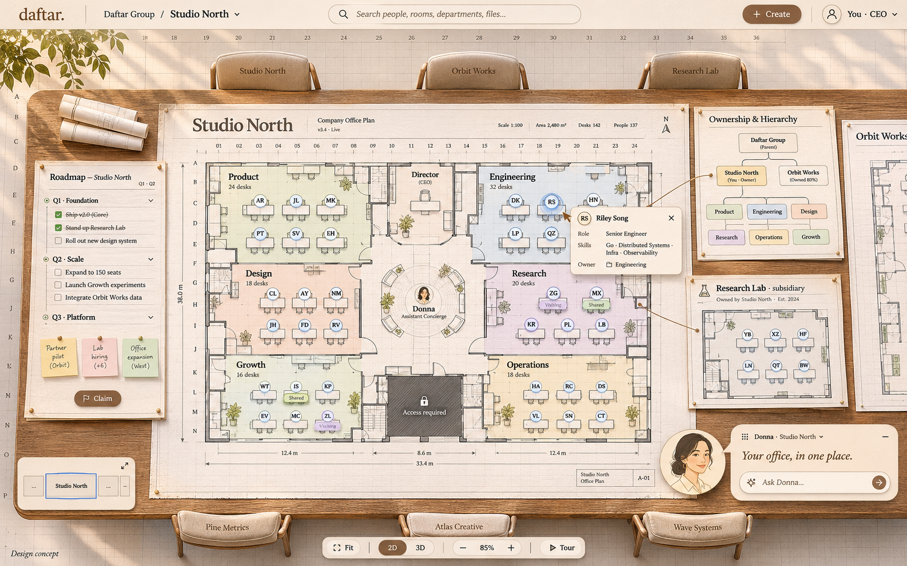

# Infinite blueprint canvas — laptop design

This branch preserves the standalone frontend prototype and visual explorations requested on 21 November 2026. The current direction is **one continuous three-dimensional world, viewed from above by default**, with optional orbit and tilt. Each company owns its blueprint boundary; its offices, departments, room divisions, desks, people and boards stay within that company. Selecting something moves the camera or opens an anchored spatial popup.

The prototype is at [`cloud-workspace/public/concepts/blueprint-office.html`](../../cloud-workspace/public/concepts/blueprint-office.html). It is self-contained HTML/CSS/JavaScript with synthetic companies and local demo state. Claude Sonnet authored the frontend and the shared 3D conversion; independent integration and edge-case review follow. Donna in this design prototype uses explicitly labelled scripted responses.

## Design checkpoints

The latest user refinement removes decorative 3D objects and makes the top view the default. The first two images explore the drafting-table/paper visual language. The third establishes company containment in a single spatial world; its decorative detail and angled default are being simplified in the working frontend. These generated concept images are visual targets, not screenshots of verified application behavior.

### Continuous world and company containment

### Earlier drafting-table exploration

### Earlier paper-office exploration

## Validation status at this checkpoint

Inline JavaScript syntax and isolated state/lifecycle checks pass. The independent 3D stress pass and live laptop browser review are in progress. A same-clock task identifier collision is recorded for correction. Final source hashes and evidence will be added after that review. This branch is a design checkpoint; its later frontend work is separate from the previously released 0.8.0 desktop packages.

Credentials, private records and raw provider conversations are excluded. Sanitized provider accounting is recorded in [`project/CLAUDE_USAGE.md`](../../project/CLAUDE_USAGE.md).
