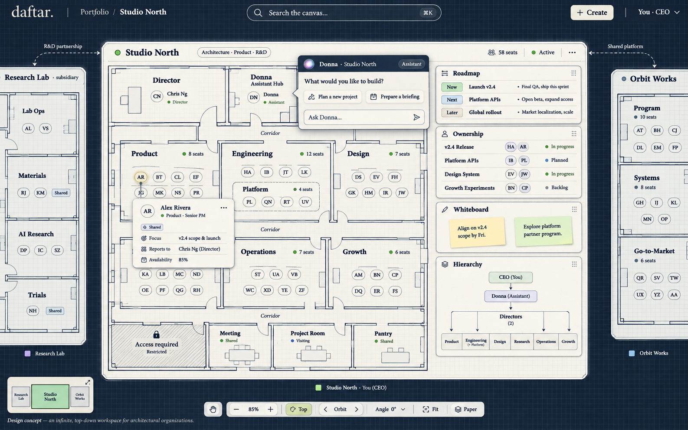

# Infinite blueprint canvas — standalone design prototype

The current direction is **one continuous three-dimensional world, viewed from above by default**. Every company has its own blueprint boundary. Its offices, departments, room divisions, desks, people and boards stay inside that boundary, and interaction popups remain anchored in the same world. Optional tilt and orbit reveal the spatial relationship without replacing the canvas with separate screens.

Open [`blueprint-office.html`](../../cloud-workspace/public/concepts/blueprint-office.html) to run the self-contained HTML/CSS/JavaScript prototype. It uses synthetic companies and bounded local browser state. **Donna is explicitly scripted in this demo.** Claude Sonnet authored the frontend core through the three recorded design calls; independent integration and review repaired concrete state, geometry and interaction defects.

This work is on `design/infinite-blueprint-canvas`; the earlier remote design checkpoint is `239d4d5`. It is separate from the published 0.8.0 application and is **not included in the 0.8.0 desktop binaries**. The synthetic stress suite and actual browser interaction review have passed for the source identified below. The prototype is now [published on the owner-only Site](https://atlas-command-office.whatswrong-inc.chatgpt.site/concepts/blueprint-office), with exact provenance in [publication.json](publication.json). The source hash identifies the published file; this branch's Git history records its checkpoints and verification artifacts.

## Primary visual direction

The fourth concept is the current direction: a restrained, readable top-view blueprint canvas with company-contained plans. The generated image is a visual target, not a screenshot or proof of application behavior.

## What the prototype does

| Area | Implemented demo behavior |
| --- | --- |
| Shared world | Company plans, company-contained offices and departments, desks, people, boards and anchored popups occupy one continuous world. |
| Camera | Starts at Top, 0°. Supports pan, cursor-anchored zoom, fit, optional 20°/38°/52° tilt, and left/right orbit. Top restores a straight overhead view. |
| Navigation | Company selection, search, blueprint interactions and the minimap move through the world. Nearest-company detail rendering keeps the large synthetic scene bounded. |
| Local company structure | Create a company or sub-company in the local demo. A sub-company requires a valid parent; names and record counts are bounded. |
| Local tasks and notes | Add local tasks and whiteboard notes. Saved inputs are normalized and bounded; task identities remain unique when two tasks are created in the same clock tick. |
| Spatial boards and popups | Boards remain within their company's allowed area. Popups face the viewer while retaining a shared-world anchor, with elevation that keeps their lower edges above the floor and board plane. |
| Donna | Opens a movable spatial conversation, keeps bounded history and an unsent draft during company navigation, and returns labelled scripted responses from demo data. |
| Local persistence | Uses browser storage when available and handles corrupt or unavailable storage. This state is a local demonstration, not a native office or cloud database. |

Office and department divisions are displayed within each company; **the prototype does not create actual offices, departments or hires**. Synthetic shared/visiting labels do not grant access. No real company, worker, membership, model or provider permissions are created, and no real employee process or model request is launched by the demo.

### Camera and interaction controls

Drag empty canvas to pan; use the wheel, pinch or `+`/`−` to zoom. `F` fits the selected company. The tilt control or `T` cycles the optional pitches; `[` and `]` orbit, and **Top** returns to 0°. `D` opens Donna, `C` opens local company creation, and `Esc` closes a popup. These shortcuts leave focused text inputs available for typing. Camera flights stop when the user interrupts them.

## Verified source and evidence

| Field | Value |
| --- | --- |
| Source | `cloud-workspace/public/concepts/blueprint-office.html` |
| Bytes | 86,124 |
| SHA-256 | `91d824237d60305a51d255b0e8ca58b1a327fc6135bd9f9150c1f370b22e69cf` |
| Synthetic verification | All 15 groups passed at `2026-11-21T22:34:08.263Z` |
| Reproducible runner | [`validation/check.mjs`](validation/check.mjs) |
| Machine receipt | [`validation/receipt.json`](validation/receipt.json) |
| Evidence explanation | [`validation/RECEIPT.md`](validation/RECEIPT.md) and [`validation/README.md`](validation/README.md) |
| Actual browser review | Managed Chromium, 1363 × 936 viewport; independent of the synthetic runner |

### Synthetic state, lifecycle and geometry checks

The independent suite exercises public DOM controls and calculates CSS transformations. Its final full pass includes:

- Nine storage cases, limits of 100 companies / 60 tasks / 40 notes, valid parent relationships and four unsafe-text surfaces.
- Seventy-five popup lifecycle cycles, 80 Donna sends bounded to 60 visible messages, and two same-clock tasks retaining eight unique task IDs after reload.
- Company containment for 192 wall/desk boxes and 12 boards; top-view defaults and optional tilt/orbit.
- Thirty-six cursor zoom anchors and 12 inverse drags across 12 pitch/orbit combinations, with a maximum recorded anchor error of 0.01705 CSS pixels; 12 billboard matrices also passed.
- Forty-eight popup plane cases covering 192 corners. The minimum tested corner elevation was 113.996 world units, which is 68.996 above the board plane at 45.
- Three hundred camera/orbit clicks, five non-finite input events, six camera-flight interruption cases, and distant-company navigation in a 100-company scene while retaining the unsent draft and limiting detailed plans to three.

These are **synthetic DOM and mathematical geometry checks**. Canvas drawing is stubbed, time and timers are controlled, and the popup-depth checks use explicit simulated dimensions because JSDOM does not perform layout. They do not measure real browser compositing or pointer hit testing. The runner rejects external resources and network API references and traps explicit network APIs during execution; it uses synthetic fixture data throughout. Follow the [validation instructions](validation/README.md) to reproduce it.

### Actual browser interaction review

A separate managed Chromium review through the Sites preview exercised Donna's **Send** button at **20°, 38°, 52° and Top 0°**. At each pitch, Send was the actual hit target, the input cleared, and a scripted response appeared. All ten inspected ancestor elements retained zero scroll offsets. This provides browser evidence for the tilted popup's visibility, hit testing and focus behavior, beyond the synthetic geometry calculations.

The preview review is scoped to that desktop viewport and those interactions. It does not certify every browser/device, a backend integration, autonomous Donna execution or real model use. The published owner-session observation is recorded separately below.

## Private Site publication

[Open the published prototype](https://atlas-command-office.whatswrong-inc.chatgpt.site/concepts/blueprint-office). The owner-only deployment succeeded, and the published page was then reviewed in the signed-in owner session: it opened at **Top 0°**, and sending **Summarize tasks** to Donna produced its scripted response. That published-page review is distinct from the four-pitch preview check above.

| Publication field | Verified value |
| --- | --- |
| Saved Site version | 14 |
| Site source commit | `ed3d1befdd083c82e6eb0b6b6bed5e7a17f3b86b` |
| Version ID | `appgprj_6b00f398b7f48191a9fd66db3c4554b8~appgver_d6a4a24001588191b8e9548f1dd296ef` |
| Successful deployment | `appgdep_6b021cb085a081919a9e311552906c6a` |
| Deployed at | `2026-11-21T22:35:33.726141+00:00` |
| Environment revision | 1 |
| Access | Owner-only; custom audience revision 1; one owner, zero groups and zero visitors; zero new grants |
| MCP connection | None (`has_mcp: false`) |
| Exact publication metadata | [`publication.json`](publication.json) |

The local gzip source archive contains **125 files / 706,025 bytes**, SHA-256 `0c841bdc779e464df7bf6a8f9471cc3ca7d572bc2831e0b3672bad0ac764abc5`. The server-normalized tar receipt contains **125 files / 2,959,360 bytes**, SHA-256 `fcde3c5244d6dc2d637d4ca542932f36594353de2ba49aa966309beb1522858b`. These are different archive representations; their sizes and digests are not interchangeable. The uploaded source contains the exact tested 86,124-byte prototype identified above.

Publishing this static demo does not connect it to the real office runtime or change the 0.8.0 desktop release. The same scripted Donna, synthetic records and local browser storage boundary applies on the hosted page.

## Earlier visual explorations

These images preserve the design progression. They are historical explorations, not the current top-view default or screenshots of verified behavior.

### Earlier continuous-world and company-containment exploration

### Earlier drafting-table exploration

### Earlier paper-office exploration

## Authorship, accounting and handoff

The three external Sonnet design requests are calls 16–18 in the [sanitized usage ledger](../../project/CLAUDE_USAGE.md), with a combined $0.552900 in observed token-derived accounting. The first response was incomplete at its output limit; the continuation and corrected continuous 3D core returned normally. Independent review and the evidence above establish the prototype's verified behavior separately from those provider completion events.

Credentials, private company records, raw prompts, provider responses and private local paths are excluded. The [0.8.0 release receipt](../../project/release-0.8.0.json) remains the historical application release boundary. This prototype's private publication is recorded above; any future integration with the real runtime requires its own acceptance evidence.
