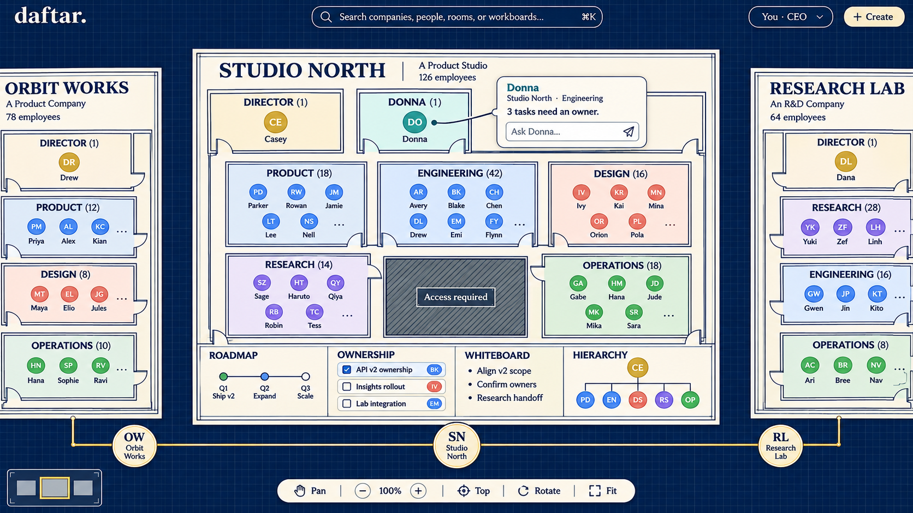

# Daftar — flat blueprint content in an infinite 3D canvas

**Current status: planning checkpoint.** The latest user correction establishes flat color-coded circles, floorplans and blueprints. The physical-office and figurine studies are superseded.

The generated concept is a visual target. Its sample labels and counts are illustrative, not data from the user's companies or a screenshot of an implemented application.

## Read the plan

- [PLAN.md](PLAN.md) — complete table layout, graphics architecture, camera/semantic zoom, physics decision, shared record model, Donna/workflows, performance targets, implementation packages and edge-case acceptance.
- [BRIEF.md](BRIEF.md) — compact operating-interface and workflow brief.
- [provenance.json](provenance.json) — image identities, selected/superseded status and the unchanged prior frontend boundary.

## Direction

One continuous conference-table scene contains company blueprint territories. A flat company circle represents its conference seat. All office and department lines, employee circles and company boards stay within the owning territory. Sub-companies have separate territories with explicit parent connectors.

Top view is the default. Smooth pan, zoom and optional tilt/orbit reveal different levels of the same world. Work interfaces open as anchored elements. Employees, directors and Donna remain flat circles at every zoom level.

Three.js is the proposed rendering foundation. Begin with bounded spring/snapping/containment behavior; Rapier 2D is the escalation path if collision requirements grow. PhysX through a third-party WASM binding is feasible, but its simulation capabilities do not provide graphics by themselves. The plan explains the tradeoffs and links primary sources.

## Checkpoint scope

This revision adds a plan and visual assets. It does not replace the [previous validated frontend](../../cloud-workspace/public/concepts/blueprint-office.html), change its owner-private publication, alter the 0.8.0 desktop release, or claim new runtime/provider behavior. No Claude API request was made for this planning revision. Future Claude implementation is split into bounded packages in the plan.

## Superseded explorations

Retained only as design history:

- [Physical-office study](assets/01-superseded-physical-office.png).
- [Desk-focus study](assets/02-superseded-desk-focus.png).

Both are excluded from the active direction because the user requested flat circles and blueprint linework.
