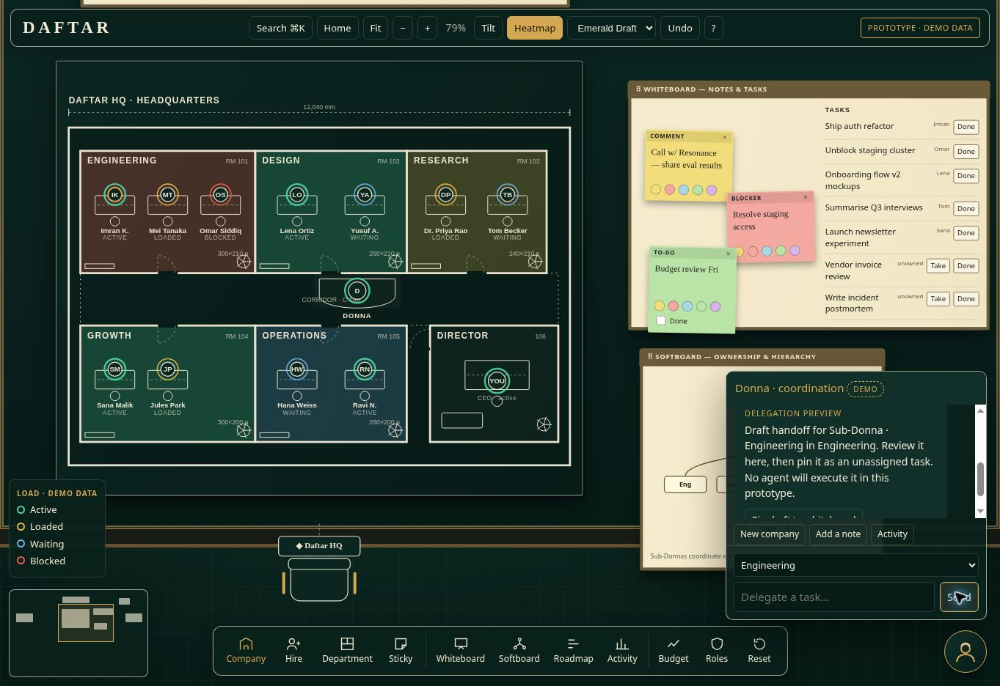
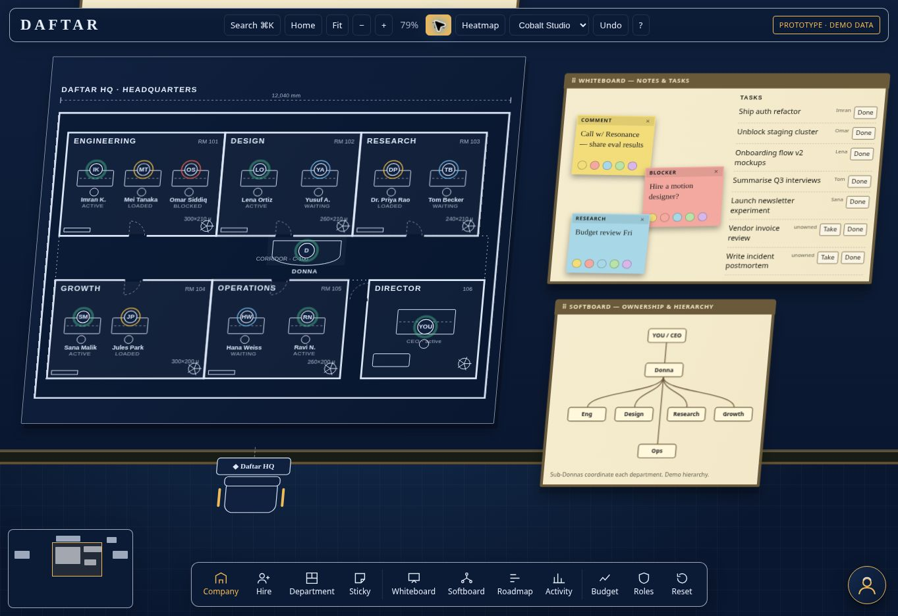
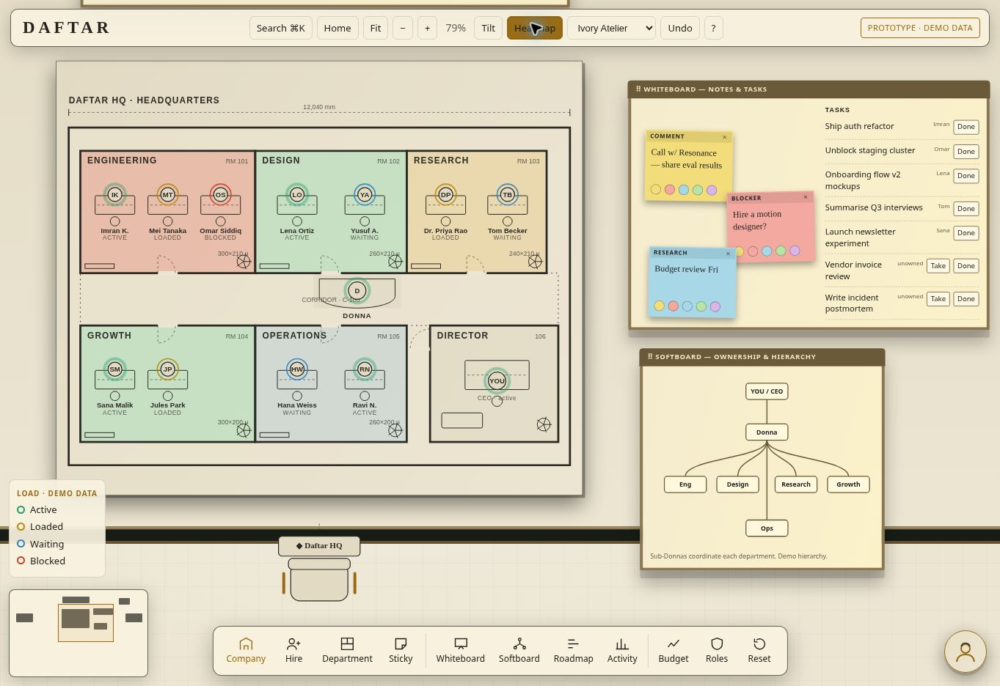

# Daftar — conference-table blueprint prototype

**[Open the interactive preview](https://daftar-infinite-blueprint-studio.whatswrong-inc.chatgpt.site/)**

A laptop-first design reference: companies sit around an extendable conference table, their office blueprints lie on the canvas, departments contain employee seats, and the Director, Donna, notes and boards share one spatial workspace. Entity details and creation forms open in place.



## Run and check

Open [`index.html`](index.html) in a desktop browser, or serve this directory locally:

```sh
python3 -m http.server 8000 --directory design/conference-table-prototype
```

Then open `http://localhost:8000`. The file includes its styles, JavaScript and vector graphics; there is no package installation or external asset dependency. Supported edits are stored in the current browser. **Reset immediately restores the synthetic demo workspace and clears local edits.** It does not ask for confirmation.

From the repository root, run the state and geometry checks with Node:

```sh
node design/conference-table-prototype/tests/state-geometry.cjs
```

## Explore the workspace

- Pan, zoom, use the minimap, or select **Home** and **Fit** to frame the office.
- Select a company, department, employee or the Director to inspect it without leaving the canvas.
- Use **Company**, **Department** and **Hire** to extend the demo organization. Companies can have a parent company.
- Edit sticky notes, choose Comment / Blocker / Research / To-do / Idea, and check off a to-do note.
- Use the whiteboard to take ownership of a task or mark it done. Board and note movement supports keyboard handles and undo.
- Open Donna, choose a company or department scope, enter a draft task and select **Pin draft to whiteboard**.
- Switch palettes and sample heat-map visibility from the utility bar.

## Visual directions

| Palette | Intent |
| --- | --- |
| Emerald Draft | Green drafting surface, warm paper, brass details and conference-room furniture |
| Cobalt Studio | Cooler technical blueprint treatment for an engineering workspace |
| Ivory Atelier | Light architectural-paper treatment for planning and reading |





The [`30-second motion study`](assets/Daftar-Canvas-Motion-Study.mp4) uses animated concept stills; it is not a recording of the functioning frontend. Its [transcript](assets/Daftar-Canvas-Motion-Study.txt) describes the four chapters. The GitHub video is an 8.6 MB playback transcode of the preserved 12.8 MB original, with the same 30-second duration, 1600 × 900 frame size and 30 fps; [encoding provenance](assets/motion-playback-provenance.json) records both hashes. The JPEGs are browser captures from the November 22 review. Minor seed-note text in the cobalt and ivory captures differs from the final published sample.

## Relationship to the product

This directory is an additive design reference imported on **November 24, 2026**. It preserves the exact reviewed HTML from the private prototype's source commit `a590007392a0a3734799478ebe9100a93c9a72fc`:

```text
index.html: 69,076 bytes
SHA-256: 705ceba7df169ed2f69faf992a736b98bcfd218b5e5d004c0dd02febc049c547
```

The import started from main at `3a3cc3d56d7f43195ab8b857ca9f3c2bed46390e`. It does not replace the shared production renderer, native state, cloud API or other design experiments. The existing `design/infinite-blueprint-canvas` branch has separate ongoing work and remains independent.

Companies, employees, assistant messages, activity and spend displays in this prototype are synthetic. Donna can open local tools and pin drafts; she does not execute real provider jobs here. This HTML does not synchronize users, enforce backend permissions, connect billing, or control the operating system. The tilted presentation is **2.5D**, with precise board/note movement confined to top-down editing.

Production adoption should reuse the existing native/cloud entities, Donna scope and authority checks. The prototype's local data model is not a migration schema. Keep real activity and costs tied to recorded runtime evidence, and preserve the product's signed-in and visiting-employee boundaries.

## Handoff and evidence

- [Claude build brief](CLAUDE-BUILD-BRIEF.md): original November 22 design and integration contract. Its statement that the production repository had not yet been inspected describes that earlier brief; this import's repository comparison is recorded above.
- [QA report](QA-REPORT.md): dated browser observations, repairs, test coverage, renderer failures and remaining acceptance gates. Historical browser results are not presented as a fresh desktop/runtime test.
- [Generation provenance](claude-build-provenance.json): historical Claude requests, token usage and reviewed artifact hashes. Provider message IDs are omitted; no credentials or private source attachments are included. This import made no additional provider calls.

Keep the source here. `scripts/build-static.mjs` recreates `docs/`, so a direct copy into `docs/` would be erased by the next build. Publishing this reference through GitHub Pages would require an explicit source/build-copy step; the existing private preview remains the runnable delivery for this increment.
