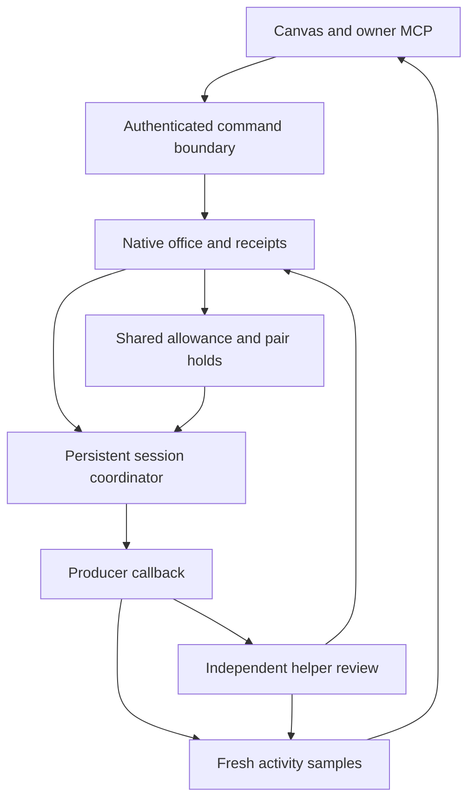

# Continuous improvement on the blueprint canvas

This increment adds scoped improvement sessions, colored notes and measured activity to the shared laptop canvas used by VS Code, desktop and the owner website. The native office remains the source of truth. The canvas stays one continuous blueprint plane, overhead by default, with optional architectural relief. Employees remain flat circles.

## What the owner can do

Open **Notes & improvement** from the canvas launcher, a company footprint, or a department inspector. The movable surface contains Notes, Sessions and Evidence. Its forms use the same company, office and department identities as the floorplan.

- Create a comment or a todo, choose yellow, blue, green, pink, purple or gray, assign a steward and link native goals. Notes appear inside their saved company/department footprint. Text is treated literally.
- Edit an existing note against its saved revision. A concurrent change preserves the unsent draft. A transport failure retains the exact request body and ID for retry.
- Register one parent allowance of at most USD 20, carrying any reviewed prior observed or uncertain commitments. Every session shares it. It cannot be replaced, raised or reset by creating another session.
- Choose an existing producer and a distinct helper, an objective, explicit permitted model routes, optional scoped todos, and a combined pair allocation. Create the session paused, then start it. Existing native permissions still apply.
- Choose continuation through the selected backlog or continuation within the remaining allowance. An optional explicit cycle cap may stop earlier; there is no implicit 100-cycle completion limit.
- Request existing repository-read and managed-publication capabilities. This does not create grants or connect credentials. An output is a proposal until an existing managed action records its applied result.
- Pause or cancel from the same surface or through the authenticated owner MCP command path. A cancelled session cannot be restarted as a fresh budget.

## What “continue within budget” means

The runtime reconstructs runnable sessions from durable native state. Each cycle has one producer and one independent reviewer. Both allocations are held before either phase can run. Normal worker jobs cannot claim session-owned work. The next cycle requires a completed, settled pair and accepted evidence for the exact producer artifact.

The optional repository capability currently reads repository metadata, the verified default-branch head, a bounded branch list and README. It is not a general source-tree reader. When the owner explicitly enables managed publication, the existing publisher can apply one validated JSON text changeset during the producer phase. The helper subsequently reviews the saved artifact and publication evidence; its acceptance gates the next cycle, not the first publication. This session does not run a shell, build, test suite or browser. Those operations require a separately connected, explicitly scoped execution workflow. A generated proposal, a published commit and verified running behavior are different outcomes.

When selected todos are exhausted, an `until-budget` session can continue its explicit objective, rotating research, company organization, UX, graphics and setup focus. The next producer receives the previous accepted handoff. Identical recent delivered-body digests stop repetition even when cycle headers differ. The complete file hash remains the review-integrity identity. This byte-level check does not prove semantic novelty.

Continuation is not an unconditional spending loop. It stops or waits when the next complete pair cannot be funded, a permission changes, a route cannot be verified, the pricing evidence expires, the provider outcome is uncertain, review requests revision, a source artifact is incomplete, capacity is reached, or the owner pauses. It does not pad prompts or send empty work to consume a residual balance. A cap of USD 20 is never evidence that USD 20 was charged.

| State | Meaning |
|---|---|
| Paused | Saved configuration; no new phase may start until resumed. |
| Active | The native session may admit its next eligible phase. |
| Waiting for work | No unassigned scoped work, or a durable capacity limit prevents another cycle. |
| Waiting for budget | Parent, global, token or policy admission prevents the next complete allocation. |
| Needs review | Uncertain accounting, failed/changed evidence, rejected review, expired quote or authority issue requires attention. |
| Completed | Finite selected backlog is finished. This does not claim the monetary cap was spent. |
| Cancelled | Terminal owner cancellation; existing charges and uncertainty remain recorded. |

An active native session survives application/service restart. A ChatGPT turn alone does not host the daemon. For unattended operation, the already configured desktop or headless runtime must remain running. The stopped Vast instance was not restarted for this increment.

## Shared budget and model routing

Native `improvementBudget` is derived from records before exposed snapshots and admission. It includes carried observed/estimated amounts, observed charges, estimated charges, reservations and undisbursed pair holds. The existing global budget and token cap are independently enforced, so they may be stricter than the improvement allowance.

The runtime selects the lowest conservative declared token cost among the session's explicitly allowed, currently discoverable, configured eligible routes. This is not a claim to have searched every provider or model. Both employees must have a valid assignment and current resource grant for a local model. Local model token cost excludes hosting, hardware and electricity.

The bounded price catalog records its first-party source, observation, expiry and digest. Each frozen execution quote has a short lifetime, and route membership, capability and quote validity are checked again before dispatch. Cache keys and route discovery are bounded and credential-sensitive. Discovery does not generate paid responses.

This source's [reviewed catalog](../../company/provider-price-catalog.json) contains `anthropic claude-haiku-5-5` and `anthropic claude-sonnet-5-5`. They still require live discovery under the runtime's configured credential. An explicitly permitted installed Ollama model can qualify through both employees' existing assignments and grants. Other hosted routes, including OpenAI routes accepted by the form, require a reviewed matching catalog entry before this loop can dispatch them. A session's native `active` state means scheduling is enabled; it is not evidence of an executing call. If no priced route is eligible, the headless runtime's improvement status reports `no-current-eligible-priced-route` without creating a new job or making a generation call. Desktop and VS Code session cards show a plain-language explanation only when fresh coordinator evidence matches that exact session, scope and revision. Checking, idle, stopped, stale and unavailable observations are distinct; reading status never refreshes the original check time. The website does not currently relay this coordinator projection and explicitly reports it unavailable. Use Activity & output for separately verified model-call evidence; a coordinator check never lights an executing employee.

Unknown outcomes retain their reservations and never replay automatically. Unexpected unreserved or over-reservation managed charges are recorded truthfully and pause further global dispatch. This increment does not add an owner reconciliation command for uncertain historical costs. Resetting the allowance is not a substitute for reconciliation.

The development-call ledger is separate from the app's native ledger. Importing a reviewed carry checkpoint is explicit so a commitment cannot silently be counted twice. Current external-development accounting is recorded in [the budget receipt](evidence/development-budget.json).

## Activity lighting and graphs

The map distinguishes saved definitions, queued jobs, leased/preparing work, actual generation callbacks, paused jobs and unknown/stale evidence. An active light requires current callback evidence plus a matching running native job and live lease. It never represents GPU utilization, CPU utilization or a benchmark.

The website receives small authenticated samples from its current paired runtime writer, separately from workspace revision synchronization. Publication is bounded and coalesced. Revoked writers, expired leases and stale samples stop contributing activity. A fresh empty sample means observed idle; missing evidence means unknown.

Evidence graphs show retained completed-job costs by completion time and recorded/accepted outputs. They label incomplete history, uncertain cost, missing timestamps and unknown states. Reservations and pair holds appear in the current native budget view, not as invented historical spending. Accepted outputs require reciprocal pair identities, distinct employees, matching hashes, full review coverage and valid timestamps.

Graphics add contained contact bands, doorway thresholds and shaded architectural faces. The renderer retains one shared geometry and three material batches. It draws on change, disposes owned resources and preserves the existing context-loss fallback. It does not add a permanent animation loop to make idle work look active. Motion and camera controls continue to honor reduced motion and manual interruption.

## Website acknowledgment and sharing

Website writes first enter the native command relay. A queued command is not an executed edit. The retry retains its original request ID. After a terminal success, the bridge refreshes the workspace and waits for the exact native improvement receipt before clearing the pending draft; the runtime can acknowledge execution before uploading the resulting snapshot. Terminal rejection, conflict and cancellation are surfaced separately.

Members receive only scoped, bounded, read-only notes. The projection closes office/department/goal links before rendering and excludes allowance details, session objectives, pricing quotes and receipts. Visiting-employee status and note stewardship do not grant execution authority.

## Architecture

The native core owns identity, scope, state transitions, receipts and accounting. The coordinator owns one coalesced adaptive timer and one scoped attempt at a time. Provider/model adapters own the actual generation call. Renderer projections, telemetry and website relays cannot grant permissions or settle billing.

## Compatibility and validation

The outer workspace schema remains 1; the office is schema 3. Schema 1/2 migration preserves historical records and starts without invented sessions, carry, grants or provider activity. Older native executables must not be used to write schema 3 state. Personal backup/restore recognizes the new bounded collections.

For an existing paired website, upgrade the original runtime in place while retaining its pairing credentials and saved cloud revision. Sync that runtime to schema 3 before exporting and relocating it. A fresh runtime restored from a schema 2 data-only archive does not automatically match an unclaimed schema 2 website after migration; this path deliberately refuses a first-sync overwrite. The existing authenticated, verified bootstrap path is separate. Neither path rebases mismatched work or changes the budget merely to make synchronization succeed.

Implementation and review were paired across native state, runtime/MCP and UI/graphics. Claude supplied the initial website activity projector and independent reviews; the coordinator corrected and tested the projector and rejected unsupported review claims. [Validation](VALIDATION.md) separates unit tests, synthetic provider wiring, real browser rendering and installed VS Code acceptance.

## Start in VS Code

1. Run **Daftar: Start Workspace on This Host**, or connect the existing private runtime. On an already running Linux host, **Daftar: Start Persistent Workspace in tmux** keeps that service independent of the editor. No Vast instance needs to be resumed to use a local workspace.
2. Open **Daftar: Open Office**, select the saved company/office, and configure its provider connection through the runtime credential control.
3. Open **Notes & improvement → Improvement mode**. Reuse an existing allowance, or register the one-time cap with a reviewed, nonduplicated carry checkpoint. The current development accounting is linked above; it has not been imported into a user's application state automatically.
4. Enter a concrete objective or select scoped to-dos. Choose distinct primary/helper employees and explicit eligible model routes. New-session defaults are 32,000 combined pair tokens, a USD 0.25 pair ceiling, and a ten-minute target. These do not override a stricter global policy.
5. Choose **Continue within remaining budget**, select only the optional repository capabilities you intend to use, and save the paused session. **Start** enables scheduling. Leave the runtime running and use **Activity & output** plus the session's recorded reason to monitor progress. The ordinary worker queue can remain disabled.

No real user improvement session was started during this increment's automated acceptance. Browser tests used isolated native state with dispatch globally paused; runtime wiring tests used synthetic provider replies. The paid development reviews are recorded separately.

Current durable bounds include 2,000 notes, 256 sessions, 4,096 mutation receipts, 5,000 jobs and 2,000 goals. History is not silently discarded to keep a spending loop running. The infinite canvas describes navigation, not an unbounded database.
