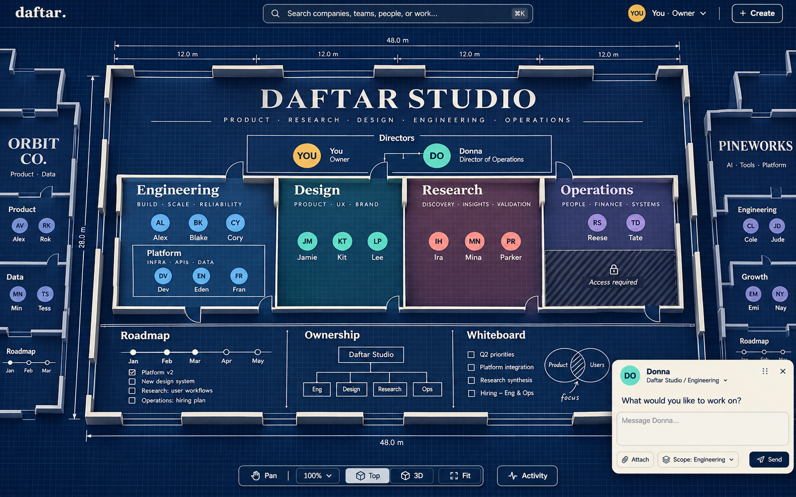

# Endless blueprint visual study

This is the selected generated image for the latest direction. The earlier table-based concept was superseded when the owner requested the blueprint itself as the entire canvas layer.

**Medium:** built-in image generation; original UI concept, not a product screenshot. Names, counts, architectural dimensions and work examples are illustrative. Application coordinates remain presentation units, not metres. The implemented native app must never adopt fictional employees, grants or task states from this image.

## Prompt used

Use case ui-mockup, high fidelity laptop app product design concept. Fullscreen wide 16:10 single app screenshot, no laptop/device/frame. Daftar is an ENDLESS BLUEPRINT PLANE, one continuous midnight-navy architectural drafting grid edge-to-edge. Important: NO conference table, NO wood/furniture, NO tabletop, NO paper sheets laid over a table, NO separate raised card platforms, NO dashboards of rectangular cards. The blueprint itself is the entire world and canvas. Company footprints are finely outlined territories on this same continuous blue plane. Near top-down orthographic camera at about12degrees tilt, real shallow 3D navy-and-ivory architectural partition walls rise directly from the blueprint plane. Subtle physically believable occlusion in slim walls, clean blueprint lines, a few measured architectural dimension ticks, expansive depth yet very usable. Main company 'DAFTAR STUDIO' centered and large with blue translucent room floor tints, directly inscribed on blue grid, not a white paper/card. Other company territories are partially visible off both lateral edges to imply infinity. Every company's offices, subdepartments, employee circles and attached work areas are contained inside its own perimeter. Top row Director amber flat circle 'YOU', Donna teal flat circle 'DO', then rooms Engineering, Design, Research, Operations. Employees ONLY flat colored2D circles with initials and short names, no humanoid figures or props. Engineering contains a thin nested 'Platform' subdivision. One restricted region uses muted dark graphite hatch and small 'Access required'. Clear room headers, restrained pastel blue teal coral lavender color coding, ivory text and bright architectural outlines, high contrast text, no neon bloom. Small native work elements inside each company bottom band labelled Roadmap, Ownership, Whiteboard; thin time markers in roadmap, miniature hierarchy lines as blueprint annotations. A compact pale floating draggable Donna chat popup lower-right with scope 'Daftar Studio / Engineering', 'What would you like to work on?', input and attach/scope/send controls. Minimal floating app controls: small 'daftar.' top-left, centered search, upper-right 'You · Owner' and '+ Create'; bottom-center camera controls Pan, 100%, Top, 3D, Fit and separate small 'Activity' button. This is a professional operating canvas, not game scenery. Precise sans serif interface typography plus elegant serif main company title, disciplined spacing, strong readability at laptop scale. Only necessary world elements. Avoid gradients over every surface, overlyroundedcards, glowingglass, giant widgets, decorative objects, fullheight sidebar, tabs replacing theworld. Top-down default and depth throughslimpartitions. Labels illustrative, not an exact data diagram.

## Adopted and deferred

Adopted: continuous blueprint plane, contained company geometry, real shallow partition relief, flat circles, semantic controls, modest floating instruments and contextual Donna.

The current live implementation preserves native saved room geometry and offers both night and light drafting themes. Its functional screenshots are acceptance evidence. Concept-only illustrations, invented room measurements, automatic historical scene playback and fictional board content are not implementation claims.
