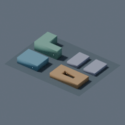

# Offline GeoJSON building-footprint example

This example converts **reviewed local Polygon/MultiPolygon footprints** into a small Blender scene and an embedded GLB. It accepts no network location, executable, Python expression, material script or provider credential as an operation.

The included input is **original synthetic geometry**, created for this project. It is not OpenStreetMap, Google content, a DEM, a traced image or a real city's buildings. The coordinate origin is an arbitrary geographic reference for demonstrating a transform. The fixture and its original derived geometry are designated CC0-1.0 in the companion ledger.

## Included results

Generated with the actual **Blender 4.5.17 LTS Linux executable**:

| File | Contents | Bytes |
| --- | --- | ---: |
| [city-block.blend](generated/city-block.blend) | Four building objects, presentation ground, camera and light | 95,582 |
| [city-block.glb](generated/city-block.glb) | Four building meshes, embedded materials and feature metadata | 10,568 |
| [preview.png](generated/preview.png) | 256 × 256 CPU render, 16 samples | 81,362 |
| [build-receipt.json](generated/build-receipt.json) | Hashes, provenance, projection, dimensions and geometry acceptance | 6,104 |

The receipt is the authoritative machine-readable record. The generated set is **193,616 bytes**, below the one-megabyte bound. The model contains five polygon parts, including one courtyard hole, from 26 footprint vertices. The accepted Blender building meshes contain 52 vertices, 62 faces and 88 triangles. GLB export also contains 88 triangles; hard-edge export duplicates some vertex attributes, so its 116 position entries are not the same measure as Blender's shared mesh vertices.

The building extent is approximately **133.434 × 88.956 × 18 metres** in the chosen local approximation. These are invented example dimensions, not measured site dimensions. The Blender scene has seven objects, five of which are meshes; the GLB deliberately excludes the presentation plane, camera and light.

## Files

- [footprints.py](footprints.py): dependency-free Python preflight and local geometry validation.
- [import_blender.py](import_blender.py): fixed Blender 4.5 build/export/render entry point.
- [synthetic-city-block.geojson](fixtures/synthetic-city-block.geojson): original rectangle, courtyard, L-shaped footprint and paired pavilions.
- [synthetic-city-block.rights.json](fixtures/synthetic-city-block.rights.json): exact-input SHA-256, provenance, rights assertions and coordinate declaration.
- [test_footprints.py](tests/test_footprints.py): offline geometry, metadata, path and artifact checks.

Only Python's standard library is needed for preflight/tests. Building the model uses the Python modules included with Blender. This example targets Linux and Blender 4.5.x; it is not a claim of tested Windows/macOS support.

## Run preflight

Use absolute, canonical paths. Replace the two executable/project paths below with the reviewed installation and checkout.

~~~bash
DAFTAR_GEO_ROOT="/absolute/path/to/repository/projects/architecture-library/geospatial"

python3 "$DAFTAR_GEO_ROOT/footprints.py" \
  --source "$DAFTAR_GEO_ROOT/fixtures/synthetic-city-block.geojson" \
  --ledger "$DAFTAR_GEO_ROOT/fixtures/synthetic-city-block.rights.json"
~~~

Preflight reads bounded regular files and prints the accepted local projection, input hashes, counts and bounds. It does not create a scene or modify the source.

## Build with Blender

The output's parent directory must exist. The output directory itself **must not exist**, even if empty. The checked-in generated directory is an example result, not a reusable output target.

~~~bash
DAFTAR_BLENDER="/absolute/path/to/blender-4.5/blender"
DAFTAR_GEO_ROOT="/absolute/path/to/repository/projects/architecture-library/geospatial"

"$DAFTAR_BLENDER" \
  --background --factory-startup --disable-autoexec --threads 2 \
  --python-exit-code 1 \
  --python "$DAFTAR_GEO_ROOT/import_blender.py" -- \
  --source "$DAFTAR_GEO_ROOT/fixtures/synthetic-city-block.geojson" \
  --ledger "$DAFTAR_GEO_ROOT/fixtures/synthetic-city-block.rights.json" \
  --output "/absolute/path/to/existing-parent/new-city-block" \
  --preview
~~~

The preview flag adds the fixed 256-pixel render. No caller-supplied render engine, texture path, script or arbitrary Blender operation is accepted. The command creates geometry in a fresh background scene.

The build checks that every building is a closed manifold and that its enclosed volume matches footprint area minus courtyard holes multiplied by height, within a relative tolerance of 0.0001. Coincident cap/side vertices from Blender curve conversion are welded at 0.0001 metres; that processing tolerance is not an accuracy claim about the original geography. The GLB is checked for embedded resources, retained feature IDs and matching triangle count.

A success receipt is written last. If a build fails, its newly created directory may contain incomplete outputs; no success receipt is published. Inspect that directory and use a new destination for the next run. The helper never overwrites an existing destination.

The generated .blend can subsequently be reviewed for an authorized creative project and used with the existing bounded Blender inspection, render and GLB-export operations. This example does not register a new runtime/MCP command or grant employee capabilities.

## Accepted input profile

This is a deliberately small GeoJSON profile, rather than a general GIS importer.

- Top level: exactly a FeatureCollection with type and features.
- Each Feature: type, unique string id, properties and geometry.
- Properties: name, height and heightBasis. Height is a finite number in metres; evidence is synthetic, measured, published_attribute or author_assumption.
- Geometry: Polygon or MultiPolygon with explicitly closed rings.
- Coordinates: exactly two finite numbers in **longitude, latitude** order. Third-coordinate elevations and alternative CRS members are rejected.
- The first ring is the exterior; subsequent rings are holes. Either input winding is accepted and normalized to exterior counterclockwise/hole clockwise.
- Non-closing duplicate vertices, self-intersections, self-touching, collinear/reversing adjacent edges, escaping/touching/nested holes and touching/overlapping building parts are rejected. This profile is stricter than the full range of GIS geometries.

The order and ring conventions follow [RFC 7946](https://www.rfc-editor.org/rfc/rfc7946). The ledger explicitly identifies the input as EPSG:4326 and records longitude-latitude axis order. That avoids silently applying a latitude-longitude ordering assumption.

| Bound | Limit |
| --- | ---: |
| GeoJSON input | 256 KiB |
| Rights ledger | 32 KiB |
| Building features | 32 |
| Total polygon parts | 64 |
| Vertices per ring, excluding closure | 128 |
| Total vertices, excluding closures | 4,096 |
| Holes per polygon | 4 |
| Exterior/hole ring area | At least 1 m² |
| Filled polygon area | At least 1 m² |
| Edge length | At least 0.05 m |
| Height | 0.5–80 m |
| Absolute input/origin latitude | At most 75° |
| Distance from origin | At most 1,000 m |
| Extent along either local axis | At most 1,000 m |
| Generated artifacts including receipt | At most 1,000,000 bytes |

Both file size and geometry limits apply. JSON duplicate keys, NaN and Infinity are rejected.

## Projection and accuracy limits

The local approximation uses a fixed sphere radius R = 6,371,008.8 metres and the declared origin longitude/latitude. In radians:

~~~text
x = R × (longitude − originLongitude) × cos(originLatitude)
y = R × (latitude − originLatitude)
z = local building height above the flat base
~~~

Blender uses east/north/up as X/Y/Z. The GLB export uses east/up/south as X/Y/Z. The receipt records both conventions, the geographic origin, sphere radius and actual bounds.

This **local equirectangular approximation is not an EPSG projected CRS, an ellipsoidal geodesic calculation or a survey transformation**. It has no centimetre-accuracy guarantee. The small-area and latitude restrictions bound the example's scope; they do not certify error against a real survey. It rejects antimeridian crossings and polar inputs.

The base is flat at local z=0. It has no geodetic vertical datum, terrain elevation, sea-level reference or inferred roof shape. Use a reviewed proper GIS transformation and vertical-datum workflow for real measured work.

## Rights ledger and review boundary

The companion ledger is mandatory and tied to the exact GeoJSON byte hash. It records:

- Dataset identity, publisher, source URI, source date and description.
- License ID and its matching license URL.
- Attribution, reviewer, review date and review explanation.
- Explicit derivative, redistribution, commercial-use, third-party-rights and database-obligation review assertions.
- CRS, axis order, height unit, origin and limitations.

The supported ledger licenses are CC0-1.0, CC-BY-4.0 and ODbL-1.0. A dataset under other terms is outside this example's accepted profile. A non-commercial-only license is rejected for this distributable game-asset example.

**The program checks the completeness and consistency of those assertions, not their truth or legal sufficiency.** A boolean does not authenticate permission or make an unsuitable dataset reusable. The included ledger establishes the provenance of the original synthetic fixture only.

Reviewed external datasets must use a provenance HTTPS URL without embedded credentials or query parameters. URLs are metadata and are never fetched. Known Google Maps/Earth tile endpoint URLs are excluded; this is not a downloader, tile extractor or a way to convert restricted content into an open asset.

See [the geospatial tool review](../docs/GEOSPATIAL_TOOLS.md) for distinctions between software licenses, service agreements and content rights.

## Extending to reviewed OSM or terrain

For OSM, obtain a permitted regional data extract through an appropriate source. Prepare a small GeoJSON selection offline using reviewed QGIS/GDAL steps, with explicit heights and height evidence. Keep contributor attribution and applicable ODbL derivative-database/access obligations with the data. Populate a new ledger and bind its hash only after that review. Do not bulk-scrape public map-display tiles or assume a mesh conversion removes database obligations. The relevant primary guidance is the [OSM license](https://www.openstreetmap.org/copyright), [ODbL](https://opendatacommons.org/licenses/odbl/1-0/) and [OSMF tile policy](https://operations.osmfoundation.org/policies/tiles/).

DEM ingestion is intentionally **not implemented**. A reviewed extension would need explicit elevation-file rights, horizontal/vertical datums, no-data behavior, sampling/interpolation limits, building-base rules and slope tests. A coplanar presentation rectangle must never be relabeled as imported terrain. Until that work is implemented and verified, this example produces flat-base massing only.

## Tests and verification

From the repository root:

~~~bash
python3 -m unittest discover \
  -s projects/architecture-library/geospatial/tests \
  -p 'test_*.py' -v
~~~

The tests cover accepted courtyard/multipart geometry, winding normalization, invalid/self-intersecting rings, coordinate/height/count/area bounds, incomplete or restricted rights, exact input hashes, nonfinite/duplicate-key JSON, symlinks, traversal, FIFOs and overwrite rejection. The directory-descriptor test replaces a parent path after opening it and confirms that receipt writes remain in the originally held directory.

All input path components are opened without following symlinks. Linux Blender writes through the held output directory descriptor, not through a path that could be redirected by replacing an ancestor. The private output directory is created exclusively. These checks do not turn Blender or this local process into a sandbox for hostile operating-system users; run only the reviewed scripts and respect the surrounding runtime isolation.
