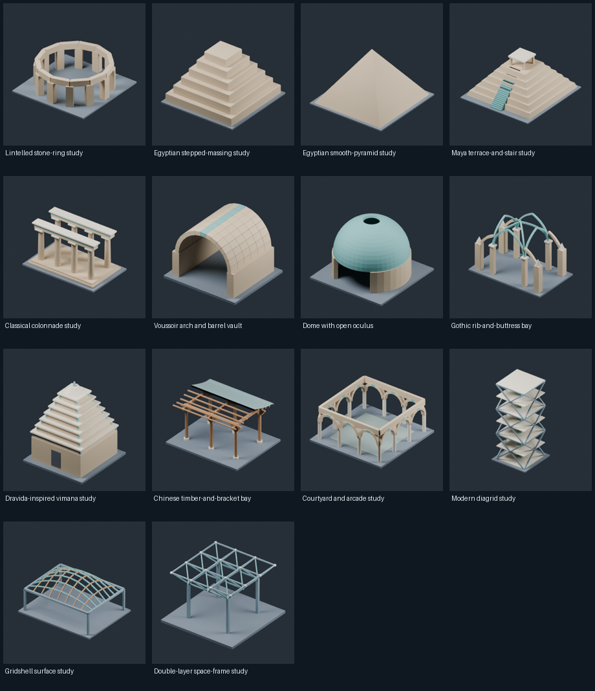

# Original procedural architecture studies

This collection contains **14 schematic teaching studies**, each with an editable compressed Blender source, a self-contained GLB, a 384 × 384 PNG preview and a JSON metadata record. The models were made from original procedural primitives. They are not accurate reconstructions of named sites, construction designs or fabrication instructions.



## Contents

| Sample ID | Teaching focus |
| --- | --- |
| `megalithic-ring` | Uprights and connecting lintels in an invented circular setting |
| `egyptian-stepped-pyramid` | Diminishing square stages |
| `egyptian-smooth-pyramid` | A continuous four-face exterior |
| `mesoamerican-terrace-stair` | Terraced massing, ascent and a summit setting in a separately identified Maya context |
| `classical-colonnade` | Columns, capitals and layered entablature |
| `arch-barrel-vault` | Voussoir arch rings extended into a tunnel |
| `dome-oculus` | Curved shell, open crown and a display cutaway in the drum |
| `gothic-rib-buttress` | Pointed ribs, piers and exterior flyers; vault webs omitted |
| `dravida-tower` | Diminishing tiers in a Tamil Chola-informed vimana study |
| `chinese-timber-bracket-bay` | Bearing blocks, bracket arms, beams and purlins exposed by a roof cutaway |
| `courtyard-arcade` | Repeated arches framing open space |
| `modern-diagrid` | Diagonal envelope members, ties and floor plates |
| `gridshell-canopy` | Crossing laths on a curved surface; unresolved bracing explicitly disclosed |
| `space-frame` | Offset chord layers, nodes and web diagonals |

[presets.json](presets.json) contains the exact parameters and per-sample limitations. The public [sample index](../data/samples.json) relates each asset to [element records](../data/elements.json), [primary-source references](../data/sources-elements.json) and the two repository skills used to produce it.

## Generation contract

- **Blender:** 4.5.17 LTS, build `2f5ec98689b8`; the generator accepts the validated 4.5 series.
- **Coordinates:** right-handed Z-up in Blender, one scene unit per metre. The glTF exporter converts to right-handed Y-up. No real-world georeferencing is assigned.
- **Random seed:** `20261124`; the current geometry is deterministic and does not depend on an external random provider.
- **Rendering:** Cycles CPU, 384 × 384, 12 samples, two render threads, denoising, original solid-colour materials and procedural studio lighting.
- **Budgets:** fewer than 400 mesh objects and 20,000 triangles per sample; 8,000,000 bytes for sample artifacts. Actual counts are substantially lower and recorded per file.
- **External assets and services:** none. No network fetches, paid provider calls, textures, scans, Google tiles or third-party model packs.
- **Source separation:** parameters and Python stay outside `generated/`; only generated artifacts and evidence receipts are placed inside it.

The `.blend` saves include camera and lights for revisiting the preview. The GLBs include model meshes and the display plinth, with no cameras, lights, animations, textures or required glTF extensions. Object, vertex, triangle and dimension statistics include the plinth and exclude preview cameras and lights. No watertightness or structural suitability is claimed; the timber roof uses intentionally open surfaces.

## Reproduce in a new directory

Run from the repository root with an existing Blender 4.5 executable. Listing presets uses only Python's standard library:

```sh
python3 projects/architecture-library/samples/generate.py --list
```

The following example assumes the verified deployment-pack installation. Set `ARCHITECTURE_BLENDER` to the actual executable on your machine. The output parent must exist, and the destination itself must **not** exist, even as an empty directory.

```sh
ARCHITECTURE_BLENDER=/opt/daftar-tools/blender/4.5.17/blender
"$ARCHITECTURE_BLENDER" --background --factory-startup --disable-autoexec \
  --threads 2 --python-exit-code 1 \
  --python projects/architecture-library/samples/generate.py -- \
  --output "$PWD/architecture-study-review"
```

Use `--ids dome-oculus,space-frame` for a subset. Unknown and duplicate IDs are rejected. Relative paths, parent traversal, symlinked destination ancestry and existing destinations are rejected. The generator does not overwrite source models. A failure leaves an explicit `generation-failed.json` in the newly created directory; inspect it and choose another new output directory for a retry.

The manifest's paths intentionally describe the **published** location, `samples/generated/<id>/`, relative to the architecture-library root. The verifier maps this prefix to the provided `--input` directory, so a new review directory can be verified before publication.

```sh
"$ARCHITECTURE_BLENDER" --background --factory-startup --disable-autoexec \
  --threads 2 --python-exit-code 1 \
  --python projects/architecture-library/samples/verify_samples.py -- \
  --input "$PWD/architecture-study-review"
```

The verifier writes a new `inspection.json`; it refuses to overwrite an existing report. Use `--report /absolute/new-report.json` to retain a second inspection. It reopens each Blender file with embedded scripts disabled, parses and reimports each GLB, decodes each preview, checks exact file sizes and hashes, and compares bounds and triangle counts. This is a focused interoperability check, not a claim to run the full Khronos validator or a structural solver.

The generator destination and glTF external-resource rejection tests need no Blender:

```sh
PYTHONDONTWRITEBYTECODE=1 python3 -m unittest discover \
  -s projects/architecture-library/samples -p 'test_*.py' -v
```

## Recorded execution

The final collection generated successfully on the installed official Blender executable in **40.223 seconds**. Its 56 indexed files occupy **4,958,009 bytes**: 14 `.blend`, 14 `.glb`, 14 `.png` and 14 metadata JSON files. The manifest and inspection receipt bring `generated/` to **4,975,112 bytes** at this inspection. The contact sheet is a separate small review aid.

Saved-file inspection passed for **all 14 samples** in **1.965 seconds**. It verified all **56 manifest hashes**, reopened every Blender source, reimported every GLB, matched object and triangle counts, checked finite nondegenerate geometry, compared bounds within **0.0002 metres**, and decoded every preview at 384 × 384. The separate Python safety suite passed **9 tests** with no skips. These timings describe this bounded local run and are not a performance guarantee for another machine.

All previews were visually reviewed in the contact sheet, with the timber cutaway inspected individually. The review checked framing, visible geometry, the open oculus and vault, differentiated masses, and the legibility of the lattice assemblies. This prompted the intentional timber roof cutaway, which is preserved in its limitations. Colour is a teaching device, not evidence of historic finishes.

The [manifest](generated/manifest.json) gives per-file byte counts and SHA-256 hashes. Every [metadata file](generated/megalithic-ring/metadata.json) records the generator and preset hashes, Blender version and build, source kind, dimensions, object and triangle counts, parameters, source IDs and limitations. [inspection.json](generated/inspection.json) contains the independent saved-file results. Binary serialization and rendering can vary across Blender versions and machines; reproducibility refers to the fixed parameters and geometry, not a promise of identical compressed file bytes everywhere.

## Rights and limits

These are original procedural samples with no third-party assets. Repository terms apply; no new licence for the whole repository or for linked sources is asserted. Only short original paraphrases and source links accompany the geometry. The source register and [elements guide](../docs/ELEMENTS.md) distinguish actual evidence from these invented teaching dimensions.

No historic fabric was modified, no physical toolpath or printer command was emitted, no real building was approved, and no remote engine or paid service was called. A qualified project team must supply site, climate, program, cultural/custodial context, applicable jurisdiction, material specification, structural and conservation evidence before any real-world use.
