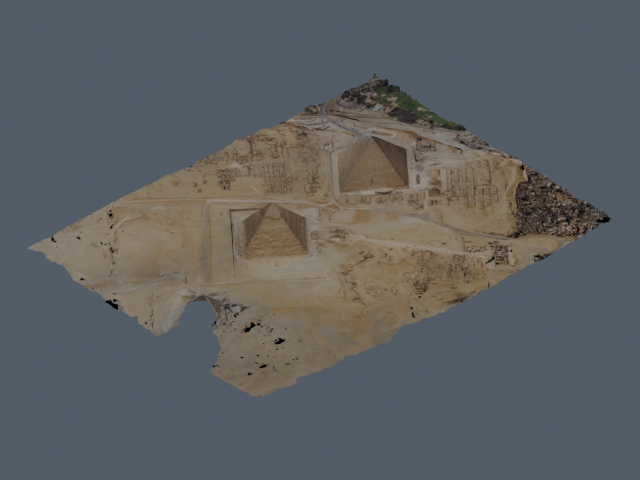

# Giza source-asset dossier — round 1

Checked 2026-11-25. Expert: heritage survey and architectural accuracy. Scope: Khufu, Khafre and Menkaure; research and visualization, with no production publication or heritage intervention.

## Result

Four real GLB files were acquired through public, permitted downloads: three monument-specific derivatives and a larger Giza plateau model. Total geometry downloads: **45,128,724 bytes**. Original creator metadata independently confirms **CC BY 4.0** for all three underlying works. No login, disabled-download extraction, tile scraping, payment, or external contact was used. Large GLBs remain outside Git; immutable URLs, hashes and acquisition filenames are in [assets.json](assets.json).

These assets are **uncontrolled photogrammetry references**. None meets a measured-accuracy acceptance gate. Ground control, independent checkpoints, error statistics, complete interiors and capture dates were not supplied. Polygon counts describe file complexity; they do not establish geometric accuracy. The word `original` in the plateau acquisition filename denotes the larger mirrored model, **not raw photographs or a field survey master**.

## What was actually checked

The original creator public APIs supplied identity, capture description, license and download availability. GitHub delivery was pinned to commit `e89853b4351de608e908e30004d8c5860a0d83b5`. The plateau mirror retained the original model UUID and matched its published MD5; SHA-256 was calculated for every file. GLB headers, lengths, JSON, counts and external-resource references were inspected. No external buffer/image URI occurs in these files.

Blender **4.5.17 LTS** imported the larger model without a required compression extension and rendered a 640×480, eight-sample CPU preview. It contains 12 meshes and 1,163,285 triangles, with a **single 1024×1024 texture**. The three smaller derivatives require meshopt, WebP and mesh quantization support; their compressed geometry was not decoded here. [Inspection receipt](blender-inspection.json).

Visual inspection shows two main pyramids, clipped terrain boundaries and holes; the apparent Menkaure area reaches a cut boundary. This does not establish complete coverage of all three pyramids. Imported scene extents are approximately 10.77×12.86×8.52 **source units**. No metre interpretation is validated. The texture cannot substantiate extreme block-by-block detail. No invented stone geometry or synthesized surface detail was added.

## Provenance and reuse

Underlying creators: **ianicolo** (Khufu), **pierre391** (plateau/Khafre), and **PolarNick239** (Menkaure). The first two describe video-based photogrammetry; the third reports a Realme XT 16 MP perimeter capture. The original video identities, camera calibration and independent underlying-footage permissions were not established. These are authenticity gaps, even though the creators explicitly license their models for reuse.

For each reused asset, retain the original title, creator, source page, [CC BY 4.0 license](https://creativecommons.org/licenses/by/4.0/), distributor and adaptation notice from [assets.json](assets.json). GeorgePhilippou distributes the smaller modified copies; the plateau file is an Objaverse/Zenodo conversion. This preview is a new camera/render of pierre391’s model; no geometric alteration was made. No endorsement by the creators, archaeological teams or custodians is implied.

## Archaeological measurement layer

[measurements.json](measurements.json) preserves source-specific reference dimensions separately from downloaded geometry. The 2015 Dash/AERA casing-baseline study fits surviving evidence and extrapolates missing corners. Its confidence bounds concern an estimated original footprint, not a tolerance for these meshes. AERA also distinguishes unfinished Menkaure casing/baseline work from a fully executed ideal envelope. Official monument overviews give useful nominal height references, while the ScIDEP paper reports present Khafre dimensions. These different surface states must not be merged silently. See the exact publisher URLs and reading depths in [sources.json](sources.json).

AERA documents genuine laser survey and control-network work. Harvard supplies archaeological reconstruction and documentation. This bounded review did **not** locate an openly licensed, complete, controlled full-resolution exterior/interior survey download from either project. Their published images and interactive access do not grant permission to extract or redistribute raw geometry. No restricted source was downloaded.

## Acceptance proposed for the next rounds

1. Load immutable, attributable source bytes and display their evidence class, capture/processing metadata and visible gaps. Preserve the original source hash alongside any derivatives.
2. Keep original-envelope reconstruction, present captured fabric and inferred gap fill in separate named layers. Never count a reconstructed corner as an independently measured checkpoint.
3. Before enabling a measured-accuracy claim, require declared physical units, datum/CRS, control geometry, a documented transform and **independent** checkpoints. Record spatial distribution, residuals, RMSE and maximum error against an explicit user-approved tolerance. No tolerance is invented here.
4. Review exterior, interior, roofs, cavities, occlusions and later restoration coverage separately. Missing coverage must remain marked. A plausible render cannot close an evidence gap.
5. Evaluate close-up texture and geometric resolution at the intended viewing distance. File size, triangle count and sharp synthetic detail cannot satisfy a survey acceptance criterion.

[Round-1 review receipt](round-1-review.json) records findings, impact, implementation changes and acceptance tests. Root remains the moderator and publication owner. The current deliverable supports a truthful site-specific visual workflow; the requested extreme measured detail remains an acquisition/validation gap.

## Existing skills applied

- [Architecture and built heritage research](../../../../../skills/architecture-and-built-heritage-research/SKILL.md): regional provenance, reconstructed-versus-measured evidence, conservation and reuse discipline.
- [Spatial 3D production engineering](../../../../../skills/spatial-3d-production-engineering/SKILL.md): units, source preservation, actual import/render checks, and explicit unverified outcomes.

The offline resource-router packet was read; its catalog hash was `1564141dda2f13b4df474676123b96997b5c62b8b22a460316cf7f6a23b0016a`. It selected Harvard Digital Giza as a discovery source and did not itself read or license any asset.
