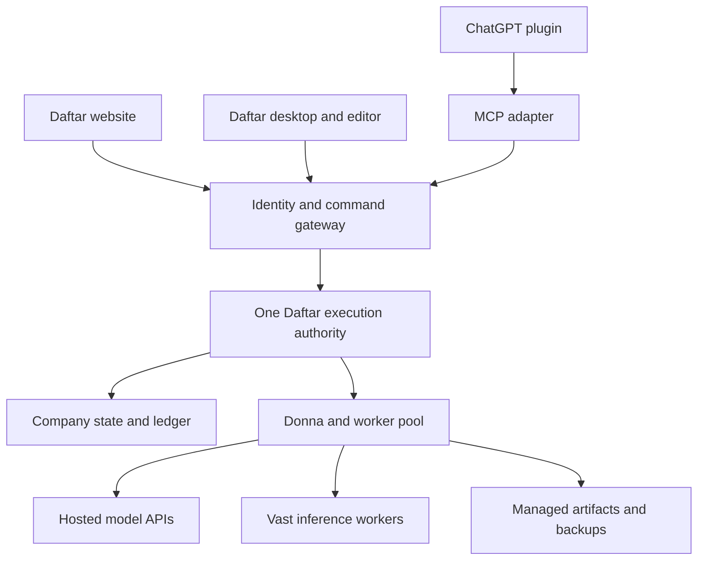

> Update for 0.7.0: the source now includes optional [encrypted runtime-to-Site device sync](../deploy/CLOUD_DEVICE_SYNC.md), [shared local model management](../deploy/MODEL_POOL.md), and the permanent deterministic observer. Older planning sections below record the design rationale; the [current validation receipt](FREEFLOW_VALIDATION.md) controls completion claims.

# Daftar cloud runtime, Vast.ai and ChatGPT control

Research and implementation plan: **21 November 2026 (America/New_York)**.

Source baseline: [`f4813437466c16acb2507cabc31944d9b482ea59`](https://github.com/occult-kranti/engineering-intelligence-atlas/commit/f4813437466c16acb2507cabc31944d9b482ea59), desktop version 0.6.1. This document accompanies a separate development branch. It does not announce a production deployment or a new desktop release.

## Decision

Run Daftar's durable execution authority on an always-on **CPU VPS**. Keep GPU inference independently replaceable, using a model API initially and a **Vast.ai GPU instance or Serverless endpoint** when measured demand justifies it. Website, Daftar desktop, VS Code and ChatGPT should issue commands to that same authority and display its results.

This is an engineering recommendation based on the current repository and the provider documentation listed below. It is not a measured capacity claim. A first sizing hypothesis is 4 vCPU, 8 GiB RAM and 80–160 GB SSD, with inference elsewhere. Browser automation, builds, indexing and media generation need their own measured worker capacity.

Daftar can also run on a Vast **VM**. That is useful for a GPU-heavy prototype, but couples the office's availability to the GPU rental. Vast's VM documentation explicitly supports systemd and Docker Compose; an ordinary Vast Docker rental must not be treated as a full VM with nested Docker support. [V1]

## What this branch provides

The implementation is a first, single-owner runtime foundation:

- A headless Node service that reuses the existing `OfficeService`, `OfficeWorkerPool`, provider adapters and Rust authority.
- Persistent native state and managed artifacts, independent of an Electron window.
- Authenticated private control endpoints, sanitized state reads, expected-state checks and native durable mutation receipts.
- Explicit worker lifecycle controls; workers start paused. Provider calls retain existing authorization, reservation, usage and capability checks.
- A separate stdio MCP adapter that talks to the daemon. Disconnecting the adapter does not stop the daemon's worker process.
- VPS/container deployment configuration and an operator runbook in [`deploy/`](../deploy/README.md).
- Synthetic protocol tests and a real-core integration gate. Exact executed checks and limits belong in [`CLOUD_RUNTIME_VALIDATION.md`](CLOUD_RUNTIME_VALIDATION.md).

This branch does not itself rent a server, start a paid model request, connect an owner's ChatGPT account, migrate private state, modify the deployed website, or add a general-purpose shell executor. Provider-account setup, public OAuth, the Sites runtime bridge, native desktop remote mode and a direct Vast model adapter have distinct acceptance work below.

## 1. Architecture to retain



The diagram is the target arrangement. The current branch supplies the private daemon and MCP path. The authenticated web/desktop gateway and direct GPU adapter are integration phases, not already deployed edges.

### Responsibilities

| Component | Owns | Does not need to own |
| --- | --- | --- |
| VPS runtime | State transitions, job leases, schedules, budget reservations, authority checks, provider dispatch and artifact receipts | A graphical desktop session |
| Rust core | Validated durable state, command receipts, atomic writes and workflow invariants | HTTP, model transports or UI rendering |
| Website | Sign-in, office map, Donna conversation, job progress and authorized command submission | Provider or cloud-account secrets |
| Daftar desktop | Remote office view, optional local device execution and local models | A competing authoritative copy of the same cloud company |
| ChatGPT MCP adapter | Focused tool discovery, read queries and typed command submission | A second scheduler or independent employee database |
| Vast worker | A configured model or bounded compute task | The sole copy of office records, contracts or company history |
| Artifact store | Output files with stable identities and verified checksums | Worker lease ownership |

The conference table, company chairs, departments, Donna's movable chat and ownership board remain views over the same record identifiers. Switching interface should not create a new organization or a second set of employees.

### Permanent employees and shared services

A permanent employee is a durable identity, role, scope, knowledge selection and task history. It is not a model continuously generating while idle. Daftar can keep the employee present in the office and wake an execution worker only for eligible work.

Donna should continue to route work through the existing company/service contracts. A shared employee receives only the explicit cross-company knowledge references selected for its task. The observer should perform deterministic indexing and ledger checks first; use a model when a finding requires interpretation. This preserves the existing low-cost shared-service direction.

## 2. Existing capabilities and actual gaps

The following findings are grounded in the audited source, not inferred from UI labels.

| Area | Baseline implementation | Cloud implication |
| --- | --- | --- |
| Native state | JSON stdin/stdout Rust helper, cross-process lock, atomic state replacement | Can run headlessly on Linux |
| Worker pool | Portable TypeScript, 1–4 worker slots, default 2 | Reuse it in the daemon; preserve its leases and budgets |
| Execution | Model-generated artifacts and separately authorized managed GitHub operations | Does not imply arbitrary code/build/browser execution |
| Local MCP | `tools/atlas-mcp.mjs`, stdio, direct local state commands | Keep as a trusted local interface; do not publish its entire action list |
| Private website | Sites identity, Cloudflare D1, saved projection, command queue and cloud Donna chat | A VPS migration requires an identity and persistence adapter |
| Cloud sync | Explicit desktop-driven sync, seed/hash matching, writer claim, revision checks | A server writer must replace the desktop intentionally |
| Remote receipts | `apply_remote_command`, immutable command hash, bounded retained receipt history | Same-ID retry of a lost acknowledgment can avoid duplicate state mutations |
| Model transports | OpenAI, Anthropic and loopback-only Ollama | No direct configurable Vast/vLLM endpoint in the baseline |
| Credentials | Electron OS-backed vault for desktop; separate server credentials for hosted chat | Server secrets must have a real server adapter |

Source paths: [`officeWorker.ts`](../desktop-shell/src/main/officeWorker.ts), [`office.ts`](../desktop-shell/src/main/office.ts), [`remote_commands.rs`](../native-core/src/remote_commands.rs), [`cloudSync.ts`](../desktop-shell/src/main/cloudSync.ts), [`atlas-api.ts`](../cloud-workspace/lib/atlas-api.ts), [`providers.ts`](../desktop-shell/src/main/providers.ts), [`ollama.ts`](../desktop-shell/src/main/ollama.ts).

### State and concurrency

For this deployment, one server owns one local state directory. Multiple clients submit commands to it. The existing file lock coordinates native calls on that machine; it is not a distributed database protocol. Do not place the JSON authority on a shared filesystem and start independent VPS authorities against it.

A remote mutation includes an ID, expected state hash and explicit command. Rust checks the hash within its transaction and persists the receipt with the effect. Repeating the same ID and body returns the existing outcome; reusing the ID with different content fails. A genuinely stale command returns a conflict for the client to review against fresh state.

This guarantees receipt-backed state-command replay, not universal exactly-once external execution. An interrupted provider request or publication may have taken effect remotely. Such attempts need recorded evidence and reconciliation; automatically retrying a potentially billed request can cause duplicate work or cost.

Horizontal scaling should come after a transactional shared persistence adapter, distributed worker claims and fencing are designed and tested. It is unnecessary for the first owner-operated deployment.

## 3. Deployment choices

| Arrangement | Appropriate use | What must remain durable | Tradeoff |
| --- | --- | --- | --- |
| CPU VPS + hosted APIs | First cloud runtime, uncertain inference volume | Native state, artifacts, provider receipts and backups | Simplest baseline; model use is metered |
| CPU VPS + rented Vast GPU | Predictable model demand | VPS state plus independent artifact storage | GPU may be replaced without rebuilding the office |
| CPU VPS + Vast Serverless | Variable inference/batch demand | Same durable authority outside the GPU pool | Cold starts and worker-state billing need measurement |
| Whole runtime on Vast VM | GPU-heavy prototype or controlled single-host installation | External recovery copies of all authoritative state | Office uptime and model capacity share one rental |
| Local Daftar desktop + MCP | Laptop-only workflow | Local workspace and backups | Execution depends on the device remaining online |

### Suggested first host

Use a Linux x86-64 host with 4 vCPU and 8 GiB RAM as a starting hypothesis, not a promise about concurrent build or browser capacity. The included runtime has few external services because the Rust core already owns the queue and ledger. Adding PostgreSQL, Redis and Kubernetes solely to deploy this version would duplicate working components.

Published price anchors checked on 21 November 2026:

| Reference | Published configuration | Price qualification |
| --- | --- | --- |
| DigitalOcean Basic bundled plan | 4 vCPU, 8 GiB, 160 GiB SSD | US$48/month in the published table; other services are separate [P1] |
| Hetzner CX33 | 4 vCPU, 8 GB, 80 GB NVMe | June price notice lists €8.49 / US$9.99 excluding IPv4; current product page reports unavailable. This is a historical published anchor, not a reservable quote. [P2][P3] |
| Vast GPU marketplace | Depends on actual offer and model requirements | Fetch a current offer; compute, storage and transfer all matter [V5] |

Taxes, backups, object storage and model usage must be added to the selected offer. The lowest hourly GPU price is not necessarily the lowest cost per successfully completed task.

## 4. Vast.ai integration in detail

### First compatible route: a private Ollama connection

The existing adapter accepts loopback Ollama only. A manually configured authenticated SSH forward can make an already-running GPU-hosted Ollama reachable at the runtime's loopback address. This avoids changing the existing provider enum for a first isolated trial.

Bind the forward to loopback, and place it in the runtime's network namespace. With Docker, host loopback and container loopback are different: a tunnel listening only on the host will not appear at `127.0.0.1` inside the runtime container. The systemd installation is the simpler route for an initial host-local forward. Do not broaden the adapter's URL validation just to make a tunnel reachable.

A local/Ollama token rate of zero does not represent a free rented GPU. Infrastructure cost must remain separately visible. Model download, licensing, GPU memory fit, context length and throughput must be measured on the chosen model/offer before enabling routine work.

### Direct route to add: Vast Serverless

Vast documents an OpenAI-compatible proxy at `https://openai.vast.ai/<ENDPOINT_NAME>` for an active Serverless endpoint using its vLLM template. Its model is selected by the endpoint's `MODEL_NAME`; the request's `model` field does not switch models. The documented supported API surfaces are completions and chat completions. [V2]

Daftar therefore needs a named endpoint/provider adapter rather than an assumption that the existing official-OpenAI adapter can be repointed unchanged. The adapter should bind:

- Provider kind and endpoint ID.
- Actual configured model name and revision where available.
- Credential reference, retained only on the server.
- Supported modalities and request schema.
- Measured context/concurrency limits.
- Request timeout, cancellation behavior and observed usage.
- Infrastructure spend attribution and unknown-cost handling.

Keep several model endpoints in an explicit route table. Select a route using task requirements, measured quality and cost. Preserve the chosen route in the job receipt so that a result remains reproducible when the preferred model changes.

### Instance durability and networking

Vast container storage survives a stop but is deleted when its instance is destroyed. Persistent volumes survive destruction but remain tied to one physical host; they do not migrate to another host. Keep independent recovery copies of authoritative data. [V3]

Docker-instance public ports may be remapped from their internal numbers. Use the actual mapping supplied by the provider or an outbound/private connection. Keep the user-facing office address stable outside the GPU rental. [V4]

For all-on-Vast deployment, select a VM-capable offer and check its actual disk, network and lifecycle behavior. Back up application data from inside that VM; the provider's VM-copy facility is not a substitute for an application restore test. [V1]

### Cost controls to implement

Vast Serverless bills Ready and Loading workers for compute, storage and traffic. Inactive workers still incur storage/traffic; suspending an endpoint can retain active billed workers. Stopping and destroying have different effects. [V6]

The future compute panel should show these states accurately and maintain separate controls for pausing new Daftar work, stopping compute and deleting a rental. A pause in the office is not evidence that infrastructure billing stopped.

Use this planning equation:

`monthly total = VPS + backups + artifact storage + model APIs + GPU compute hours × rate + retained GPU storage + transfer`

The budget controller should reserve expected task cost before dispatch, record observed cost afterward, retain a conservative hold for unknown usage, and separately reconcile rental billing. Idle shutdown and a maximum rental duration must be explicit policies. No purchase or infrastructure shutdown is performed by this branch.

Vast distinguishes community and vetted Secure Cloud providers. Choose the provider category appropriate to the sensitivity of the workload and avoid placing organization-wide credentials on a broadly shared compute worker. [V7]

## 5. ChatGPT control routes

The current OpenAI documentation contains several distribution routes with different availability. Account-level access has not been verified during this work.

| Route | Supported mechanism | Daftar fit |
| --- | --- | --- |
| Custom remote MCP | Current Plugins flow, HTTP streaming/SSE, user authorization | Future public OAuth-protected gateway |
| Secure MCP Tunnel | Outbound connection from a private stdio or HTTP MCP server | Private VPS + this branch's stdio adapter |
| ChatGPT Desktop local plugin | Local MCP apps run on ChatGPT Desktop | Local adapter, optionally reaching VPS through SSH |
| Sites-hosted plugin | Tools hosted on a ChatGPT Site, including external API calls | Fits the existing private Site once its server bridge is implemented |
| Daftar assistant using OpenAI API | Remote MCP via Responses, or a separately evaluated agent-runtime adapter | Website and Daftar desktop operate independently of ChatGPT product entitlements |

Sources: [O1]–[O7].

### Current plan and platform qualification

OpenAI's custom-server Help Center page describes full custom MCP, including writes, for Business and Enterprise/Edu on web, and Pro custom connections as read/fetch. The newer Plugins page describes Desktop local MCP and Sites-hosted apps on any plan, subject to the relevant permissions. These are separate paths; do not assume a Pro account can use every write-enabled external custom MCP route. [O2][O3]

For the current Plugins flow, setup starts with **Plugins → plus → Add custom MCP server**. The documentation says the former Developer Mode switch is not required for that flow. Local Desktop tools do not become available on web/mobile simply because their plugin is saved to the account. [O1][O2][O3]

### Private VPS connection

The private approach keeps the daemon on loopback and runs the MCP adapter as a subprocess of the official `tunnel-client`. The adapter holds the daemon's local control credential; ChatGPT does not receive that credential as a tool argument.

OpenAI's documented stdio setup uses a named profile:

```bash
tunnel-client help quickstart
tunnel-client init \
  --sample sample_mcp_stdio_local \
  --profile daftar \
  --tunnel-id YOUR_TUNNEL_ID \
  --mcp-command "node /opt/daftar/tools/daftar-runtime-mcp.mjs"
tunnel-client doctor --profile daftar --explain
tunnel-client run --profile daftar
```

Configure the runtime API URL and the private token-file path in the service environment. The tunnel also needs its own runtime credential, tunnel/workspace association and appropriate Platform permissions. Use current official installation instructions and CLI help; no real tunnel ID or key is included here. A tunnel is connectivity, not a grant of another person's company access. This branch's control credential represents one owner-operated workspace. Do not share that owner bridge with visiting employees. [O4]

The tunnel has a documented 120-second absolute request deadline. Long jobs should return their job identity promptly and continue inside Daftar. Tool callers inspect later status; progress events do not extend the tunnel deadline. [O4]

### MCP capability surface

The new adapter has its own tool list. It does not publish the baseline local MCP's worker settlement and lease-management operations. Read tools return bounded metadata; mutations go through the daemon's native receipt path. Worker enabling is described as an operation that can start authorized, potentially billable work.

The full product should eventually expose small tool families:

| Family | Examples | Required execution evidence |
| --- | --- | --- |
| Office | Query companies, employees, roadmaps and blockers | Saved records and current state hash |
| Work | Create/pause/cancel jobs, delegate bounded goals | Job ID, receipt, status and selected model |
| Knowledge | Index allowed evidence, retrieve scoped handoffs | Source IDs and ownership references |
| Coding | Prepare a worktree, run checks, inspect diff | Sandbox ID, commit, command outcome and artifacts |
| Release | Deploy an exact release, inspect health, roll back | Deployment identity, verified source and result |
| Compute | List offers, estimate cost, start/stop worker | Provider resource ID and budget receipt |
| Audit | Inspect ledger, cost and artifacts | Stable references and observed outcome |

Only the first runtime/control subset is implemented in this branch. A tool declaration or an employee role does not create a missing executor.

### Public multi-user gateway

Before exposing the private owner API to multiple people, add verified user identity and per-tool/company scope enforcement. For user-authenticated ChatGPT MCP, the official guide describes OAuth discovery, authorization-code flow with PKCE, client registration and audience/resource validation. ChatGPT's user-auth mechanism is not an arbitrary customer API-key field. Use an established identity provider and validate the resulting tokens on every protected request. [O5]

Visitor expiry, department access and selected knowledge transfers should use existing Daftar authority records after the caller's identity has been verified. UI greying is an explanation of access; the server must reject an unauthorized operation independently.

Tool annotations help the client understand an operation; they do not replace the server's authorization checks. ChatGPT, workspace and provider action requirements still apply to actions initiated from ChatGPT. [O3][O5]

## 6. Website and desktop integration

### Preserve the current private website first

The existing Site contains functioning company views and a durable command queue. Its identity headers are trusted because they are supplied by the Sites platform. Moving that code onto a VPS and accepting the same headers from the public internet would not establish the caller's identity.

The first integration phase should keep Sites/D1 as the hosted interface and add an explicit **runtime device** writer to its existing protocol:

1. Add a `runtime` device kind and appropriate issuance/revocation rules.
2. Extract cloud credential access into a server-secret interface; do not fake Electron secure storage.
3. Restore the owner's private workspace to the VPS while both execution workers are paused.
4. Compare the sanitized projection with the cloud seed and preserve current company IDs.
5. Release the old desktop writer and claim the runtime writer through the existing revision protocol.
6. Enable a documented, owner-controlled sync interval. Initially expose an explicit sync action for deterministic verification.
7. Keep native receipt IDs through queue delivery, execution and ACK recovery.
8. Treat completed command delivery separately from provider job completion.

The current branch does not perform those production mutations or enable background synchronization.

### Desktop remote mode

Add a clear **Local workspace / Cloud workspace** connection mode. In Cloud mode, commands go to the shared runtime and job state comes back from it. The installed desktop should not silently claim the cloud writer or upload an unrelated local seed.

Local files and local model execution can be added through a paired device runner. The cloud job records the required device ID; if that device is offline, the UI shows that dependency. The same approach allows a user to retain local-only repositories while using the VPS for continuously running Donna tasks.

The existing VS Code client speaks the current desktop/Sites protocol, not the new private daemon API. Keep it on that protocol until a deliberately tested runtime client adapter is added.

### Full website hosting on a VPS

If all components must move off Sites, add verified OIDC/browser sessions, a database adapter and migrations, session/CSRF handling, artifact delivery and an authenticated server-to-runtime boundary. Preserve directory records, cloud chat and command revisions during migration. Deploying the research atlas as static assets alone does not migrate the private office.

No new database is required merely to run the current headless authority. A server database becomes useful for multi-user sessions, cloud-facing queues or horizontal scaling, but its authority must be explicit rather than competing with native state.

## 7. What complete operational control requires

The intended product outcome is that an authorized instruction can originate in ChatGPT, the website or Daftar desktop and reach the same action implementation, with the same budget, permissions, receipt and visible result.

For example: "Have the code department improve this repository, run the checks, ask QA to review it, and deploy the accepted release within the configured budget." The full chain requires a repository runner and deployment adapter in addition to a language-model worker. Today's worker can prepare a text artifact and perform selected managed GitHub operations; it cannot claim that a build ran without an executor and captured result.

Add coding/browser/system adapters as isolated task runners. Give each runner an assigned worktree and defined network/resource capability, return bounded logs/artifacts, and keep publication/cloud credentials in the service that performs the corresponding action. A generic public root shell is unnecessary for operating Daftar's defined tasks.

### Prioritized delivery sequence

| Phase | Work | Acceptance condition |
| --- | --- | --- |
| A — this branch | Headless authority, private HTTP API, stdio MCP, deployment pack | Real native state round-trip, mocked worker execution, replay/conflict/auth tests |
| B — shared remote workspace | Runtime device/secret adapter, Sites bridge, desktop remote mode | Same company/job IDs and ledger visible across web, desktop and MCP; no duplicate writer |
| C — account connection | Authorized tunnel or OAuth MCP, selected ChatGPT route | Real read plus authorized mutation from the owner's ChatGPT account |
| D — GPU route | Vast-compatible adapter, endpoint registry, usage/cost reconciliation | One bounded GPU task with real usage and artifact evidence, including worker-loss handling |
| E — code department | Isolated repository/test runner and deployment adapters | Worktree → test result → review → exact release receipt |
| F — visiting employees | Verified user identities and scoped remote authorization | Cross-company rejection, expiry/revocation and permitted handoff tests |
| G — operational recovery | Independent backups, restore rehearsal and monitoring | Recovery preserves state/artifacts without replaying uncertain external effects |

Phases B–G are specific integration work, not claims of completed cloud deployment.

## 8. Migration, recovery and ongoing operation

Before moving an existing workspace, pause dispatch and let in-flight attempts settle or enter explicit review. Export through the existing private workspace tool, including managed artifacts. Restore into a separate server data directory, reconnect server credentials, compare company/job counts and projection hash, and verify the result before transferring writer ownership.

Retain a rollback copy. Do not run the old desktop authority and the new server authority independently over copies of the same workspace. Rollback must reconcile commands and external attempts created after cutover; simply copying yesterday's state back can replay side effects.

The existing export script creates a bounded workspace bundle and excludes the credential vault. It requires an idle writer for a consistent application checkpoint. For growing artifact storage, add an external object-store copy and verified manifest rather than silently omitting outputs beyond the export limit. An instance snapshot alone is not an application restore test.

Operate the daemon as an unprivileged service with one persistent data directory and separate private secret files. Default bind/publish is loopback. The included runtime starts paused after restart; unattended resume policy should be a separately reviewed setting after crash-recovery acceptance.

Useful monitoring fields include worker enabled/running state, active job IDs, oldest queued task, stale leases, unresolved cost holds, storage free space, last verified backup and provider error rate. The observer should report these from recorded facts without claiming a provider or GPU is healthy merely because its configuration exists.

## 9. Verification boundaries

The code department's tests must use synthetic state and injected model providers by default. Real external calls need an intentionally selected account, model, resource and cost bound. This keeps routine stress tests from renting GPUs or spending tokens.

Required checks for the runtime foundation:

- Authentication and loopback/Origin boundaries; no secret-bearing status output.
- Malformed/oversized bodies, bounded queues and timeouts.
- Same-ID retry creates one state effect; changed payload is rejected.
- Stale expected state is rejected atomically.
- A disconnected MCP client does not kill the daemon's queued/running work.
- Worker enable/disable and job pause/cancel remain separate, observable actions.
- Concurrent workers preserve native leases and budget reservations.
- Mutations that committed but produced an oversized response remain distinguishable from pre-commit rejection.
- Restart retains state and artifact references while starting the process paused.

Optional encrypted Sites device synchronization is implemented with a restored-state cold-start guard and the existing one-writer protocol. Public OAuth, an actual ChatGPT connection, live Site-to-VPS migration, owner desktop behavior, container boot and actual Vast execution require separate evidence where not run. The validation receipt is the source of truth for this branch's test outcomes.

## 10. Billing and OpenAI runtime choices

ChatGPT is a control surface; it does not itself make the VPS or Daftar's workers continuously run. The server process or an explicitly selected managed agent runtime owns long-lived tasks.

Daftar can retain its scheduler and call model APIs, or later add an OpenAI Agents API adapter for managed sessions/self-hosted execution. That is an optional provider/runtime integration, not a prerequisite for moving the existing worker headlessly. The Responses API can call remote MCP servers or a configured tunnel. [O6][O8]

API usage is metered. Current OpenAI documentation describes activated monthly API credits for eligible Pro/Business subscribers; eligibility and activation have not been checked here. This should not be presented as unlimited model use or assumed credit in Daftar's budget. [O9]

## Primary sources

Provider documentation was checked on 21 November 2026. Prices, availability and ChatGPT entitlements may change. Architecture and sizing recommendations above are our engineering decisions; the links establish platform behavior.

| ID | Primary source | Used for |
| --- | --- | --- |
| V1 | [Vast virtual machines](https://docs.vast.ai/guides/instances/virtual-machines) | Full VM, Compose/systemd and VM limitations |
| V2 | [Vast OpenAI-compatible interface](https://docs.vast.ai/guides/serverless/openai-compatible-api) | Endpoint/model binding and supported API routes |
| V3 | [Vast storage types](https://docs.vast.ai/guides/instances/storage/types) | Stop/destroy persistence and host-local volumes |
| V4 | [Vast networking](https://docs.vast.ai/guides/instances/connect/networking) | Docker port mapping |
| V5 | [Vast instance pricing](https://docs.vast.ai/guides/instances/pricing) | Marketplace and resource charges |
| V6 | [Vast Serverless pricing](https://docs.vast.ai/guides/serverless/pricing) | Worker/endpoint billing states |
| V7 | [Vast security FAQ](https://docs.vast.ai/guides/reference/faq/security) | Provider categories and workload trust |
| P1 | [DigitalOcean Droplet pricing](https://www.digitalocean.com/pricing/droplets) | Published bundled-plan anchor |
| P2 | [Hetzner June 2026 price notice](https://docs.hetzner.com/general/infrastructure-and-availability/price-adjustment/) | Historical published CX33 price; search-index record accessible during review |
| P3 | [Hetzner cost-optimized products](https://www.hetzner.com/cloud/cost-optimized/) | Configuration and observed unavailability |
| O1 | [OpenAI custom MCP guide](https://developers.openai.com/api/docs/guides/custom-mcp-server) | Remote tool connection |
| O2 | [Custom MCP in ChatGPT](https://help.openai.com/en/articles/12584461-connecting-custom-mcp-servers-in-chatgpt) | Account/platform permissions and current setup flow |
| O3 | [Plugins in ChatGPT](https://help.openai.com/en/articles/20001256-plugins-in-chatgpt) | Local Desktop and Sites-hosted routes |
| O4 | [Secure MCP Tunnel](https://developers.openai.com/api/docs/guides/secure-mcp-tunnels) | Private stdio/HTTP connection and request deadline |
| O5 | [Plugin authentication](https://developers.openai.com/plugins/build/auth) | OAuth and user-auth requirements |
| O6 | [MCP in the Responses API](https://developers.openai.com/api/docs/guides/tools-connectors-mcp) | API-mediated orchestration |
| O7 | [Hosting a plugin with Sites](https://help.openai.com/en/articles/20001547-hosting-a-plugin-with-chatgpt-sites) | External API bridge and separate installation |
| O8 | [Agents API overview](https://developers.openai.com/api/docs/guides/agents-api/overview) | Optional managed runtime alternative |
| O9 | [API credits for ChatGPT subscribers](https://developers.openai.com/api/docs/guides/chatgpt-api-credits) | Eligibility/activation qualification |
