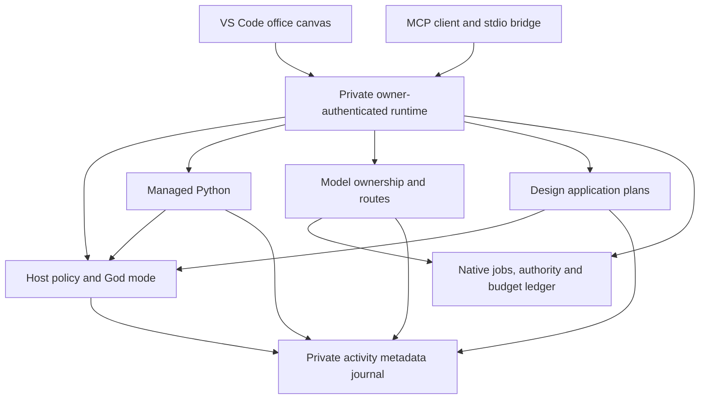

# Daftar operations control

This guide describes the current source controls and their integration into the
primary VS Code product. Installed Linux/Windows package acceptance and the shared
canvas passed at `7766c91`; see the
[successful product CI](https://github.com/occult-kranti/engineering-intelligence-atlas/actions/runs/44974716262)
and [current handoff](../HANDOFF.md).
[v0.9.0-preview.1](https://github.com/occult-kranti/engineering-intelligence-atlas/releases/tag/v0.9.0-preview.1)
is a public prerelease containing both platform packages, verification evidence
and checksums. All four assets were independently downloaded without
authentication and their actual bytes verified; the
[publication receipt](release-0.9.0-preview.1.json) records the result.
The owner's Vast instance remains stopped. No real GPU
workload, software installation or ChatGPT MCP connection is claimed here.

## Control and evidence flow

The office canvas and MCP bridge reach the same private runtime. The human owner
holds the runtime credential; company and employee records supply canonical
attribution and managed policy, not independent tenant authentication.

The native ledger is authoritative for job, budget and authority outcomes. The
activity journal is a bounded observation history. It does not replace native
receipts, retry commands or authorize actions. A parent company, blueprint,
department diagram or shared model cache never supplies an implicit grant.

## God mode means explicit owner host authority

God mode is an owner policy preset. Read current host status and the active native
company list, then submit the exact list with the expected policy revision. The
server compares both the revision and the complete current active company set
before committing the change. Stale membership or a stale revision fails; review
the current state rather than applying a guessed replacement.

Enabling selects auto mode and replaces host grants with company-wide grants for
the listed current active companies. Each job still names one accountable employee
and rechecks native eligibility. A company-wide grant can admit later eligible
hires into an already covered company; a newly created company is not silently
added. Refresh the preset explicitly to cover the new active company set. Use the
normal manual/auto grant editor when access should be restricted to particular
employees instead.

Host commands run as the runtime's OS account. Root inside a rented container can
administer that container; it does not control the provider's physical host. This
is trusted owner administration, not an isolation boundary against hostile root
users. God mode changes neither model-resource policy, native authority/budgets,
worker enabled state, ChatGPT/VS Code approval settings nor instance lifecycle.
Enabling it launches no job, resumes no instance and changes no spending ceiling.

Turning God mode off clears its host grants and prevents new dispatch. Existing
jobs are not thereby undone. **Stop managed host work** switches policy off and
requests cancellation of managed jobs. Inspect their saved receipts for the final
outcome; unrelated processes and already-completed external effects remain.

Implementation: [host policy](../headless-runtime/host-control.mjs) and
[compute controls](../vscode-extension/src/compute-office.js).

## Setup with explicit verification stages

| Stage | Action | Evidence needed before the next claim |
| --- | --- | --- |
| Choose placement | Install the matching target-platform VSIX and choose local, Remote-SSH or an existing private runtime | Correct extension host and workspace; final installed-product CI is separate |
| Choose lifecycle | Start an editor-owned backend, or Linux persistent tmux backend, or connect an existing service | Authenticated runtime identity and intended shutdown/detach behavior |
| Read readiness | Open the connector-readiness view and inspect existing reports | Configuration and observed status, with unknowns preserved; this view is not a new connectivity test |
| Assign actors | Select the active company and hire/reuse the needed operations employee | Canonical employee/company/office identity; shared employees need current contracts |
| Set host policy | Choose off/manual/auto or review the exact God mode company set and revision | Persisted policy receipt; no job or provider execution follows from hiring or the preset alone |
| Prepare Python | Submit a managed environment preparation job and inspect its operation ID | Verified copied interpreter and virtualenv prefix; submission alone is not readiness |
| Share models | Stage catalog weights, register the installed digest, grant assign/use and select the model | Current native eligibility, resource grants and matching installed/assigned digest |
| Plan design apps | Review exact target/package versions or an official artifact and SHA-256 | A ready plan and explicit install receipt; software proof, GUI availability and GPU execution are separate |
| Dispatch work | Submit a scoped durable job or expert route; enable scheduled workers only when desired | Native/host admission, current grants, bounded time/output/cost and retained job identity |
| Inspect results | Read native job/artifact receipts and scoped activity metadata | Verified outcome, provenance, uncertainty and any retention gap |
| Connect MCP | Configure the stdio bridge and a supported client transport | Actual account registration and authenticated tool response, not just copied JSON |

Keep the existing Vast instance stopped during setup review. If the owner later
requests compute, verify its current SSH endpoint after resume and connect to the
existing instance. A separate terminal login does not attach this chat. Account
listing and readiness reports are not instance start/rental operations.

Python source runs through a verified managed interpreter with scrubbed variables,
`PIP_REQUIRE_VIRTUALENV` and `PYTHONNOUSERSITE`. Do not use global pip for new
project work. System administration is an explicit host command. Application
runtimes such as Blender/Godot are recorded separately from project virtualenvs.
Penpot remains blocked pending the reviewed pinned-container deployment path.

MCP and VS Code share the same owner-authenticated backend. Port 8788 serves REST;
the packaged stdio adapter is the MCP bridge. Protected token files and native
credential prompts keep keys out of webview state. See
[the primary VS Code guide](VSCODE_PRIMARY_PRODUCT.md),
[MCP setup](../tools/DAFTAR_RUNTIME_MCP.md) and
[design installation boundaries](../deploy/DESIGN_TOOLCHAIN.md).

## Permanent operations roles

| Role | Responsibility | Execution boundary |
| --- | --- | --- |
| Cloud Compute Operator | Existing compute, workload requirements, maintained environments and explicit host jobs | Current host grant and native eligibility; no implicit instance lifecycle changes |
| Runtime Observer | Worker cadence, error/unknown states, policy revisions and receipt evidence | Read the assigned scope; hiring does not launch a monitoring model loop |
| Knowledge Steward | Source provenance, indexing, short handoffs and cache/retention interpretation | Explicit source access and cross-company grants/contracts; no authority from cached text |
| Connector Steward | Readiness stages, secure setup and connector verification evidence | Existing configuration is not a successful probe, GPU workload or provider call |

These are permanent definitions available for native hiring. The UI creates or
reuses an active matching employee for the selected company. It does not silently
hire a separate employee in every company, grant provider tools, enable workers
or start a recurring paid task. Each actual job has one accountable native actor,
its current permission/contract context and a bounded allocation. The exact role
title resolves to its bundled specialist/reference brief when no explicit
assignment key supplies another contract.

Donna coordinates the handoff; sub-assistants keep their existing identities and
permissions. Distinguish the source claimant, recorder, accountable employee and
reviewer when those actors differ. A permission or ownership diagram describes
records; it cannot itself move data across companies or authorize execution.

## Idle, delay, error and cleanup behavior

By default each enabled worker slot checks for new work after 15, 30, 60 and then
120 seconds when consecutive polls remain idle or fail. The delay is capped at
120 seconds; a configured base interval can differ. A successful work attempt or
explicit one-shot resets the backoff. This schedules the next lease check and does
not automatically replay a failed or uncertain attempt.

An explicitly requested **Run once** starts immediately and may run while scheduled
workers are paused. Native authority, current model grants and budget reservation
still apply. Repeated enable calls do not create duplicate poll timers. Stop/close
clears owned polling and cancels active requests where possible; already-dispatched
usage remains accounted. Editor-owned backends shut down with the editor, while
the explicitly chosen persistent tmux daemon continues after detachment.

This worker backoff is not OS sleep, a VPS suspension or a billing control. It is
also separate from the visible editor's lightweight status refresh. Report actual
scheduling timestamps and outcomes instead of inventing activity while idle.
Cleanup tests measure owned timers, readers, listeners, request slots, locks and
processes; they do not prove that every possible long-running memory leak is absent.

## Logging, indexing and summaries

The private activity journal retains up to **1,000 events within 1 MiB**. Events
contain allowlisted family/operation/outcome metadata, symbolic error code,
canonical actor/request/job IDs and bounded duration. Commands, prompts, provider
responses, keys, error messages and stack traces are excluded. Sequence numbers
remain monotonic across restarts; queries expose dropped-event ranges explicitly.
Filters select owner-visible metadata and do not create independent tenant access.

The deterministic summary cache holds at most **64** scoped entries and is
invalidated when a new event is saved. Summary queries make no LLM call. Counts
describe retained observations: one request can have an accepted event and a later
result, so event totals are not unique completed-job totals. The journal is not a
complete historical or exactly-once action ledger. Keep source/artifact hashes,
model digests, original actor/scope and observed timestamps in the appropriate
durable evidence records.

If a journal write has an uncertain outcome, further journal reads/writes are
fenced until reopening and review. Diagnostic status reports the last acknowledged
sequence and an unknown latest sequence. The caller preserves the original managed
operation receipt and can show a generic logging warning; logging failure must
not invite a duplicate mutation. Corrupt history is preserved, not silently
deleted. Native jobs, budget/authority records and artifact proofs remain the
authoritative result evidence.

Keep this metadata cache separate from native exact-context model-output caching.
A cached result never grants scope access or repeats external side effects. A
missing old event, a successful summary calculation or a cached dashboard does
not establish that a GPU workload or software installation succeeded.

Implementation: [activity journal](../headless-runtime/activity-journal.mjs),
[journal contract](../headless-runtime/activity-journal-contract.mjs),
[runtime observer charter](../company/role-library/runtime-observer.md),
[knowledge steward charter](../company/role-library/knowledge-steward.md) and
[connector steward charter](../company/role-library/connector-steward.md).
