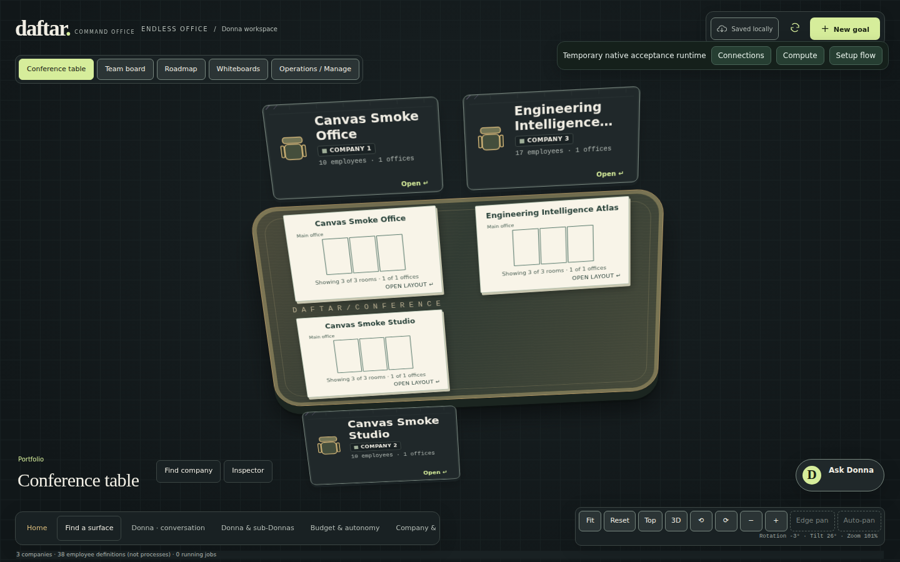
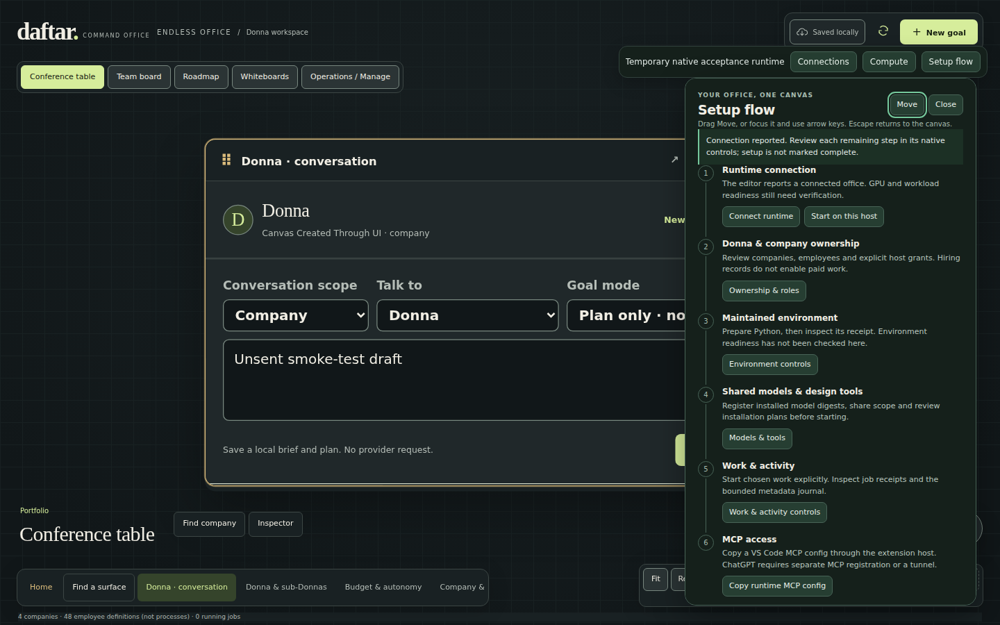

# Daftar 0.9 VS Code product verification

## Verified code checkpoint

The primary product is the platform-specific VS Code extension. It packages the
shared office canvas, portable Node backend and native Rust core. The runtime,
container, installed Linux/Windows and shared-canvas gates have passed. The exact
verified product source is **`7766c91c6d6c3481b419623f1149a291d2da439d`**.

[v0.9.0-preview.1](https://github.com/occult-kranti/engineering-intelligence-atlas/releases/tag/v0.9.0-preview.1)
was publicly published at **`2026-11-22T02:34:51Z`** as release `454137767`, with
`draft: false` and `prerelease: true`. The tag points to the verified source above.
At `2026-11-22T02:35:06.407392Z`, both platform VSIXs, the verification archive and
`SHA256SUMS` had been independently downloaded without authentication. Their
actual byte counts and SHA-256 hashes match the local assets and GitHub asset
digests; the checksum manifest covers exactly the two VSIXs and verification
archive. See the [publication receipt](release-0.9.0-preview.1.json). These public
asset checks are separate from the CI evidence below.

| Evidence | Source | Status |
| --- | --- | --- |
| Runtime and container | `f8ba6c5a7e1ec56737889b8c462a6383b92e1498`, [run 44973271977](https://github.com/occult-kranti/engineering-intelligence-atlas/actions/runs/44973271977) | Passed |
| Installed Linux extension | `7766c91c6d6c3481b419623f1149a291d2da439d`, [run 44974716262](https://github.com/occult-kranti/engineering-intelligence-atlas/actions/runs/44974716262) | 11 installed checks passed, including persistent tmux and an actual host command |
| Installed Windows extension | Same successful product run | 9 installed checks passed, including packaged backend readiness and owned shutdown |
| Shared canvas and setup flow | Same successful product run | 5 real-browser checks passed; 3 screenshots retained |

The runtime source is unchanged between the passing backend checkpoint and this
product checkpoint. The subsequent changes concern installed-editor test fixtures,
browser selection, setup-popup acceptance, a smoke-receipt label and documentation.
A passing installed extension check and a passing canvas check are separate results.

| Test suite | Result | Scope |
| --- | --- | --- |
| Linux extension | 129 passed, zero failed/skipped | Connection, lifecycle, bridge, setup, compute and packaging cases |
| Windows extension | 122 passed, zero failed, 7 skipped | The seven skips are Linux-only persistent-supervisor cases |
| Runtime/MCP/deployment Node suite | 158 passed, zero failed/skipped | Actual tmux is required in CI |
| Native-boundary/provider/worker Vitest suite | 86 passed across 3 files | Native authority, provider adapters and worker behavior |
| Python deployment suite | 26 passed | Deployment/credential/setup handling |
| Real native → HTTP → stdio acceptance | 12 checks passed | Actual native transactions, daemon replacement, host/tmux and stable receipts |

Counts describe separate suites. The extension suite runs during both the normal
test step and packaging prepublish; it is counted once for each platform. The
native acceptance receipt records `hostTmuxRequired: true`,
`hostTmuxVerified: true`, zero provider calls and no provisioned infrastructure or
owner workspace. Its historical first-check label says "thirty-one" tools, but
the exact-set assertion checks all 35 tools; the original receipt is retained and
the label was corrected in the later source.

The container job passed Compose validation/build, a rebuild with existing
protected secrets, healthy startup without provider credentials, authenticated
headless API checks, in-container MCP initialization/office summary and cleanup.
There was no separate container reboot test. The full backend collection is
retained in the release verification archive's `runtime/` directory.

Evidence copies: [Linux installed receipt](validation/vscode-0.9/linux-installed-receipt.json),
[Windows installed receipt](validation/vscode-0.9/windows-installed-receipt.json),
[canvas receipt](validation/vscode-0.9/canvas-receipt.json),
[backend evidence](validation/vscode-0.9/runtime-evidence.json) and
[native HTTP/stdio receipt](validation/vscode-0.9/native-http-stdio-receipt.json).

The verification archive preserves the test and extraction evidence assembled
before publication. Its extraction metadata is a prepublication snapshot, not a
current release-status record. Those historical bytes remain unchanged; the
publication receipt records the later public availability and download checks.

## What installed acceptance exercises

Each platform uses a fresh VS Code 1.147.0 profile and installs the built VSIX
separately from the test-host extension. It verifies the installed entry's actual
filesystem identity, refuses a loaded source-development entry, checks the
runtime/canvas manifests and all 14 commands, and scans the package for unintended
development or credential-shaped material.

The test then starts the actual packaged backend through the editor's Node mode,
uses authenticated requests only to its owned loopback endpoint, verifies paused
provider workers and initially off host policy, and awaits shutdown of the owned
process. An installed package must activate before these runtime checks can pass.

Linux adds the persistent path: editor Node mode → dedicated tmux supervisor →
native backend → attributed host runner. Detaching and reconnecting must preserve
the daemon's owner identity and credential. A fixed bounded shell fixture runs
under a canonical company assistant after an exact-company God mode policy
transaction. Replaying its completed request must preserve the receipt and show
one execution. The shell must not inherit Electron's bootstrap flag. Cleanup
returns host policy to off, leaves provider workers paused and stops the exact
test-owned supervisor. It does not use an owner's project data or cloud instance.

## Canvas acceptance scope

The separate browser harness loads the actual bundled renderer and workbench
bridge through an emulated VS Code parent, connected to a real temporary native
backend. At 1440 × 900 it checks canonical companies, one continuous canvas,
camera zoom/pan, a movable Donna surface, a company created through its actual
in-canvas form, and the parent compute-command boundary. The six-stage setup
popup is checked for keyboard movement, isolated input and focus restoration.

Control credentials stay in the Node harness. The final gate requires no page,
console, CSP or RPC errors, no external browser requests, no provider calls, no
backend cloud/model-server work and no credential in browser content or persisted
view state. This harness is distinct from interaction with a live installed VS
Code webview on the owner's laptop.

The first browser attempt used a downloaded Chromium build and was blocked before
any canvas assertion because the Ubuntu runner could not launch that binary with
its sandbox. CI now explicitly selects the runner's installed Chrome through
Playwright's supported `chrome` channel with `chromiumSandbox: true`. It does not
change AppArmor, sysctl, kernel policy or sandbox flags, and has no automatic
unsandboxed fallback. Browser version and selection are recorded in the receipt.

Primary environment references: [Playwright browser channels](https://playwright.dev/docs/browsers),
[sandbox option](https://playwright.dev/docs/api/class-browsertype#browser-type-launch-option-chromium-sandbox),
[Chromium's Ubuntu profile explanation](https://chromium.googlesource.com/chromium/src/+/main/docs/security/apparmor-userns-restrictions.md)
and [GitHub's Ubuntu runner inventory](https://github.com/actions/runner-images/blob/main/images/ubuntu/Ubuntu2404-Readme.md).

The final browser was Chrome **157.0.8103.78**, with sandboxing enabled. All five
checks passed with zero recorded page/CSP/console/RPC errors, external browser
requests, backend cloud/model-server attempts, provider calls or credential
exposure. An earlier harness failure tried to fill a deliberately collapsed
company form; the final test opens its visible disclosure before filling it.

## Fault, cleanup and authority coverage

The backend suites cover stale policy revisions and membership, grant revocation,
paused/fired employees, installed-model digest drift, unscoped legacy model paths,
duplicate request IDs, changed request bodies, concurrent same-ID dispatch,
unknown launch outcomes, and persistence failures before and after atomic rename.
Uncertain writes fence subsequent operations instead of enabling an implicit retry.

Cleanup tests exercise stalled fetch/read/cancel adapters, late bodies, connection
epochs, repeated open/request/dispose cycles, worker timers, process ownership,
locks, output limits, deadlines and retained receipt capacity. Idle/error worker
polling backs off at the configured bounded cadence; direct one-shots are still
explicit work. Activity summaries use a bounded deterministic cache without model
calls. A journal failure preserves the underlying operation receipt and exposes a
logging warning; it must not cause the caller to repeat an already completed job.

These are bounded stress and lifecycle checks. They do not establish that every
possible memory leak is absent or that an arbitrary long-running GPU model fits
the intended machine.

## Package and live-target requirements

Install the package matching the extension host, including the remote machine in
a Remote-SSH window. The build matrix targets Linux x64 and Windows x64. A backend
requires Node 22+; an older supported editor can use an absolute `atlas.nodePath`
pointing to a compatible executable. Persistent tmux and host shell jobs require
Linux and installed tmux.

The packaged Linux native core is ELF64 x86-64 and requires glibc 2.34 and
`libgcc_s.so.1`, with loader `/lib64/ld-linux-x86-64.so.2`. Its exact bytes match the
inspected binary and the final canvas/installed receipt. Package and artifact
digests are recorded in the release receipt and `SHA256SUMS`. Windows x64 has its
own native binary. Other OS/architecture combinations are not covered by this
preview's binary matrix.

The user's Vast instance remains stopped. No live GPU/driver diagnostic, model
download or inference, design-application installation, GUI/display or GPU-render
acceptance has occurred here. Managed installation plans and model-routing APIs
are capabilities, not evidence of completed workloads. Expert routes compose
requests and native job dependencies; they do not train new MoE weights. The stdio
MCP bridge exposes 35 reviewed tools, while ChatGPT registration and an actual
account-authorized tool response remain separate setup steps.

## Provider accounting

The additional $20 development allowance records $0.623718 in observed,
token-derived Claude usage, leaving $19.376282 under that allowance. This is not an
invoice or a claim about all hosting, ChatGPT or CI costs. Earlier uncertain
reservations remain preserved. God mode, the activity journal, role hiring,
deterministic summaries and these CI fixes added no paid recurring model loops.
See [the usage ledger](CLAUDE_USAGE.md) for request-level accounting and scope.
