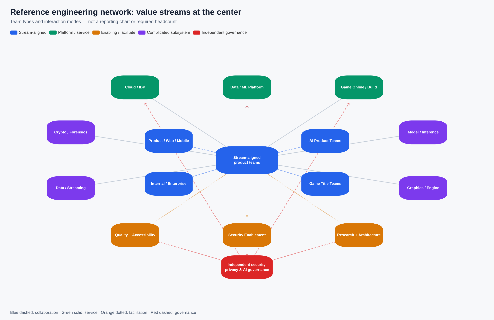
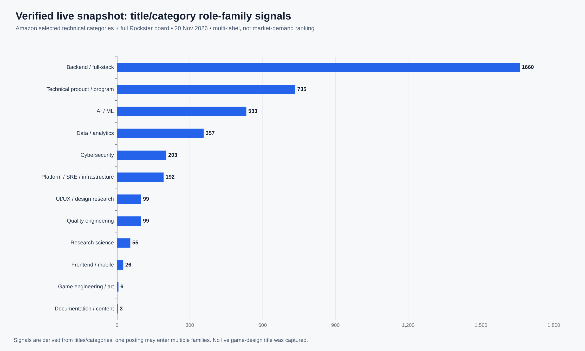
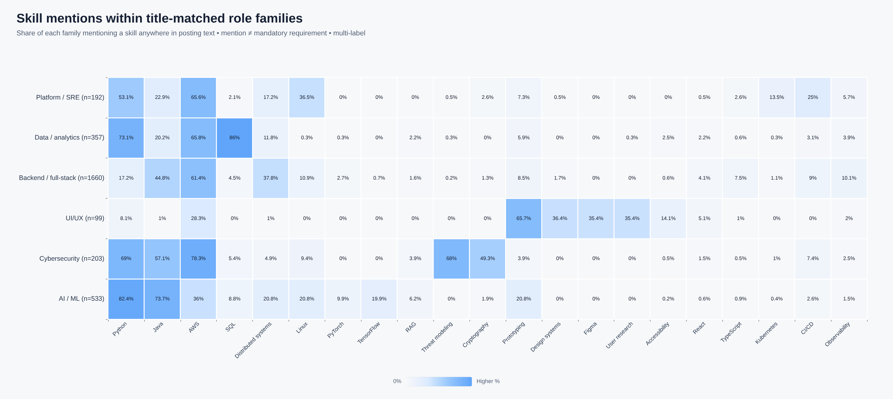

# Engineering Workforce and Hiring Blueprint

**Report date:** 2026-11-20. **Evidence snapshot date:** 2026-11-20 (job-market crawl) and 2026-11-20 (resource/repository verification). **Character:** a public, evidence-based reference model for designing, staffing, hiring, and governing an engineering organization spanning software, AI/ML, cybersecurity and reverse engineering, game development, 3D/additive manufacturing, computational geometry, and architecture — plus the agent-skill ecosystem that can automate parts of this work.

---

## 1. Executive summary

This blueprint answers one practical question: *how should an organization decide which engineering roles exist, when to split or combine them, how to hire for them with evidence, and which skills, tools, and learning resources to build around — without inventing confidential org charts, staffing ratios, or demand rankings?* The direct answer is a **public reference model** of **109 role charters grouped into 52 function families**, a **Team Topologies–style organization network** with explicit scaling triggers instead of fixed staffing ratios, an **evidence-based hiring system** built on role scorecards and structured work samples, and a **verified jobs snapshot of exactly 10,560 records** (10,544 Amazon postings across 14 selected technical categories plus 16 Rockstar Games records comprising the full official board) retrieved on 2026-11-20 ([Amazon Jobs](https://www.amazon.jobs/en/search), [Rockstar Games careers board](https://job-boards.greenhouse.io/rockstargames)). The model deliberately refuses three temptations: claiming knowledge of any company's confidential organization, converting posting counts into cross-company "demand rankings," and treating the 109 charters as 109 required headcount.

The measured inventory behind this report is concrete. The role database contains **109 charters** spanning engineering, product, design, research, security, data, 3D/AM, geometry, architecture, agent governance, and company-wide functions (ethical psychology, marketing and growth, social media and content, community and developer relations, brand, market research, sales, legal/policy, people operations, finance, customer success, trust and safety, and knowledge transfer); the curated resource catalog contains **296 verified learning/reference resources** (including ethical-growth, behavioral-science, and company-building materials alongside the technical canon); the agent-ecosystem survey covers **35 GitHub repositories, 125 skill/plugin catalog entries, 20 discovery topics, and 24 communities**, all verified 2026-11-20; and the research base includes indexed literature on agent reasoning (ReAct and successors), multi-agent collaboration, and agent/skill security. The live jobs snapshot is intentionally narrow and honest: Amazon's public search JSON and Rockstar's public Greenhouse board were retrieved within their robots/terms constraints, while **Meta was not crawled** because its robots.txt prohibits automated data collection without express written permission, **Google's careers access could not be verified**, and **Netflix returned HTTP 403** including for robots retrieval — so **15 indirect/indexed leads for Meta, Google, and Netflix are catalogued separately and excluded from every verified aggregate**. The headline verified signal: within this snapshot, backend/full-stack titles dominate (1,660), followed by technical product/program roles (735), AI/ML titles (533), data/analytics (357), and cybersecurity (203), with counts being multi-label and not comparable across companies.

The principal limitations, stated up front: the jobs data is a **single-day, two-source census** — Amazon restricted to 14 selected technical categories and Rockstar a full but tiny board (16 records) — so it grounds *role requirements and skill vocabulary* but cannot support market-share, salary, or demand-trend claims; seniority signals are title-language heuristics, not cross-company level mappings; skill counts are "postings mentioning X," not certified requirements; and every repository license, lifecycle status, and skill-security note is a point-in-time observation that must be re-verified before adoption. Everything labeled "recommendation" in this report is an original design proposal grounded in the cited public sources, not a description of any real company's internal practice.

## 2. Scope, methods, and evidence classes

### 2.1 What this model is — and is not

This blueprint is a **reference architecture for organizations and hiring**, assembled from public standards (SFIA 9, NIST CSF 2.0, NIST AI RMF, NIST NICE, OWASP ASVS/MASVS, WCAG 2.2, ISO 19650, ICOMOS charters, DORA, Google SRE practice) and from a verified snapshot of public job postings ([SFIA 9](https://sfia-online.org/en/sfia-9), [NIST CSF 2.0](https://www.nist.gov/cyberframework)). It does **not** contain, claim, or reconstruct confidential org charts, headcounts, compensation bands, or internal leveling for Amazon, Meta, Google, Netflix, Rockstar, or any other employer; where company names appear, they refer only to public careers-board data or public career frameworks such as the Dropbox engineering career framework and the GitLab handbook ([Dropbox Career Framework](https://dropbox.github.io/dbx-career-framework/), [GitLab Careers](https://handbook.gitlab.com/handbook/engineering/careers/)). Equally, the 109 role charters are *responsibility definitions* — a single person may hold several charters at small scale, and a charter is split into dedicated hires only when depth, workload, or independence of challenge requires it.

A second scope boundary concerns automation. Fifteen domain `.skill` packages (organization architecture, job-market intelligence, defensive reverse engineering, spatial 3D production, computational geometry, architecture and built heritage, agent research direction, local-model runtime engineering, game reconstruction, mathematics, physics, chemistry, biology, science history, and AI open-model research) encode parts of this blueprint for agent-assisted execution, and Section 14 documents how to use them and the companion workbooks. None of these artifacts authorizes unattended action: physical production steps, external writes, security testing, and hiring decisions all retain human gates defined in the domain contracts.

### 2.2 Evidence classes and crawl limitations

Every externally sourced claim in this report is classified. The job-market evidence uses four classes: **`verified_live`** (full record retrieved directly from the official source during the snapshot), **`indexed_official_sample`** (search-index or cached official-page text with an official job URL but unverified current status), **`indirect_mirror`** (third-party copy used as a research lead only), and **`source_failed`** (a coverage-log entry, not a job record). Only `verified_live` records enter counts, family breakdowns, or skill-frequency charts. The crawl itself followed source-specific policy: Amazon's public `search.json` endpoint is not disallowed by the robots rules that block internal paths, so it was paged politely with stable IDs; Rockstar's official Greenhouse board API returned the full public board; Meta's robots.txt states automated data collection is prohibited without express written permission, so **no Meta crawl occurred**; Google's careers retrieval failed in the research environment and robots could not be verified, so nothing was automated; and Netflix returned **HTTP 403 "Not Available"** including for robots, which the methodology treats as a stop signal rather than as "zero openings" — never as a proxy-bypass justification. These are 2026-11-20 observations, not permanent permissions; robots, terms, and endpoints must be re-checked before every refresh.

The snapshot schema preserves provenance on every record — `source_job_id`/requisition ID, unmodified title, canonical URL, source labels, timestamps, multi-label `role_families`, a title-language `seniority_signal`, controlled-dictionary `skills_mentioned`, and raw text — so classifications can be recomputed without losing evidence. Two semantic cautions follow. First, `role_families` is a deterministic, multi-label classifier: title/category matches are stronger than content matches, content families require at least two pattern matches, and family counts therefore need not sum to the record total. Second, `skills_mentioned` means exactly that — a mention somewhere in retained posting text — so this report always says "postings mentioning X," never "jobs requiring X," and never averages years-of-experience expressions without parsing their context.

### 2.3 Verification and reproducibility

Derived numbers in this report were recomputed from the underlying data files rather than copied from narrative text: the record count (10,560 = 10,544 Amazon + 16 Rockstar), the 14 Amazon category counts (which sum exactly to 10,544), the 16-record Rockstar department breakdown, the role catalog size (109), the resource catalog size (296), and the ecosystem counts (35 repositories, 125 skill/plugin entries, 20 topics, 24 communities). The two deliverable workbooks are built so that summary counts are spreadsheet formulas (COUNTA/COUNTIF/COUNTIFS/SUM) over catalog sheets, making the arithmetic auditable inside the file itself. The job snapshot is treated as an immutable run: refresh behavior tracks added, changed, and disappeared IDs, suppresses removals for failed sources, and records that a posting's disappearance is not proof a role was filled.

## 3. Organization network and team types

### 3.1 Design principles and the organization network

The organization is designed around a **flow of customer or business value**, using the public Team Topologies vocabulary as a design aid rather than an automatic org-chart generator ([Team Topologies](https://teamtopologies.com/key-concepts)). Ownership of build, release, operation, documentation, security, accessibility, and learning stays close to the stream-aligned team; cognitive load is reduced with self-service platforms and time-boxed enablement instead of permanent handoffs; and every cross-team service relationship carries an explicit interface contract. Figure 1 visualizes the resulting network: stream-aligned teams consuming platform X-as-a-Service offerings, enabling teams transferring capability on a deadline, complicated-subsystem teams owning irreducibly specialist components (codecs, inference engines, cryptography, rendering, consensus), and governance overlays (security, AI risk, accessibility, reliability) that set policy while the stream teams still operate their own services.

Two overlays matter for this blueprint's domains. The **AI and data overlay** assigns ownership for research/model development, data acquisition and governance, application integration, evaluation, inference/serving, observability, security/privacy, incident response, and human override/fallback, using NIST AI RMF GOVERN across the lifecycle and MAP/MEASURE/MANAGE per system, with a maintained AI inventory, evaluation evidence, monitoring, an incident owner, a deactivation mechanism, and a decommissioning plan ([NIST AI RMF](https://www.nist.gov/itl/ai-risk-management-framework)). The **game-development overlay** recognizes that a game value stream normally spans game direction; game/systems/level/narrative design; gameplay/engine/graphics/tools engineering; art and technical art; animation; audio; UI/UX; player research; production; QA/playtesting; build/release; online/backend services; data; accessibility; community/player safety; anti-cheat/security; and live operations — roles that small projects combine and large productions separate when craft depth and content throughput require it.

### 3.2 Team types, entry criteria, and interaction modes

| Team type | Mission | Add only when | Interaction and exit rule | Anti-pattern to reject |
|---|---|---|---|---|
| Stream-aligned | Own a product/value stream from discovery through operation | Always — the default team | Owns service/API, SLO, backlog, runbook, docs, and a published team API | Layer-only teams that hand every feature to another team |
| Platform | Provide a compelling internal product that reduces stream-team load | Multiple teams repeatedly need the same capability and self-service demand exists | X-as-a-Service with roadmap, docs, support model, adoption and reliability measures | A renamed ticket-driven operations team; a mandatory immature platform |
| Enabling | Transfer a missing capability or remove a specific obstacle | A measurable capability gap cannot be closed by normal consultation | Facilitation with named recipient, baseline, target, deadline, and exit | A permanent "center of excellence" that owns the work forever |
| Complicated-subsystem | Own work requiring deep specialist knowledge | Expertise is genuinely irreducible (codecs, inference engines, cryptography, rendering, consensus) | Explicit subsystem contract with performance/correctness evidence | Treating messy but ordinary code as a specialist subsystem |

*Table 1 — Team taxonomy adapted from public Team Topologies concepts ([Team Topologies](https://teamtopologies.com/key-concepts)); interaction modes are collaboration for discovery, X-as-a-Service for stable consumption, and facilitation for temporary capability transfer.*

Every service relationship — internal or external — should be recorded with an **interface contract**: purpose; customers; owned outcomes; inputs; outputs/APIs; accountable owner; collaborators; SLO/quality bar; data classification; security/privacy/accessibility obligations; documentation/runbook; support hours; escalation path; change/deprecation policy; measures; interaction mode; and a review/expiry date. This is an original recommendation in the sense that the *template* is this blueprint's synthesis, though each field reflects standard public practice.

### 3.3 Scaling triggers — not staffing ratios

| Current condition | Recommended change | Trigger evidence |
|---|---|---|
| One small product team | Combine compatible roles; keep senior technical ownership explicit | Low coordination overhead and limited operational load |
| Several stream teams repeat infrastructure work | Create the thinnest viable platform | Repeated duplicated effort, long onboarding, inconsistent reliability/security |
| Specialists become ticket gatekeepers | Create an enabling engagement and embed champions | Wait time and late defects rise while capability stays concentrated |
| On-call and reliability work exceed team capacity | Establish SRE/production engineering or a formal embedded rotation | Sustained toil, incident load, unavailable error-budget governance |
| Model/data products multiply | Separate ML platform/MLOps and AI evaluation/governance capabilities | Repeated deployment/eval/monitoring work and material model risk |
| Game production grows | Add specialist craft teams and production/live-operations interfaces | Content pipeline load, multi-discipline dependencies, release cadence, player-safety needs |
| Cross-team programs miss dependencies | Add TPM/program capability | Multi-team dependency risk exceeds EM/tech-lead coordination capacity |

*Table 2 — Scaling triggers (original recommendation grounded in Team Topologies and Google SRE practice [Team Topologies](https://teamtopologies.com/key-concepts), [Google SRE Workbook](https://sre.google/workbook/table-of-contents/)).*

**Headcount alone is never a trigger, and this blueprint deliberately contains no fixed QA:developer, designer:developer, PM:engineer, or manager:engineer ratios.** Capacity is derived from demand, service windows, work in progress, cognitive load, risk, and operational load. This matters for reading Section 6 correctly: the verified posting mix (for example, 99 quality-engineering titles against 1,660 backend/full-stack titles in the snapshot) reflects one employer's selected-category board composition on one day, not a recommended ratio.

### 3.4 Dual ladder, governance/RACI, and lifecycle

Senior individual-contributor and management paths are kept distinct and similarly valued. Management requires people stewardship, capacity planning, hiring, performance management, organizational design, and delivery systems — it is not a promotion prize for technical excellence — while staff-plus IC roles require technical direction, influence, judgment, and leverage, and are not "managers without direct reports" unless explicitly scoped that way. Track switches should include a reversible acting period and explicit support. Decision ownership follows a pragmatic RACI: product management normally owns problem/value/viability; design owns usability evidence; technical leadership owns feasibility/architecture; engineering management owns team health and the delivery system; QA/SET owns quality strategy; security owns security review policy; SRE facilitates SLO/error-budget governance — with the explicit caveat that RACI is a communication aid, not a substitute for conversation.

Delivery governance uses **DORA's five metrics** — change lead time, deployment frequency, failed-deployment recovery time, change fail rate, and deployment rework rate — as service/system improvement signals, never as individual goals or league tables ([DORA](https://dora.dev/guides/dora-metrics/)). Reliability governance centers SLOs, error budgets, toil reduction, on-call design, incident response, blameless postmortems, and canarying, with SLO/error-budget agreements requiring product, development, and production stakeholders together ([Google SRE Workbook](https://sre.google/workbook/implementing-slos/)). Security governance uses NIST CSF 2.0's six functions — Govern, Identify, Protect, Detect, Respond, Recover — with NIST SSDF for secure development practices and OWASP ASVS/MASVS for application and mobile verification ([NIST SSDF](https://csrc.nist.gov/Projects/ssdf), [OWASP ASVS](https://owasp.org/www-project-application-security-verification-standard/), [OWASP MAS](https://mas.owasp.org/)). Accessibility governance applies WCAG 2.2's testable success criteria at A/AA/AAA conformance levels and distributes responsibility across UX, visual design, frontend, and content roles via W3C ARRM rather than loading everything onto one specialist ([WCAG 2.2](https://www.w3.org/TR/WCAG22/), [W3C ARRM](https://www.w3.org/WAI/planning/arrm/)).

The lifecycle discipline is measurement humility. DORA levels are never compared across dissimilar services; engineers are never ranked individually; lines of code, commit counts, raw posting counts, and keyword frequencies are never used as productivity or hiring-potential measures; and metrics are revisited when teams game them or when the system boundary changes. Teams, platforms, roles, and metrics all carry review/expiry dates, and every metric is paired with user outcomes, reliability, quality, security, cognitive load, and qualitative evidence.

## 4. The role-family map: 109 charters, 52 function groups

### 4.1 Complete role-family map

The role database contains **109 role charters** across **52 function groups**. Each charter records a mission, 3–6 accountable outputs, core skills, a senior-scope differentiator, interfaces, and a public reference. The map below is complete at the function-group level, with representative roles named per group.

The catalog extends beyond engineering into **company-wide functions** — research and responsible growth (including ethical/behavioral psychology), marketing and growth, community and developer relations, brand and communications, market and customer research, sales and solutions, legal/trust/policy, people and organization, finance and operations, customer outcomes, trust and safety, and knowledge transfer — because a hiring blueprint that ignores these functions produces organizations that can build but cannot responsibly sell, support, explain, or retain what they build. These groups follow the same charter discipline: accountable outputs (for example, the Trust, Safety & Ethics Program Manager owns risk scenarios, policy/controls, incident review, harm metrics, and transparency records) and ethics-anchored references such as the ACM Code of Ethics rather than engagement-at-any-cost mandates ([ACM Code of Ethics](https://www.acm.org/code-of-ethics)).

| Function group (roles) | Representative roles | Primary public reference |
|---|---|---|
| Leadership & governance (3) | CTO/VP Engineering; Director of Engineering; Engineering Manager | [SFIA 9](https://sfia-online.org/en/sfia-9) |
| Architecture & technical leadership (2) | Staff/Principal Engineer; Software/Solutions Architect | [Dropbox Career Framework](https://dropbox.github.io/dbx-career-framework/) |
| Product & program (3) | Product Manager; Technical Program Manager; Release/Delivery Manager | [SFIA 9](https://sfia-online.org/en/sfia-9) |
| Software engineering (5) | Backend; Frontend; Full-stack; Mobile; API/Integration Engineer | [OpenAPI Specification](https://spec.openapis.org/oas/latest.html) |
| Quality engineering (3) | QA Analyst/Quality Engineer; SDET; Performance Engineer | [Software Engineering at Google](https://abseil.io/resources/swe-book) |
| Support & knowledge (2) | Support Engineer; Technical Writer/Documentation Engineer | [Diátaxis](https://diataxis.fr/) |
| AI & research (3) | Research Scientist; Research Engineer; Applied Scientist | [NIST AI RMF](https://www.nist.gov/itl/ai-risk-management-framework) |
| AI & ML engineering (3) | ML Engineer; AI/LLM Application Engineer; AI Evaluation/Safety Engineer | [NIST AI RMF](https://www.nist.gov/itl/ai-risk-management-framework) |
| Data & analytics (3) | Data Scientist; Data Engineer; Analytics Engineer | [SFIA 9](https://sfia-online.org/en/sfia-9) |
| AI & data platform (1) | MLOps/ML Platform Engineer | [NIST AI RMF](https://www.nist.gov/itl/ai-risk-management-framework) |
| Responsible technology (1) | Responsible AI/AI Governance Engineer | [NIST AI RMF](https://www.nist.gov/itl/ai-risk-management-framework) |
| Platform & infrastructure (4) | Platform Engineer; Cloud/Infrastructure Engineer; DevOps/CI-CD Engineer; Network/Systems Engineer | [NIST SSDF](https://csrc.nist.gov/Projects/ssdf) |
| Reliability (1) | Site Reliability Engineer | [Google SRE Workbook](https://sre.google/workbook/table-of-contents/) |
| Data infrastructure (1) | Database Engineer/DBA | [SFIA 9](https://sfia-online.org/en/sfia-9) |
| Developer experience (1) | Developer Experience Engineer | [SFIA 9](https://sfia-online.org/en/sfia-9) |
| Security leadership (1) | CISO/Security Director | [NICE Framework](https://niccs.cisa.gov/tools/nice-framework) |
| Security engineering (5) | Security Architect; Application/Product Security; Cloud Security; IAM/Identity; Security Software Engineer | [OWASP ASVS](https://owasp.org/www-project-application-security-verification-standard/) |
| Security operations (5) | Detection Engineer; SOC Analyst; Incident Responder; DFIR/Forensics; Threat Intelligence Analyst | [NIST SP 800-86](https://nvlpubs.nist.gov/nistpubs/legacy/sp/nistspecialpublication800-86.pdf) |
| Security assurance (2) | Vulnerability Management Engineer; Offensive Security/Red Team Engineer | [NICE Framework](https://niccs.cisa.gov/tools/nice-framework) |
| Security research (1) | Malware Analyst/Reverse Engineer | [NICE Framework](https://niccs.cisa.gov/tools/nice-framework) |
| Privacy & cryptography (2) | Privacy Engineer; Cryptography/Security Protocol Engineer | [NICE Framework](https://niccs.cisa.gov/tools/nice-framework) |
| Security governance (1) | Security GRC/Compliance Engineer | [NIST CSF 2.0](https://www.nist.gov/cyberframework) |
| Game direction & production (2) | Game/Creative Director; Game Producer/Production Lead | [Rockstar careers board](https://job-boards.greenhouse.io/rockstargames) |
| Game design (5) | Game Designer; Technical Game Designer; Level/Mission Designer; Systems/Economy Designer; Narrative Designer | [Rockstar careers board](https://job-boards.greenhouse.io/rockstargames) |
| Game engineering (3) | Gameplay Engineer; Engine/Graphics Programmer; Game Tools/Build Engineer | [Rockstar careers board](https://job-boards.greenhouse.io/rockstargames) |
| Game art & audio (2) | Technical Artist; Game Audio Designer/Programmer | [Rockstar careers board](https://job-boards.greenhouse.io/rockstargames) |
| Player experience (2) | Game UI/UX Designer; Player/Games User Researcher | [W3C ARRM](https://www.w3.org/WAI/planning/arrm/) |
| Game quality (1) | Game QA/Playtest Engineer | [Rockstar careers board](https://job-boards.greenhouse.io/rockstargames) |
| Game online & safety (3) | Online Services/LiveOps Engineer; Anti-Cheat/Game Security Engineer; Game Data/LiveOps Analyst | [Google SRE Workbook](https://sre.google/workbook/table-of-contents/) |
| Additive manufacturing (3) | DfAM/AM Engineer; AM Process/Applications Engineer; AM Quality/Validation Engineer | [ISO/ASTM AM standards](https://www.iso.org/committee/629086/x/catalogue/p/1/u/0/w/0/d/0) |
| CAD & print systems (3) | CAD/Computational Design Engineer; Slicing/Print-Process Engineer; 3D Printer Embedded/Firmware Engineer | [Marlin Firmware](https://github.com/MarlinFirmware/Marlin) |
| 3D content & spatial UX (2) | Blender/3D Designer; 3D UI/UX/Spatial Interaction Designer | [Blender license](https://www.blender.org/about/license/) |
| Real-time 3D & XR (2) | Real-time 3D/WebXR Engineer; Simulation/Animation/Pipeline Technical Director | [Three.js](https://github.com/mrdoob/three.js), [OpenVDB](https://www.openvdb.org/) |
| BIM & information management (2) | 4D/5D BIM Specialist; BIM/Information Manager | [buildingSMART standards](https://www.buildingsmart.org/standards/) |
| Architecture (1) | Architect/Architectural Designer | [RIBA Plan of Work](https://www.riba.com/work/finance-and-business-management/plan-of-work) |
| Architecture & heritage (2) | Conservation Architect/Built-Heritage Specialist; Architectural Historian/Researcher | [ICOMOS Charters](https://www.icomos.org/en/charters-and-texts) |
| Architecture & computation (2) | Computational Designer/Design Technologist; Architectural Geometry Specialist | [CGAL](https://www.cgal.org/) |
| Geometry & numerical engineering (2) | Geometry Processing Engineer; Computational Geometer/Applied Mathematician | [CGAL](https://www.cgal.org/) |
| Simulation & validation (1) | CAE/FEA/CFD Validation Engineer | [NAFEMS](https://www.nafems.org/) |
| Agent governance & research (3) | Agent Research Director/Orchestration Lead; Agent Skill Engineer/Evaluator; Agent Security/Prompt-Injection Researcher | [Agent Skills specification](https://agentskills.io/specification), [OWASP GenAI](https://genai.owasp.org/) |
| Research & responsible growth (2) | Behavioral/Research Psychologist; Product Psychology/Behavioral Design Lead | [ACM Code of Ethics](https://www.acm.org/code-of-ethics) |
| Marketing & growth (3) | Marketing Engineer/Technologist; Growth Product Manager; Social Media/Content Lead | [SFIA 9](https://sfia-online.org/en/sfia-9) |
| Community & developer relations (1) | Community/Developer Relations Manager | [SFIA 9](https://sfia-online.org/en/sfia-9) |
| Brand & communications (1) | Brand/Communications Designer | [SFIA 9](https://sfia-online.org/en/sfia-9) |
| Market & customer research (1) | Market Research/Competitive Intelligence Analyst | [SFIA 9](https://sfia-online.org/en/sfia-9) |
| Sales & solutions (1) | Sales Engineer/Solutions Consultant | [SFIA 9](https://sfia-online.org/en/sfia-9) |
| Legal, trust & policy (1) | Legal/Policy/Compliance Specialist | [ACM Code of Ethics](https://www.acm.org/code-of-ethics) |
| People & organization (1) | Talent Acquisition/People Operations Specialist | [SFIA 9](https://sfia-online.org/en/sfia-9) |
| Finance & operations (1) | Finance/Operations Analyst | [SFIA 9](https://sfia-online.org/en/sfia-9) |
| Customer outcomes (1) | Customer Success Manager | [SFIA 9](https://sfia-online.org/en/sfia-9) |
| Trust & safety (1) | Trust, Safety & Ethics Program Manager | [ACM Code of Ethics](https://www.acm.org/code-of-ethics) |
| Knowledge & capability (1) | Knowledge Transfer/Learning Systems Manager | [SFIA 9](https://sfia-online.org/en/sfia-9) |

*Table 3 — Complete 52-group / 109-role map. Each role is a charter (mission + accountable outputs), not a mandatory headcount.*

### 4.2 Why 109 roles do not mean 109 hires

The charters are **reference responsibilities, not copied job descriptions, and not a claim that every company needs a separate person per role**. A ten-person startup might run with five engineers collectively holding charters from software engineering, quality, platform, security engineering, and data — with each charter's accountable outputs explicitly assigned to a named owner so nothing is silently unowned. The splitting rule is symmetric: split a charter into a dedicated hire only when (a) the depth of specialist knowledge becomes irreducible (for example, cryptography or rendering), (b) the workload exceeds what a combined role can carry without degrading its accountable outputs, or (c) independence of challenge requires separation — security assurance, AI evaluation, and AM quality validation are the canonical cases where the checker should not report to the checked.

Figure 2 shows that the live market signal is consistent with this combine-and-split logic: employers advertise broad hybrid titles (backend/full-stack dominates) far more often than narrow specialist titles, while specialist families (security research, game engineering, documentation) appear in small numbers attached to specific organizational needs. The verified posting data is evidence about *which vocabularies employers currently use*, not about how many people an organization should employ.

### 4.3 Progressive seniority expectations

Levels follow SFIA-style responsibility dimensions — autonomy, complexity, influence, scope, and knowledge — as a **local reference model, explicitly not a mapping of Amazon, Meta, Google, Netflix, or Rockstar levels** ([SFIA 9](https://sfia-online.org/en/sfia-9)).

| Local level | Autonomy and complexity | Influence and scope | Evidence expected |
|---|---|---|---|
| L1 Follow/trainee | Structured tasks under close guidance | Learns team practices | Foundational exercises, learning agility, supervised delivery |
| L2 Assist/associate | Defined tasks and routine problems | Contributes within a small work area | Working features/tests/docs with review; explains choices |
| L3 Apply/independent | Varied non-routine work with limited direction | Owns a component or service slice | End-to-end delivery, debugging, operations, collaboration |
| L4 Enable/senior | Resolves ambiguous cross-component problems | Guides others; improves team capability | Technical leadership, design tradeoffs, mentoring, incident learning |
| L5 Ensure/advise (staff) | Sets direction for multiple teams or a difficult subsystem | Influences without line authority | Cross-team outcomes, strategy, reusable mechanisms, risk reduction |
| L6 Initiate/influence (principal) | Shapes organizational technical/functional strategy | Company/domain-wide influence | Multi-org technical bets, standards, succession and capability building |
| L7 Set strategy (distinguished/executive) | Long-term strategy under broad accountability | Organization or industry-scale influence | Sustained strategic outcomes and stewardship |

*Table 4 — Local responsibility ladder informed by SFIA 9 and public career frameworks ([SFIA 9](https://sfia-online.org/en/sfia-9), [Dropbox](https://dropbox.github.io/dbx-career-framework/), [GitLab](https://handbook.gitlab.com/handbook/engineering/careers/)).*

Within each charter, the **senior-scope differentiator** column carries the progressive expectation: for example, a Backend Engineer progresses from owning service code and runbooks to leading multi-service architecture, reliability, and migration tradeoffs; a Machine Learning Engineer progresses to leading production ML architecture, quality, cost, and reliability; a Malware Analyst/Reverse Engineer progresses to leading complex analysis methodology and defensive research programs. This design keeps promotion evidence behavioral — artifacts and outcomes — rather than tenure- or title-based. Company-specific level labels such as Amazon SDE II, Meta E-levels, or Rockstar Senior/Lead are **not interchangeable**, and this blueprint never converts between them.

## 5. The hiring system

### 5.1 Role scorecards and structured evidence

Every requisition starts from a **role scorecard** with eight elements: (1) a one-sentence mission tied to a value-stream outcome; (2) three to six accountable, observable outputs; (3) must-have capabilities limited to what the first 6–12 months actually require; (4) preferred exposure that is genuinely helpful but learnable after hiring; (5) the responsibility level on the Table 4 dimensions; (6) interfaces across PM/design/engineering/data/security/SRE/QA/docs/production; (7) an evidence rubric spanning work sample, debugging or critique, design/research judgment, operational behavior, communication, and ethics/safety; and (8) **explicit non-requirements** — unnecessary degree, years, pedigree, framework, or keyword filters removed before posting. Ratings use separate anchors (1 = below, 2 = partial, 3 = meets, 4 = exceeds) with required evidence per rating, and a critical safety, integrity, or foundational-skill failure is never averaged away by strengths elsewhere.

The scorecard discipline interacts directly with the jobs evidence of Section 6. Verified postings show how qualification language is actually written — for example, a current Amazon Sr. Machine Learning Engineer (AGI) posting lists "5+ years of non-internship professional software development experience" plus leading design/architecture and mentoring experience as basic qualifications ([Amazon Jobs 10564137](https://www.amazon.jobs/en/jobs/10564137/sr-machine-learning-engineer-agi)), while a Data Engineer posting pairs 5+ years of data engineering with SQL, a modern scripting language, and mentoring ([Amazon Jobs 10598890](https://www.amazon.jobs/en/jobs/10598890/data-engineer)). The scorecard method converts such market vocabulary into testable evidence requirements rather than copying years-and-degree language wholesale.

### 5.2 Work samples, independent review, accessibility, and anti-pedigree

Interview controls are structural. Questions are structured and the same core rubric applies to all candidates for the same role; interviewers are trained; assessment is separated from team enthusiasm; evidence is documented; and the process is reviewed for adverse impact and accessibility, with required accommodations and clear logistics for every candidate. Independent bar review or hiring committees are used where feasible — with the explicit caution that practitioner-described "Big Tech" loop designs are not official or immutable and should not be cargo-culted. **Anti-pedigree is enforced through the non-requirements section**: if a degree, a named-employer history, or a specific framework cannot be tied to a first-year accountable output, it is removed from the filter. Craft-specific evaluation adjusts the evidence, not the rigor: research roles distinguish scientific novelty, experimental rigor, publication/reproduction evidence, engineering execution, and product transition; design and game roles are evaluated on process and playable/prototyped outcomes, not only visual polish; security and reverse-engineering roles must demonstrate authorization discipline, evidence preservation, limitations, and defensive handoff — not only technical exploitation ability.

**AI-in-hiring caution is a hard rule, not a disclaimer:** an AI score is never the sole basis for a hiring decision. Any automated screening or assessment tool must be validated for job relevance, bias, privacy, and human review under applicable law, and candidates deserve transparency about where automation touches the process. This mirrors the same evidence discipline applied elsewhere in this blueprint: a model's output is a signal with known failure modes, and consequential decisions require accountable human judgment.

### 5.3 Scorecard-to-charter traceability

Because every scorecard derives from a charter, the hiring system inherits the 109-role map's combination logic: a combined role's scorecard lists the accountable outputs of each constituent charter, and the interview loop must collect evidence against each one. This prevents the common failure where a "full-stack + DevOps + on-call" posting is interviewed as pure frontend work and the operational charter is discovered only after hire. It also makes the adverse-impact review concrete, because each scored dimension traces to a stated accountable output rather than to interviewer taste.

## 6. Current jobs evidence: the 2026-11-20 verified snapshot

### 6.1 Coverage table

| Source | Channel used | Coverage | Verified records | Status/limitation |
|---|---|---|---|---|
| Amazon | `https://www.amazon.jobs/en/search.json` (public search JSON; robots disallow internal paths, not this endpoint) | Selected census: **14 technical categories** | **10,544** | Category-scoped census, not the whole Amazon board |
| Rockstar Games | `https://boards-api.greenhouse.io/v1/boards/rockstargames/jobs?content=true` (official public Greenhouse board API) | **Full board** | **16** | Full but very small board; one-day snapshot |
| Meta | `https://www.metacareers.com/jobs/{id}` and published sitemaps | Not crawled | 0 (8 indexed leads held separately) | robots.txt prohibits automated data collection without express written permission; **do not crawl** |
| Google | `https://www.google.com/about/careers/applications/jobs/results/` | Not crawled | 0 (2 indirect leads held separately) | Direct retrieval failed in the research environment; robots unverified |
| Netflix | `https://jobs.netflix.com/` | Not crawled | 0 (5 indirect leads held separately) | HTTP 403 "Not Available," including robots retrieval; never convert failure into "zero openings" |
| **Verified total** | | | **10,560** | Snapshot retrieved 2026-11-20T00:43:51Z |

*Table 5 — Coverage before findings, per the reporting contract. The 15 Meta/Google/Netflix leads are `indexed_official_sample` or `indirect_mirror` evidence and are excluded from every verified aggregate, company comparison, and skill-frequency chart.*

The verified dataset therefore contains **exactly 10,560 records: 10,544 Amazon + 16 Rockstar**. Amazon's 14 selected categories reconcile exactly: Operations, IT, & Support Engineering 3,220; Software Development 2,622; Project/Program/Product Management—Technical 1,129; Systems, Quality, & Security Engineering 794; Solutions Architect 756; Hardware Development 710; Applied Science 480; Design 299; Business Intelligence 207; Data Science 139; Research Science 74; Editorial, Writing, & Content Management 64; Database Administration 25; Economics 25 — summing to 10,544 ([Amazon Jobs](https://www.amazon.jobs/en/search)). Rockstar's 16 records break down by source department as Security 10, Code 2, and one each in Security IT, IT, Administration, and Workplace Services ([Rockstar board](https://job-boards.greenhouse.io/rockstargames)).

### 6.2 Title-family counts (multi-label; no cross-company demand ranking)

| Role family (title-based) | All verified | Amazon | Rockstar |
|---|---|---|---|
| Backend / full-stack | 1,660 | 1,658 | 2 |
| Technical product / program | 735 | 735 | 0 |
| AI / ML | 533 | 533 | 0 |
| Data / analytics | 357 | 357 | 0 |
| Cybersecurity | 203 | 192 | 11 |
| Platform / SRE / infrastructure | 192 | 191 | 1 |
| Quality engineering | 99 | 99 | 0 |
| UI/UX / design research | 99 | 99 | 0 |
| Research science | 55 | 55 | 0 |
| Frontend / mobile | 26 | 26 | 0 |
| Game engineering / art | 6 | 1 | 5 |
| Documentation / content | 3 | 3 | 0 |

*Table 6 — Multi-label title/category-family counts from the verified snapshot ([Amazon Jobs](https://www.amazon.jobs/en/search), [Rockstar board](https://job-boards.greenhouse.io/rockstargames)). A posting can carry more than one family label, so family counts do not sum to 10,560; unlabeled postings simply matched no title/category-family pattern. The companion workbook's `Role_Family_Summary` uses broader content-based signals, so its counts intentionally differ from this table for some families. Because coverage is deliberately unequal (a 14-category Amazon census versus a full 16-record Rockstar board), **no cross-company demand ranking is drawn from this table** — it shows board composition, not market share.*

Seniority signals (title-language only, not cross-company level mappings) for Amazon's 10,544 records: 5,857 with no seniority marker or mid-level title, 1,982 senior, 1,960 manager, 210 principal, 166 internship, 147 associate/entry, 103 lead, 60 executive, 39 director, 13 staff, and 7 distinguished/fellow. Rockstar's 16 records show 10 senior, 1 lead, and 5 unstated. These are lexical signals useful for understanding how titles are written; they say nothing about internal leveling.

### 6.3 Skill mentions by family

| Family (postings) | Top skill mentions (postings mentioning the skill) |
|---|---|
| Backend/full-stack (1,660) | AWS 1,019; Java 744; distributed systems 628; Python 286; Rust 201; Linux 181; Go 175; observability 167; CI/CD 150; prototyping 141; TypeScript 124; REST APIs 92; SQL 75; incident response 69; React 68 |
| AI/ML (533) | Python 439; Java 393; AWS 192; distributed systems 111; prototyping 111; Linux 111; Spark 108; TensorFlow 106; scikit-learn 80; model evaluation 56; PyTorch 53; SQL 47; RAG 33; Go 31; JAX 22 |
| Data/analytics (357) | SQL 307; Python 261; AWS 235; Spark 75; Java 72; IAM 71; distributed systems 42; Node.js 32; Go 22; prototyping 21; Airflow 15; observability 14; CI/CD 11; accessibility 9; Kafka 8 |
| Cybersecurity (203) | AWS 159; Python 140; threat modeling 138; Java 116; cryptography 100; Go 98; penetration testing 72; incident response 68; IAM 33; vulnerability management 30; JavaScript 22; Linux 19; CI/CD 15; malware analysis 15; SQL 11 |
| Platform/SRE/infra (192) | AWS 126; Python 102; Linux 70; CI/CD 48; Go 48; Java 44; distributed systems 33 (further counts in workbook) |
| UI/UX/design research (99) | Prototyping 65; design systems 36; Figma 35; user research 35; AWS 28; accessibility 14; usability testing 11; JavaScript 9; Python 8; React 5; Node.js 5 |
| Quality engineering (99) | Python 40; Linux 21; AWS 18; Java 11; SQL 11; prototyping 11; CI/CD 5; JavaScript 3; Grafana 3 |
| Frontend/mobile (26) | JavaScript 19; React 19; AWS 16; TypeScript 15; REST APIs 8; accessibility 7; prototyping 6; CI/CD 5 |
| Research science (55) | Python 23; AWS 14; prototyping 13; user research 9; Java 6; Spark 4 |
| Game engineering/art (6) | Python 6; 3D mathematics 3; Unreal Engine 3; Direct3D/D3D12 2; HLSL 2; Metal 2; PIX 2; RenderDoc 2; Vulkan 2; reverse engineering 2; malware analysis 2 |

*Table 7 — Controlled-dictionary skill mentions per title family in the verified snapshot. The dictionary is fixed, so absence of a skill means absence of a mention, not absence of a requirement; boilerplate text may inflate counts.*

### 6.4 Representative verified postings

| Role (company, source label) | Verified requirement evidence (excerpt) | Official link |
|---|---|---|
| Sr. Machine Learning Engineer, AGI (Amazon, Software Development) | "5+ years of non-internship professional software development experience"; "5+ years of leading design or architecture … experience"; mentoring/tech-lead experience | [amazon.jobs/10564137](https://www.amazon.jobs/en/jobs/10564137/sr-machine-learning-engineer-agi) |
| Software Development Engineer, AWS DevOps Agent (Amazon, Software Development) | "3+ years of non-internship professional software development experience"; 2+ years design/architecture; C#/C++/Java/Perl; OOD; bachelor's or equivalent | [amazon.jobs/10608183](https://www.amazon.jobs/en/jobs/10608183/software-development-engineer-aws-devops-agent) |
| Data Engineer (Amazon, Business Intelligence category context) | "5+ years of data engineering experience"; data modeling/warehousing/ETL; SQL; Python/Java/Scala/NodeJS; mentoring | [amazon.jobs/10598890](https://www.amazon.jobs/en/jobs/10598890/data-engineer) |
| Business Intelligence Engineer II (Amazon, Business Intelligence) | 3+ years analyzing/interpreting data with Redshift/Oracle/NoSQL; 2+ years Tableau/QuickSight or similar; degree or equivalent Amazon experience path | [amazon.jobs/10594152](https://www.amazon.jobs/en/jobs/10594152/business-intelligence-engineer-ii) |
| Graphics Programmer (Rockstar, Code) | Small experienced team; responsibility for one or more game-technology areas; "extensive knowledge and experience in software development" with passion for interactive graphics | [greenhouse/7751501003](https://job-boards.greenhouse.io/rockstargames/jobs/7751501003) |
| Senior Cheat Software Engineer (Rockstar, Security) | Research and implement mitigations for threats to player experience; stay ahead of evolving attack vectors; supports the cheat lifecycle | [greenhouse/7792318003](https://job-boards.greenhouse.io/rockstargames/jobs/7792318003) |
| Senior Threat Intelligence Analyst (Rockstar, Security) | Identify/analyze threats to live-service titles and the organization; intelligence and investigations principles; five such requisitions on the board | [greenhouse/7787472003](https://job-boards.greenhouse.io/rockstargames/jobs/7787472003) |

*Table 8 — Representative `verified_live` postings with directly retrieved text. Excerpts are quoted from the snapshot's retained posting text.*

### 6.5 The 15 excluded leads (research value only)

Fifteen leads sit outside the verified aggregates: 8 Meta `indexed_official_sample` entries (including Research Scientist Embedded ML; AI Research Scientist Robotics; Staff Computer Vision/ML Engineer; Research Scientist Intern GenAI Red Team; Product Designer Human Interface; Visiting Researcher AI Mentorship; SWE Intern Systems & Infrastructure; and a Research Scientist Intern AI Core ML PhD role), 2 Google `indirect_mirror` entries (Senior Security Engineer, Agentic Red Team, Google DeepMind; Research Scientist/Engineer, Frontier Reasoning), and 5 Netflix `indirect_mirror` entries (L5 Security Engineer GenAI Security; Senior Technical Game Designer; Principal UX Designer Creative Publishing (Games); Machine Learning Scientist 4 Generative Models Evaluation; Senior Gameplay Programmer Game Prototypes). Each carries its official URL where known, an evidence URL, a retrieval date of 2026-11-20, live status "not established," and a verification note. They are useful as *qualitative signals about emerging role vocabulary* — agentic red-teaming, GenAI security, generative-model evaluation — and must never be mixed into counts, comparisons, or charts. Mirrors may be stale or inaccurate; current status requires manual verification against the official site within that site's terms.

## 7. Role/skill requirements and learning paths

### 7.1 Requirement patterns across core software families

The verified snapshot grounds the following requirement patterns, which should be read as *current employer vocabulary*, not as mandatory gates. Backend and full-stack roles center one language in depth, data modeling, concurrency, API design, testing, and distributed-system failure handling — consistent with the 628 distributed-systems, 1,019 AWS, and 744 Java mentions across 1,660 backend/full-stack titles (Table 7) — and the charter's accountable outputs are service code, API contracts, tests, dashboards/SLOs, runbooks, and migration plans. Frontend and mobile roles combine HTML/CSS/JavaScript/TypeScript, framework literacy (React leads verified mentions at 19 of 26 frontend/mobile titles), state and data handling, accessibility, and testing, with mobile adding lifecycle, offline/sync, and store-release constraints. Data engineering and analytics roles foreground SQL (307 mentions across 357 titles), Python, orchestration (Airflow, Spark, Kafka), modeling, quality SLAs, lineage, and access controls — matching the verified Data Engineer posting evidence in Table 8.

| Family | Core requirement pattern (charter + verified mentions) | Learning path (curated resources) | Senior-scope marker |
|---|---|---|---|
| Backend | One language deeply; data modeling; concurrency; APIs; distributed-system failure handling; runbooks | Teach Yourself CS ([teachyourselfcs.com](https://teachyourselfcs.com/)) → Designing Data-Intensive Applications ([dataintensive.net](https://dataintensive.net/)) → Google SRE books ([sre.google/books](https://sre.google/books/)) | Leads multi-service architecture and migration tradeoffs |
| Frontend | Semantic HTML/CSS; TypeScript; framework literacy; accessibility; performance budgets; telemetry | MDN Learn Web Development ([MDN](https://developer.mozilla.org/en-US/docs/Learn_web_development)) → WCAG 2.2 ([W3C](https://www.w3.org/TR/WCAG22/)) → Web Vitals ([web.dev](https://web.dev/articles/vitals)) | Sets web architecture, design-system, and accessibility direction |
| Full-stack | Web/UI + backend + SQL + auth + deployment; debugging across layers | MDN + DDIA + full-stack learning resources in the Resource_Catalog | Leads product-slice architecture; knows when specialist depth is needed |
| Mobile | Kotlin/Swift or cross-platform; lifecycle; networking; offline/sync; staged release; accessibility | Platform documentation plus OWASP MAS for mobile security ([OWASP MAS](https://mas.owasp.org/)) | Owns mobile architecture, performance, and release strategy |
| Data engineering / analytics | SQL; Python; orchestration; modeling; quality SLAs; lineage; access controls | Apache Airflow docs ([airflow.apache.org](https://airflow.apache.org/docs/)) → dbt-style analytics engineering practice → governance literature in the catalog | Owns data-platform architecture and cross-domain data contracts |
| Documentation | Information architecture; audience analysis; docs-as-code; versioning | Google Technical Writing courses ([Google](https://developers.google.com/tech-writing)) → Diátaxis framework ([diataxis.fr](https://diataxis.fr/)) | Owns knowledge architecture and cross-product content governance |
| Product / program | Customer/domain knowledge; prioritization; analytics; dependency management; decision logs | Public product-analytics and leadership resources in the catalog | Portfolio ambiguity; multi-org program governance |

*Table 9 — Requirement patterns and learning paths for core families (original recommendation; verified mention counts from Table 7).*

### 7.2 AI, LLM, and MLOps families

AI/ML titles (533 verified) mention Python (439), Java (393), AWS (192), Spark (108), TensorFlow (106), scikit-learn (80), PyTorch (53), RAG (33), and JAX (22) — a vocabulary consistent with three distinct charters: the **Machine Learning Engineer** (productionize training, inference, evaluation, monitoring), the **AI/LLM Application Engineer** (LLM features, tool integrations, RAG, structured outputs, eval suites, fallback UX, autonomy boundaries, cost/latency), and the **AI Evaluation/Safety Engineer** (eval harnesses, adversarial tests, failure analysis, release evidence). The learning sequence runs Mathematics for Machine Learning ([mml-book.github.io](https://mml-book.github.io/)) → deep-learning foundations → AI Engineering ([O'Reilly](https://www.oreilly.com/library/view/ai-engineering/9781098166298/)) → Made with ML for MLOps practice ([madewithml.com](https://madewithml.com/)) → the NIST AI RMF and its Generative AI Profile for governance ([NIST AI RMF GenAI Profile](https://www.nist.gov/itl/ai-risk-management-framework/ai-rmf-generative-ai-profile)).

The MLOps/ML Platform charter (Kubernetes/cloud, IaC, model CI/CD, registry, serving, feature/eval infrastructure, GPU automation) is the AI-side expression of the platform scaling trigger in Table 2: it should be created when repeated deployment/eval/monitoring work and material model risk appear, not as a title of prestige. Every AI charter carries the same governance obligations — an AI inventory, intended context, evaluation evidence, monitoring, incident ownership, deactivation, and decommissioning — and none may equate benchmark performance with fitness for deployment ([NIST AI RMF](https://www.nist.gov/itl/ai-risk-management-framework)).

### 7.3 Platform, SRE, QA, product, design, research, and accessibility

Platform/SRE/infrastructure titles (192 verified) mention AWS (126), Python (102), Linux (70), CI/CD (48), and Go (48), matching the Platform Engineer charter (golden paths, templates, IaC modules, developer experience) and the SRE charter (SLO/error-budget policy, automation, on-call design, postmortems, capacity) grounded in Google SRE practice ([Google SRE Workbook](https://sre.google/workbook/table-of-contents/)). Quality engineering (99 titles) combines risk-based test strategy, exploratory findings, and automation literacy, with the SDET charter adding test architecture, CI suites, fixtures, contract/E2E tests, and flaky-test reduction ([Software Engineering at Google](https://abseil.io/resources/swe-book)). Product and program roles (735 technical PM/TPM titles verified) own problem selection, prioritization, dependency registers, and decision logs; the charter explicitly forbids treating coordination volume as a substitute for judgment.

Design and research families split into UI/UX craft (prototyping 65, design systems 36, Figma 35 mentions among 99 verified UI/UX titles), user research (35 mentions), and scientific research (55 research-science titles). **Accessibility is a distributed obligation, not a single hire**: WCAG 2.2 supplies testable success criteria and A/AA/AAA conformance levels, automated checks must be paired with manual keyboard, assistive-technology, content, design, and usability evaluation, and W3C ARRM assigns responsibilities across UX, visual design, frontend, and content roles ([WCAG 2.2](https://www.w3.org/TR/WCAG22/), [W3C ARRM](https://www.w3.org/WAI/planning/arrm/)). The verified data reinforces this: accessibility mentions appear in frontend/mobile (7), data/analytics (9), and UI/UX (14) postings alike — it is a cross-cutting skill mention, not a siloed one.

## 8. Cybersecurity and reverse-engineering roles

### 8.1 Role coverage and frameworks

The security function in this blueprint spans 24 charters across seven groups — leadership (CISO/Security Director), engineering (Security Architect; Application/Product Security; Cloud Security; IAM/Identity; Security Software Engineer), operations (Detection Engineer; SOC Analyst; Incident Responder; DFIR/Forensics; Threat Intelligence Analyst), assurance (Vulnerability Management; Offensive Security/Red Team), research (Malware Analyst/Reverse Engineer), privacy and cryptography, and governance (GRC/Compliance). Workforce vocabulary aligns with the NIST NICE Workforce Framework for Cybersecurity ([NICE Framework](https://niccs.cisa.gov/tools/nice-framework)); coverage governance uses NIST CSF 2.0's Govern/Identify/Protect/Detect/Respond/Recover functions ([NIST CSF 2.0](https://www.nist.gov/cyberframework)); secure development follows NIST SSDF ([NIST SSDF](https://csrc.nist.gov/Projects/ssdf)); and application/mobile verification follows OWASP ASVS and MASVS ([OWASP ASVS](https://owasp.org/www-project-application-security-verification-standard/), [OWASP MAS](https://mas.owasp.org/)). The verified market signal is substantial and security-heavy: 203 cybersecurity-titled postings in the snapshot, with threat modeling (138), cryptography (100), penetration testing (72), incident response (68), and malware analysis (15) among the mentioned skills, and Rockstar's entire 16-record board containing 11 security-department records.

Seniority progressions are explicit in the charters: a SOC/Security Analyst progresses to leading complex investigations and improving triage/detection quality; a Detection Engineer to owning detection strategy, coverage, and measurement across environments; a Malware Analyst/Reverse Engineer to leading complex analysis methodology and defensive research programs. Independence matters — security assurance and AI evaluation retain independent challenge rather than reporting into the teams they check — which is why these charters exist separately from the stream-aligned engineering roles.

### 8.2 Lawful, authorized, static-first workflow

Reverse engineering in this blueprint is strictly **defensive and authorized**. Every engagement begins from an authorization record containing target, owner/authority, purpose, permitted target set, permitted and prohibited techniques, data restrictions, analysis window, network constraints, disclosure contacts, and approval identity. Public bug-bounty or vulnerability-disclosure-program scope, or an intentionally provided CTF/lab artifact, can supply boundaries; prosecutorial guidance, legal exemptions, or past permission are not substitutes for present scope. Useful public context includes CISA's vulnerability-disclosure directive and the U.S. DOJ CFAA charging policy, neither of which is universal authorization or jurisdiction-specific advice ([CISA BOD 20-01](https://www.cisa.gov/binding-operational-directive-20-01), [DOJ CFAA policy](https://www.justice.gov/opa/press-release/file/1507126/dl)). Legality varies by jurisdiction, purpose, target, and method — interoperability, security research, and malware analysis can have different rules — so qualified counsel is involved wherever scope or law is uncertain.

Evidence handling follows the documented Collection → Examination → Analysis → Reporting process of NIST SP 800-86, with originals preserved, copies analyzed, SHA-256 as the primary integrity hash (MD5/SHA-1 recorded only for ecosystem correlation), custody continuity, and access-controlled, segregated, clearly labeled sample storage ([NIST SP 800-86](https://nvlpubs.nist.gov/nistpubs/legacy/sp/nistspecialpublication800-86.pdf), [RFC 3227](https://datatracker.ietf.org/doc/rfc3227/)). **Static analysis is the default.** Dynamic execution requires explicit dynamic scope and verified isolation — disposable VM, clean snapshot, least privilege, no production credentials, host-only/internal networking with no real egress or C2 route, simulated services, packet/memory capture, time-boxing, and rollback — with isolation tested before the sample is introduced and a clean snapshot restored between samples. Unexpected production connectivity or discovered credentials/personal data is a stop-and-escalate event. Confidential, personal, or unknown samples are never uploaded to public analysis services without explicit authorization.

### 8.3 Tool selection, AI-agent integration, and reporting

| Capability | Representative tools (license) | Use and caveat |
|---|---|---|
| Interactive static/decompilation | Ghidra (Apache-2.0) ([GitHub](https://github.com/NationalSecurityAgency/ghidra)) | Broad disassembly/decompilation; validate decompiler output against disassembly/behavior |
| CLI/GUI alternate static | radare2 (LGPL-3.0); rizin (LGPL-3.0); Cutter (GPL-3.0) ([radare2](https://github.com/radareorg/radare2), [rizin](https://github.com/rizinorg/rizin), [Cutter](https://github.com/rizinorg/cutter)) | Alternate analysis and scripting; record exact version/architecture support |
| Android/Java | JADX (Apache-2.0); Apktool (Apache-2.0) ([JADX](https://github.com/skylot/jadx), [Apktool](https://github.com/iBotPeaches/Apktool)) | DEX decompilation and APK inspection; never for piracy |
| Windows debugging | x64dbg (GPL-3.0) ([GitHub](https://github.com/x64dbg/x64dbg)) | Authorized dynamic user-mode debugging in an isolated VM only |
| Dynamic instrumentation | Frida (wxWindows Library Licence 3.1) ([GitHub](https://github.com/frida/frida)) | Authorized instrumentation only; instrumentation changes the observed environment |
| Programmatic/symbolic | angr (BSD-2-Clause); Z3 (MIT) ([angr](https://github.com/angr/angr), [Z3](https://github.com/Z3Prover/z3)) | CFG/symbolic execution; state explosion limits coverage |
| Primitives | Capstone (BSD-3-Clause); Unicorn (GPL-2.0) ([Capstone](https://github.com/capstone-engine/capstone), [Unicorn](https://github.com/unicorn-engine/unicorn)) | Building blocks; verify copyleft obligations before embedding |
| Triage/detection | capa/FLOSS (Apache-2.0); YARA (BSD-3-Clause) ([capa](https://github.com/mandiant/capa), [YARA](https://github.com/VirusTotal/yara)) | Fast capability evidence; findings need corroboration |
| Memory forensics | Volatility 3 (Volatility Software License) ([GitHub](https://github.com/volatilityfoundation/volatility3)) | Authorized memory captures only |
| Network evidence | Wireshark (GPL-2.0-or-later); mitmproxy (MIT) ([Wireshark](https://gitlab.com/wireshark/wireshark), [mitmproxy](https://github.com/mitmproxy/mitmproxy)) | Lab captures within authorization; protect captured secrets |
| Mobile assessment | MobSF (GPL-3.0); OWASP MAS (CC BY-SA docs) ([MobSF](https://github.com/MobSF/Mobile-Security-Framework-MobSF), [OWASP MAS](https://mas.owasp.org)) | Automated checks plus MASVS/MASTG requirements |
| Isolated environments | REMnux; FLARE-VM (installer Apache-2.0) ([REMnux](https://docs.remnux.org), [FLARE-VM](https://github.com/mandiant/flare-vm)) | Distribution bundles carry component-specific licenses |
| Simulated network | FakeNet-NG (Apache-2.0); INetSim ([FakeNet-NG](https://github.com/mandiant/flare-fakenet-ng), [INetSim](https://www.inetsim.org/)) | Keep all traffic in the isolated lab; simulation is not evidence of real infrastructure intent |

*Table 10 — Tool matrix with license distinctions. Selection is by file format, architecture, question, evidence needs, and isolation — never popularity; consequential findings get a second independent tool; LICENSE files are re-verified before redistribution or commercial embedding.*

AI agents integrate into this workflow through community MCP servers — **GhidraMCP** (community project, Apache-2.0) exposes Ghidra analysis to agents, and the official **REMnux MCP server** (GPL-3.0) does the same for the REMnux toolkit ([GhidraMCP](https://github.com/LaurieWired/GhidraMCP), [REMnux MCP](https://github.com/REMnux/remnux-mcp-server)). Because sample strings, symbols, decompiler output, and logs may carry prompt injection or deceptive content, agent-facing analysis treats all such content as evidence only: embedded instructions are never followed, secrets are never revealed, scope never changes from content, and a human approval gate precedes any dynamic or state-changing action, with exact tool versions/commands retained and high-impact model conclusions independently corroborated. Training paths include OpenSecurityTraining2 for architecture/assembly/RE and pwn.college for structured hands-on practice within its rules ([OpenSecurityTraining2](https://p.ost2.fyi/), [pwn.college](https://pwn.college/)).

Reports follow an 11-part contract: executive summary with authorized scope and confidence; sample/target identification with SHA-256; authorization and custody; environment and reproducibility (exact versions/commands); static findings; dynamic findings (only if authorized); capability assessment separating observed from inferred; indicators and detection handoff with false-positive notes; risk and remediation with coordinated-disclosure status; limitations and alternatives; and appendices with custody log and redaction record. Language is disciplined — "observed" for direct evidence, "inferred" for interpretation, "unknown/not tested" where evidence is absent — and safe-output rules redact credentials, personal data, live harmful infrastructure, and unnecessary exploit detail. The companion [reverse-engineered software landscape report](reverse_engineered_software_landscape.md) and its workbook extend this workflow into a provenance-preserving catalog analysis without executing listed projects or treating visibility as redistribution permission.

## 9. Game development and player research roles

### 9.1 The game value stream

The game overlay defines 18 charters across direction/production, design (Game Designer; Technical Game Designer; Level/Mission; Systems/Economy; Narrative), engineering (Gameplay; Engine/Graphics; Tools/Build), art and audio (Technical Artist; Audio), player experience (Game UI/UX; Player/Games User Researcher), quality, and online/safety (Online Services/LiveOps; Anti-Cheat/Game Security; Game Data/LiveOps Analyst). Player research is a first-class charter: the Player/Games User Researcher evaluates player understanding, experience, accessibility, and behavior with rigorous methods, producing research plans, playtests, synthesis, decision briefs, and a longitudinal insight repository from concept through live operation, with accessibility obligations distributed per W3C ARRM ([W3C ARRM](https://www.w3.org/WAI/planning/arrm/)). Small projects combine these charters; large productions separate them when craft depth and content throughput require it — the scaling trigger, again, is evidence (content pipeline load, multi-discipline dependencies, release cadence, player-safety needs), not headcount.

Anti-cheat and game security deserve explicit mention because they sit at the intersection of Sections 8 and 9: the Anti-Cheat/Game Security Engineer charter requires C/C++, reverse engineering, client/server security, and **authorization discipline**, producing cheat/vulnerability analysis, mitigations, detections, telemetry, and incident evidence. The verified Rockstar board demonstrates this intersection concretely: the Senior Cheat Software Engineer posting describes researching and implementing "solutions that mitigate threats to the player experience while staying ahead of evolving attack vectors" across the full cheat lifecycle ([Rockstar/Greenhouse 7792318003](https://job-boards.greenhouse.io/rockstargames/jobs/7792318003)).

### 9.2 Rockstar current-board findings (verified snapshot)

| # | Title | Source department | Official link |
|---|---|---|---|
| 1 | Game Security Analyst | Security | [8009072003](https://job-boards.greenhouse.io/rockstargames/jobs/8009072003) |
| 2 | Security Compliance Operations Lead | Security | [7862721003](https://job-boards.greenhouse.io/rockstargames/jobs/7862721003) |
| 3 | Senior Application Security Platform Engineer | Security | [7782765003](https://job-boards.greenhouse.io/rockstargames/jobs/7782765003) |
| 4 | Senior Cheat Software Engineer | Security | [7792318003](https://job-boards.greenhouse.io/rockstargames/jobs/7792318003) |
| 5 | Senior Cheat Software Engineer | Security | [7804421003](https://job-boards.greenhouse.io/rockstargames/jobs/7804421003) |
| 6 | Senior Threat Intelligence Analyst | Security | [7787472003](https://job-boards.greenhouse.io/rockstargames/jobs/7787472003) |
| 7 | Senior Threat Intelligence Analyst | Security | [7771376003](https://job-boards.greenhouse.io/rockstargames/jobs/7771376003) |
| 8 | Senior Threat Intelligence Analyst | Security | [7787463003](https://job-boards.greenhouse.io/rockstargames/jobs/7787463003) |
| 9 | Senior Threat Intelligence Analyst | Security | [7787477003](https://job-boards.greenhouse.io/rockstargames/jobs/7787477003) |
| 10 | Senior Threat Intelligence Analyst | Security | [7787467003](https://job-boards.greenhouse.io/rockstargames/jobs/7787467003) |
| 11 | Senior Security Vulnerability Engineer | Security IT | [7827676003](https://job-boards.greenhouse.io/rockstargames/jobs/7827676003) |
| 12 | Graphics Programmer | Code | [7751501003](https://job-boards.greenhouse.io/rockstargames/jobs/7751501003) |
| 13 | Senior Graphics Programmer | Code | [7617658003](https://job-boards.greenhouse.io/rockstargames/jobs/7617658003) |
| 14 | Technical Research Analyst | IT | [7800929003](https://job-boards.greenhouse.io/rockstargames/jobs/7800929003) |
| 15 | Admin Coordinator | Administration | [8014479003](https://job-boards.greenhouse.io/rockstargames/jobs/8014479003) |
| 16 | Workplace Coordinator | Workplace Services | [8002205003](https://job-boards.greenhouse.io/rockstargames/jobs/8002205003) |

*Table 11 — All 16 verified Rockstar records (full official board, retrieved 2026-11-20).*

The snapshot finding is precise and deliberately narrow: **the board is security-heavy — 11 of 16 records sit in Security or Security IT — and it contains no live game-design title and no AI/ML title in this snapshot.** That is a statement about one board on one day, and per the reporting contract it must not be read as "Rockstar never hires game designers" or generalized beyond the snapshot. Seniority signals show 10 senior and 1 lead title, consistent with a board weighted toward experienced security hires. For hiring design, the game-design charters in Table 3 remain the reference model even when the current board has no live design vacancy; a board absence is not evidence that the capability is unneeded.

## 10. 3D printing, Blender, spatial UX, real-time 3D/XR, and animation/simulation

### 10.1 Roles and the visual-versus-manufacturing boundary

This domain carries 13 charters across additive manufacturing (DfAM/AM Engineer; AM Process/Applications Engineer; AM Quality/Validation Engineer), CAD and print systems (CAD/Computational Design Engineer; Slicing/Print-Process Engineer; 3D Printer Embedded/Firmware Engineer), 3D content and spatial UX (Blender/3D Designer; 3D UI/UX/Spatial Interaction Designer), and real-time 3D/XR (Real-time 3D/WebXR Engineer; Simulation/Animation/Pipeline Technical Director). The central engineering rule is that **visual plausibility, watertight meshes, and successful renders are not manufacturing certification**: a Blender scene proves visual communication only; a mesh audit proves a narrow set of topological properties only; and manufacturing readiness requires domain validation — tolerances, materials, process qualification, and engineering release criteria under the ISO/ASTM additive-manufacturing standards family ([ISO/ASTM AM standards](https://www.iso.org/committee/629086/x/catalogue/p/1/u/0/w/0/d/0)). Tool routing follows purpose: Blender (GPL; artwork separate; not a tolerance-grade engineering certification tool) for visual/asset production; FreeCAD, OpenSCAD, CadQuery, or build123d for parametric CAD chosen by B-rep/CSG/scripting needs; PrusaSlicer, OrcaSlicer, or Cura for slicing with mandatory machine/material/profile compatibility review; Marlin or Klipper for firmware with physical-safety controls; Three.js or Babylon.js for real-time web 3D with device profiling and accessible fallback; Godot (MIT), Unity (proprietary), or Unreal (source-available/EULA) for engines with current commercial terms checked; OpenUSD and glTF (with the glTF Validator) for scene/asset interchange; OpenVDB or OpenFOAM for volumetric/simulation work; and IfcOpenShell/Bonsai for openBIM ([Blender](https://www.blender.org/), [Three.js](https://threejs.org/), [OpenUSD](https://openusd.org/), [glTF](https://www.khronos.org/gltf/)).

Licensing and interoperability discipline applies throughout: redistribution rights are never inferred from a public repository or a parent project; root licenses, per-folder notices, dependencies, assets, fonts, and network-copyleft implications are each reviewed; and source-available is distinguished from OSI open source.

### 10.2 4D/5D disambiguation

| Context | Working meaning | Required clarification |
|---|---|---|
| Time-based 3D media | Geometry, animation, simulation, capture, or volumetric content varying over time | Timeline, frame/sample rate, duration, cache format, playback/interaction needs |
| BIM | 4D links model elements to schedule; 5D adds cost/estimating information | Information requirements, model-element mapping, schedule/cost data, validation owner |
| 4D printing | Fabricated objects whose shape/properties change over time in response to stimuli | Material, stimulus, mechanism, reversible behavior, experimental validation |
| "5D printing" | Often vendor/marketing language for multi-axis or non-planar deposition — not a universal dimensional standard | Ask for machine/process/axes/toolpath definition; do not infer a standardized technology |
| Higher BIM dimensions | Sustainability/facility-management/safety labels that vary by vendor/framework | No consensus beyond 5D; specify information requirements instead |

*Table 12 — 4D/5D terminology disambiguation. Hiring for a "4D/5D" role without this clarification produces mismatched scorecards.*

### 10.3 Validation, safety, and human physical-action gates

Validation is organized by consequence tier. Tier 0 (read/analyze) is allowed within scope with logging; Tier 1 (reversible local draft) requires preserved originals and validated diffs/previews; Tier 2 (external digital effect — public deploy, upload, API write, repository change) requires explicit approval, least privilege, target/data confirmation, and rollback; **Tier 3 (physical or high-consequence action — printer/CNC motion, temperature, firmware, structural/safety release) is never auto-executed**: a qualified human confirms target hardware identity, approved material/profile, mechanical/thermal/electrical safety, units/tolerances, machine configuration, dry-run/slice results, hazard controls, emergency stop/recovery, the responsible operator, and authorization to execute. Any unexpected temperature, motion, network, or hardware behavior stops the task. An agent may prepare the review package but must not operate equipment.

Each artifact class carries its own evidence matrix and its own unproven residue: mesh/CAD checks (units, bounds, coordinate frame, topology/manifold/winding, degeneracy, tolerance, conversion report) leave printability, fit, structural integrity, and manufacturing qualification unproven; slicer/toolpath checks (target machine/profile/material, dry-run, layer/time/thermal review, rollback) leave safe execution on every machine or material batch unproven; firmware review leaves safe operation unproven until approved bench/hardware validation completes; and interactive 3D/XR checks (user tasks, device matrix, frame budgets, input/ergonomics, reduced motion, 2D fallback, accessibility review) leave usability on untested devices unproven. Spatial content that requires broad access gets meaningful non-visual/2D alternatives, keyboard/switch/controller alternatives, no color-only status, reduced-motion support, and photosensitivity/ergonomics assessment; downloaded models, scripts, and plugins are treated as untrusted supply-chain content — scanned and reviewed before any execution.

## 11. Computational geometry and architecture across traditions

### 11.1 Computational geometry engineering

Geometry work is staffed by four charters — Geometry Processing Engineer, Computational Geometer/Applied Mathematician, CAD/Computational Design Engineer, and Architectural Geometry Specialist — whose shared discipline is **numerical robustness as a first-class outcome**. Algorithm documentation records assumptions, time/space complexity, degeneracies, approximation error, convergence criteria, and failure modes; topological decisions are separated from measured tolerances; robust orientation/incircle predicates or exact kernels are used for topology-critical operations (Shewchuk's predicates and CGAL's kernel documentation are the canonical references) ([Shewchuk](https://www.cs.cmu.edu/~quake/robust.html), [CGAL](https://www.cgal.org/)). Epsilons are derived from units, input precision, operation, and acceptable error — never copied from a previous project — and optimization results are always labeled feasible, locally optimal, globally optimal, bounded, or unproven. Representation choice is explicit: B-rep/NURBS for exact CAD surfaces (with kernel-complexity and tolerance-interaction costs), CSG for parametric solids (with boolean-robustness caveats), triangle meshes for graphics/printing/inspection (with approximation and topology-defect caveats), point clouds for scanned geometry (no implicit topology), implicit/SDF for smooth fields, voxels for volumetric data, parametric/feature models for design intent, and graph/half-edge structures for connectivity — none of which alone establishes geometric validity.

The validation contract requires metadata (artifact hash, source and license, representation, units and uncertainty, CRS/handedness/up axis, bounds, tolerances, topology expectations, downstream target, validation method/version, responsible reviewer) and category checks spanning schema/format, units/transform round-trips, bounds/dimensions, topology, geometry quality, numerical behavior, and domain acceptance. Critically, a mesh audit reporting `is_watertight` is one narrow property: `false` is an investigation signal (a valid open surface may be intentional), and a warning-free report is never converted into "safe," "certified," or "manufacturing-approved" without the responsible authority's separate evidence. The tool layer includes CGAL (package-specific GPL/LGPL/commercial licensing), libigl, geometry-central, OpenMesh, Open CASCADE, trimesh, PyVista, Open3D, Gmsh, Manifold, MeshLab, and IfcOpenShell, each re-checked for license and validation limits before adoption ([CGAL](https://www.cgal.org/), [libigl](https://libigl.github.io/), [Open3D](https://www.open3d.org/)). The curriculum runs linear algebra/calculus/probability/conditioning/SI units ([BIPM SI](https://www.bipm.org/en/measurement-units)) → algorithms and discrete/computational geometry (de Berg et al., [Springer](https://www.springer.com/gp/book/9783540779735)) → differential/discrete geometry and geometry processing (CMU DDG, [CMU](https://www.cs.cmu.edu/~kmcrane/Projects/DDG/); Polygon Mesh Processing, [pmp-book.org](https://www.pmp-book.org/)) → numerical algorithms → a domain layer with independent validation.

### 11.2 Architecture across traditions — evidence, not pseudohistory

| Tradition | Evidence and topics | Starting sources | Failure to avoid |
|---|---|---|---|
| Modern/contemporary | Function, industrialization, materials, urban/social context, sustainability, accessibility, building systems, life cycle | Frampton, *Modern Architecture: A Critical History*; CCA ([cca.qc.ca](https://www.cca.qc.ca/)); RIBA Plan of Work ([RIBA](https://www.riba.com/work/finance-and-business-management/plan-of-work)) | Treating modernism as a universal neutral style |
| Classical Greek/Roman and revivals | Orders, proportion, entasis, construction, ancient evidence, Renaissance codification | Vitruvius; ICAA ([classicalarchitecture.org](https://www.classicalarchitecture.org/)) | Treating Palladio/Renaissance rules as unchanged ancient practice |
| Ancient Indian and later traditions | Śulba Sūtra altar geometry; Vastu textual/cosmological layers; Shilpa practice; sthapati/guilds; regional/dynastic/religious diversity | AIIS ([aiis.ind.in](https://www.aiis.ind.in/)); Meister/Hardy/Michell scholarship; ASI ([asi.nic.in](https://asi.nic.in/)); INTACH ([intach.org](https://www.intach.org/)) | Homogenizing Nagara/Dravida/Vesara or Hindu/Buddhist/Jain contexts; asserting uncertain dates as settled |
| Ancient Egyptian/pyramid | Surveying, quarrying, transport, labor organization, settlement evidence, materials, chronology, funerary context | Digital Giza ([giza.fas.harvard.edu](https://giza.fas.harvard.edu/)); AERA ([aeraweb.org](https://www.aeraweb.org/publications/)); Lehner/Hawass/Tallet/Arnold scholarship | Aliens, slave-labor simplifications, geopolymer/Orion claims presented as consensus, geometry without archaeological evidence |
| Historical Chinese | Timber frame, cai-fen modular system, dougong brackets, rank/regulation, regional/dynastic change, ritual/urban context | Yingzao Fashi research ([DOI 10.1017/S0959133100000552](https://doi.org/10.1017/S0959133100000552)); Palace Museum ([dpm.org.cn](https://www.dpm.org.cn/)); Liang Sicheng/Lin Huiyin scholarship | Reducing architecture to roof silhouette; treating one manual as timeless universal practice |
| Computational/parametric | Design-space representation, geometric rationalization, structure/fabrication, optimization, openBIM | Pottmann et al., *Architectural Geometry*; buildingSMART ([buildingsmart.org](https://www.buildingsmart.org/standards/)) | Aesthetic output without constraints, tolerance, structure, or fabrication validation |

*Table 13 — Tradition map. Every tradition is researched through geography, period, patronage/community, materials/construction, surviving evidence, textual sources, translations, later interpretation, and stated uncertainty; visual similarity alone never grounds a transmission claim, and additional cultures get their own evidence maps rather than forced categorization.*

### 11.3 Conservation, openBIM delivery, and professional limits

Heritage work passes a gate: document significance, values, condition, provenance, ownership/custody, stakeholders, and prior interventions; use minimum necessary intervention with reversibility where feasible; never reconstruct missing features conjecturally and present them as documented fact (hypotheses and visual reconstructions are marked explicitly); involve qualified conservators, archaeologists, architects, engineers, local communities/custodians, and authorities; record all measurements, sources, translations, decisions, materials, and interventions; and screen provenance and cultural-property concerns before any advice about removal, purchase, export, or alteration ([ICOMOS Charters](https://www.icomos.org/en/charters-and-texts), [UNESCO culture conventions](https://www.unesco.org/en/culture/conventions)). Venice/Nara/Burra principles are applied through context and expert judgment, not as a generic aesthetic filter.

Delivery uses openBIM: IFC for exchange, IDS for requirements, BCF for issues, with project stage, purpose, required information, units/CRS, model/authorship provenance, validation rules, clash/issue tracking, and handover ownership recorded ([buildingSMART](https://www.buildingsmart.org/standards/), [UK BIM Framework](https://ukbimframework.org/)). For 4D/5D work specifically, model-element links to schedule/cost data, source versions, missing mappings, units/currency, and temporal revisions are validated — and no construction safety, cost certainty, or regulatory compliance is inferred from a linked model. Finally, the professional boundary is absolute: computational and agent output supports research, visualization, concept exploration, documentation, and deterministic checks, but it is **not a license to practice architecture or engineering** and does not replace structural, fire, accessibility, planning, conservation, or construction review; local codes and qualified professionals approve real-world design and intervention, and conceptual, historical, reconstructed, simulated, or unverified content is always marked as such.

## 12. Agent skills and the GitHub ecosystem

### 12.1 Ecosystem inventory and lifecycle status

The verified 2026-11-20 ecosystem survey covers **35 agent-related GitHub repositories, 125 skill/plugin catalog entries, 20 discovery topics, and 24 communities**. Lifecycle status is load-bearing, not decorative:

| Repository | Status (verified 2026-11-20) | License signal | Note |
|---|---|---|---|
| anthropics/skills | Active; not archived | Per-skill LICENSE.txt; document skills Apache-2.0; no root license | **Official** Anthropic Agent Skill examples; educational — audit every bundled script ([GitHub](https://github.com/anthropics/skills)) |
| anthropics/claude-plugins-official | Active | Apache-2.0 | Anthropic-managed Claude Code plugin directory; review manifests, hooks, MCP servers, permissions ([GitHub](https://github.com/anthropics/claude-plugins-official)) |
| openai/skills | **Deprecated by its README** — points to openai/plugins; not GitHub-archived | Per-skill LICENSE.txt; no root license | Historical Codex skills catalog; do not adopt new work from it ([GitHub](https://github.com/openai/skills)) |
| openai/plugins | Active | No root license detected; inspect each plugin's terms | **Current** curated Codex plugin catalog across engineering, design, security, data, games ([GitHub](https://github.com/openai/plugins)) |
| openai/community-plugins | Active; new/small catalog | Apache-2.0 | Community submissions need independent security review ([GitHub](https://github.com/openai/community-plugins)) |
| openai/codex | Active | Apache-2.0 | Open coding-agent harness/CLI; sandbox and least privilege still necessary ([GitHub](https://github.com/openai/codex)) |
| openai/openai-agents-python / -js | Active | MIT | Agents/handoffs/guardrails/tracing SDKs ([Python](https://github.com/openai/openai-agents-python), [JS](https://github.com/openai/openai-agents-js)) |
| openai/agents.md | Active | MIT | AGENTS.md convention — a convention, not a versioned specification with a conformance suite ([GitHub](https://github.com/openai/agents.md)) |
| agentskills/agentskills | Active; evolving standard | Code Apache-2.0; docs CC BY 4.0 | Agent Skills standard organization under the Linux Foundation AAIF ([GitHub](https://github.com/agentskills/agentskills), [specification](https://agentskills.io/specification)) |
| modelcontextprotocol/* (servers, python-sdk, typescript-sdk, inspector, registry) | Active | Mixed/per-component; verify current LICENSE | Official MCP organization ([servers](https://github.com/modelcontextprotocol/servers), [python-sdk](https://github.com/modelcontextprotocol/python-sdk)) |
| a2aproject/A2A | Active | Apache-2.0 | Official A2A / Linux Foundation project ([GitHub](https://github.com/a2aproject/A2A)) |
| langchain-ai/langgraph | Active | MIT | Graph-orchestration framework ([GitHub](https://github.com/langchain-ai/langgraph)) |
| pydantic/pydantic-ai | Active | MIT | Typed agent framework ([GitHub](https://github.com/pydantic/pydantic-ai)) |
| microsoft/autogen | **Maintenance mode per README**; not archived | GitHub reports CC BY 4.0; inspect code/doc license split | Factor maintenance status into adoption decisions ([GitHub](https://github.com/microsoft/autogen)) |
| microsoft/agent-framework | **Path verification unresolved**: the repository path returned 404 to one verification path on 2026-11-20; satellite repos (e.g., agent-framework-go, MIT) are active | Verify current LICENSE and repository path before citing or adopting | Do not treat the canonical path as confirmed ([GitHub](https://github.com/microsoft/agent-framework)) |
| crewAIInc/crewAI; ag2ai/ag2; google/adk-python; block/goose; vercel-labs/skills | Active | MIT / Apache-2.0 / Apache-2.0 / Apache-2.0 / MIT respectively | Framework and distribution-layer options ([CrewAI](https://github.com/crewAIInc/crewAI), [AG2](https://github.com/ag2ai/ag2), [Google ADK](https://github.com/google/adk-python), [goose](https://github.com/block/goose), [Vercel skills](https://github.com/vercel-labs/skills)) |
| LaurieWired/GhidraMCP; REMnux/remnux-mcp-server | Active | Apache-2.0; GPL-3.0 | Security-analysis MCP integrations (Section 8.3) |

*Table 14 — Lifecycle and license status for the ecosystem's load-bearing repositories. The 125 catalog entries split as 62 Codex plugins, 39 curated Agent Skills, 19 Anthropic Agent Skills, and 5 system Agent Skills (106 OpenAI-vendor and 19 Anthropic-vendor entries). Every row carries the standing caveat: re-verify lifecycle, license, and security before adoption.*

### 12.2 Standards landscape: Agent Skills, MCP, A2A, AGENTS.md

The ecosystem is converging on layered standards. **Agent Skills** (SKILL.md packages with progressive disclosure — metadata first, body on matching task, bundled resources only as needed) are shepherded by the agentskills standard organization ([agentskills.io specification](https://agentskills.io/specification)); Anthropic's official engineering guidance frames skills as a way to equip agents with domain procedures ([Anthropic engineering](https://www.anthropic.com/engineering/equipping-agents-for-the-real-world-with-agent-skills)). **MCP** standardizes tool/context connectivity with official SDKs, an inspector, and a registry; **A2A** addresses agent-to-agent communication as a Linux Foundation project; **AGENTS.md** is a lightweight convention for repository-level agent instructions rather than a conformance-tested specification. Anthropic's own Claude Code repository is public but proprietary — public visibility is not a reuse license ([anthropics/claude-code](https://github.com/anthropics/claude-code)).

Adoption governance treats **a skill as code plus instructions plus supply-chain content**: pin and hash it, review SKILL.md frontmatter and body, all scripts, dependencies, external downloads, tool descriptions, hooks, environment-variable reads, and network/file effects; re-review whenever the content hash changes. Registry inclusion, GitHub stars, an automated "safe" badge, or a successful install are not security evidence. Empirical security research justifies the caution: a 2026 preprint analyzing 42,447 collected skills reports 26.1% containing at least one vulnerability across 14 patterns including prompt injection ([arXiv:2601.10338](https://arxiv.org/abs/2601.10338)), and skill-injection measurement work shows frontier LLMs remain vulnerable to skill-file attacks ([arXiv:2602.20156](https://arxiv.org/abs/2602.20156)).

### 12.3 Discovery topics and communities

The 20 verified discovery topics provide reproducible search anchors — `topic:agent-skills`, `topic:mcp-server`, `topic:reverse-engineering`, `topic:gamedev`, `filename:SKILL.md` code searches, and the OpenSSF Scorecard organization among them ([GitHub topics: agent-skills](https://github.com/topics/agent-skills), [OpenSSF Scorecard](https://github.com/ossf/scorecard)) — with the standing rule that code-search results are unreviewed content and nothing is installed directly from a result. The 24 communities span security (OWASP, Hack The Box, TryHackMe), language/framework ecosystems (Gophers, Django, Node.js, Reactiflux, Svelte, Vue, Next.js), cloud-native (Kubernetes, CNCF), AI/ML (Hugging Face), design (Penpot, Friends of Figma), game development (Godot, Bevy, Unity, Unreal Slackers), and an Agent Skills community Discord. Community participation follows each community's own rules — several prohibit bots/self-promotion — and no private code, credentials, or unreviewed skill bundles are ever shared.

## 13. The research-director / team-leader agent

### 13.1 Architecture: plan-first direction with bounded specialists

The Agent Research Director / Orchestration Lead charter coordinates specialist agents and evidence to produce **auditable** research and engineering outcomes, owning the research plan, delegation contracts, a source/evidence matrix, synthesis, the conflict/termination log, and evaluation. The recommended architecture (original recommendation composed from public sources) combines seven patterns: an **append-only Action/Observation event log** as the system of record, following the OpenHands pattern ([OpenHands](https://github.com/All-Hands-AI/OpenHands)); an **explicit durable state graph with checkpoints and human-in-the-loop interrupts**, following the LangGraph pattern — with the caveat that the microsoft/agent-framework repository path was unverified (404 to one verification path) on 2026-11-20, so only the pattern, not that repository, is relied upon ([LangGraph](https://github.com/langchain-ai/langgraph)); **structured artifact handoffs** between roles rather than free-form chat, following MetaGPT's artifact-oriented collaboration ([MetaGPT, ICLR 2024](https://arxiv.org/abs/2308.00352)); **agents-as-tools with directional communication permissions** so specialists cannot expand each other's authority; **progressive-disclosure skills** from the registry of Section 12; a **container/OS sandbox** for all specialist execution, as implemented openly in OpenAI's Codex harness ([openai/codex](https://github.com/openai/codex)); and an **issue/goal-board control plane** for orchestrating work items, following the approach of OpenAI's Symphony project ([openai/symphony](https://github.com/openai/symphony)). Proprietary products' internals (for example Cursor or Claude Code) are never cited as source-level facts; only public repositories and papers anchor claims.

Delegation is contractual. Each task carries an immutable goal, a specialist role, pinned skills (`name@version#sha256`), tool allow-lists with explicit scopes and rate limits, data allow/deny scopes, an output schema, evidence requirements (minimum source count, primary-anchor requirement), nonzero budgets (tokens, tool calls, wall-clock, cost), termination limits (max turns, no-progress turns, identical-action repeat, max replans), trust labels (inputs from untrusted web; outputs untrusted-until-verified), approval requirements (external write, spend, production, physical action), and provenance hashes. The contract is **enforced in orchestration code, not trusted to a prompt**.

### 13.2 Evidence gates, conflict handling, reflection, and termination

Every material claim carries source URI, source tier, quotation/artifact hash, retrieval time, and taint/trust state. Tool, web, sample, and skill content may populate evidence fields but may never alter goals, permissions, plan, or control flow — the architectural answer to indirect prompt injection, which the security literature identifies as a live risk ([OWASP LLM01](https://genai.owasp.org/llmrisk/llm01-prompt-injection/), [arXiv:2302.12173](https://arxiv.org/abs/2302.12173)). Specialist reports remain untrusted until independent acceptance checks pass, with verification independent of the producer — deterministic checks or a disjoint reviewer — and conflicts resolved by checking source identity and calculations, re-deriving load-bearing claims, preferring direct primary evidence, recording unresolved disagreement, and escalating after a defined conflict-round limit. **Same-model majority vote is not proof.**

Reflection is bounded and termination is designed, not emergent: the director terminates on accepted completion, budget exhaustion, no-progress threshold, repeated identical action, contract/security breach, or human stop; retries only when strategy or evidence changes; caps reflection and replanning (Reflexion and Self-Refine provide the bounded-reflection research basis) ([Reflexion, NeurIPS 2023](https://arxiv.org/abs/2303.11366), [Self-Refine, NeurIPS 2023](https://arxiv.org/abs/2303.17651)); and preserves partial artifacts, errors, cost, and unresolved questions so failure is visible and reusable. The reasoning/action core follows ReAct's interleaved reasoning-and-acting paradigm ([ReAct, ICLR 2023](https://arxiv.org/abs/2210.03629)), with plan-first decomposition informed by Plan-and-Solve and Least-to-Most prompting ([Plan-and-Solve, ACL 2023](https://aclanthology.org/2023.acl-long.147/), [Least-to-Most, ICLR 2023](https://arxiv.org/abs/2205.10625)); deliberate branching via Tree of Thoughts is used selectively because of cost ([ToT, NeurIPS 2023](https://arxiv.org/abs/2305.10601)). Multi-agent collaboration draws on CAMEL, AutoGen, and MetaGPT ([CAMEL, NeurIPS 2023](https://arxiv.org/abs/2303.17760), [AutoGen, COLM 2024](https://arxiv.org/abs/2308.08155)), and skill acquisition on Voyager's verified skill library ([Voyager, TMLR 2024](https://arxiv.org/abs/2305.16291)).

### 13.3 Evaluation against simpler baselines

**More agents are a hypothesis to evaluate, not a default measure of quality.** The director is compared against a single-agent setup and the simplest adequate workflow, reporting task quality, repeated-run reliability, latency, token/tool/monetary cost, human interventions, and a failure taxonomy together, using held-out tasks and multiple runs — a successful anecdote is not improvement. Candidate benchmarks include AgentBench, SWE-bench, GAIA, and τ-bench ([AgentBench, ICLR 2024](https://arxiv.org/abs/2308.03688), [SWE-bench, ICLR 2024](https://arxiv.org/abs/2310.06770), [GAIA](https://arxiv.org/abs/2311.12983), [τ-bench](https://arxiv.org/abs/2406.12045)), with methodology cautions from *AI Agents That Matter* and the rigorous agentic-benchmark checklist ([arXiv:2407.01502](https://arxiv.org/abs/2407.01502), [arXiv:2507.02825](https://arxiv.org/abs/2507.02825)) and failure-mode insight from the MAST multi-agent failure analysis ([arXiv:2503.13657](https://arxiv.org/abs/2503.13657)). Security is evaluated jointly with utility — attack success and task success in the same run — using AgentDojo and InjecAgent-style evaluations plus skill-injection literature ([AgentDojo](https://arxiv.org/abs/2406.13352), [InjecAgent](https://arxiv.org/abs/2403.02691), [arXiv:2602.14211](https://arxiv.org/abs/2602.14211)), with adaptive attacks and tool/skill updates in the evaluation set because a static clean result is not proof of safety. Human-reliance calibration follows Parasuraman et al. and Lee & See ([DOI 10.1109/3468.844354](https://doi.org/10.1109/3468.844354), [DOI 10.1518/hfes.46.1.50.30392](https://doi.org/10.1518/hfes.46.1.50.30392)). Preprints, peer-reviewed venues, and industry engineering posts are cited as distinct evidence classes, and benchmark-specific gains are never generalized to universal effectiveness.

The companion [company-swarm product research](company_swarm_product_research.md) preserves the per-system lifecycle, license, architecture, and failure evidence. The [Research Director Runtime specification](research_director_runtime_specification.md) translates those patterns into the binding authenticated application stack and explicitly separates the credential-free static atlas from the dynamic orchestration runtime. The [local desktop orchestration research](local_desktop_orchestration_research.md) adds the Odysseus/local-runtime evidence, hardware-aware model catalog, prompt budgets, and stress-test program.

## 14. Resource and repository selection: rubric, canon, and the companion artifacts

### 14.1 The selection rubric (no stars-only selection)

Resources, repositories, skills, and communities are chosen with a weighted rubric whose weights are adjustable assumptions: **security posture 18** (scripts/hooks audited, prompt-injection exposure assessed, sandbox plan), **verification currency 15** (recent re-checked status), **license fit 15** (including per-folder LICENSE.txt nuances), **fit to role and domain 15** (maps to an actual charter gap), **lifecycle/maintenance 12** (active vs archived, deprecation signals), **provenance/official status 10**, **adoption signal 10** (stars/citations as a weak, caveated signal only), and **accessibility/cost 5** — totaling 100. Stars alone never select anything: repository health is inspected through OpenSSF Scorecard checks and CHAOSS-style maintenance/community metrics rather than raw counts ([OpenSSF Scorecard](https://github.com/ossf/scorecard), [CHAOSS](https://chaoss.community/)), and a resource failing security posture or license fit is excluded regardless of popularity.

The verified inventories this rubric produced are: **296 curated resources** across 143 domain tags (CS foundations through additive manufacturing, heritage research, behavioral science and ethics, and community/knowledge), **35 agent repositories**, **125 skill/plugin entries**, **20 discovery topics**, **24 communities**, and **42 research-paper rows** in the companion workbook — each row carrying source URL, license, access, level, verification date, and a caveat. Point-in-time verification (2026-11-20) is a freshness statement, not a guarantee; re-verification precedes adoption.

### 14.2 Curated starter canon (original recommendation)

| Domain | Starter resource | Level | Why first |
|---|---|---|---|
| CS foundations | Teach Yourself Computer Science ([teachyourselfcs.com](https://teachyourselfcs.com/)) | Foundational | High-signal map across the bases every engineering charter assumes |
| Backend/distributed | Designing Data-Intensive Applications, 2nd ed. ([dataintensive.net](https://dataintensive.net/)) | Core/advanced | The shared vocabulary behind 628 distributed-systems mentions in the snapshot |
| Frontend | MDN Learn Web Development ([MDN](https://developer.mozilla.org/en-US/docs/Learn_web_development)) | Foundational/core | Vendor-neutral, accessibility-aware baseline |
| Performance | High Performance Browser Networking ([hpbn.co](https://hpbn.co/)) | Core/advanced | Networking literacy behind performance-engineering charters |
| Reliability | Google SRE Books ([sre.google/books](https://sre.google/books/)) | Core/advanced | SLO/error-budget practice referenced by governance |
| Quality | Practical Test Pyramid ([Fowler](https://martinfowler.com/articles/practical-test-pyramid.html)) | Core | Risk-based test-shape vocabulary |
| Technical writing | Google Technical Writing ([Google](https://developers.google.com/tech-writing)) → Diátaxis ([diataxis.fr](https://diataxis.fr/)) | Foundational/core | Documentation charters' method base |
| AI/ML foundations | Mathematics for Machine Learning ([mml-book.github.io](https://mml-book.github.io/)) → Dive into Deep Learning ([d2l.ai](https://d2l.ai/)) | Foundational → core/advanced | Math before frameworks |
| LLM application engineering | AI Engineering ([O'Reilly](https://www.oreilly.com/library/view/ai-engineering/9781098166298/)) | Core/advanced | Evaluation-centered LLM product practice |
| MLOps | Made with ML ([madewithml.com](https://madewithml.com/)) | Core/advanced | Production ML lifecycle discipline |
| AI governance | NIST AI RMF ([NIST](https://www.nist.gov/itl/ai-risk-management-framework)) | All professional levels | Governance vocabulary for every AI charter |
| Security workforce | NIST NICE Framework ([NICCS](https://niccs.cisa.gov/tools/nice-framework)) | All professional levels | Role/skill taxonomy anchor |
| Security practice | CryptoHack ([cryptohack.org](https://cryptohack.org/)) | Core/advanced | Hands-on cryptography behind 100 verified mentions |
| Reverse engineering | OpenSecurityTraining2 ([p.ost2.fyi](https://p.ost2.fyi/)) | Core/advanced | Architecture/assembly/RE courses |
| Accessibility | WCAG 2.2 ([W3C](https://www.w3.org/TR/WCAG22/)) | All professional levels | Testable conformance criteria |
| UX research | NN/g: Which UX Research Methods ([NN/g](https://www.nngroup.com/articles/which-ux-research-methods/)) | Core | Method selection discipline |
| Organization design | Team Topologies ([teamtopologies.com/book](https://teamtopologies.com/book)) | Leadership/architecture | The team-type vocabulary of Section 3 |
| Engineering leadership | The Manager's Path ([O'Reilly](https://www.oreilly.com/library/view/the-managers-path/9781491973882/)) | Leadership | Management-track craft |
| Product analytics | PostHog Documentation ([posthog.com/docs](https://posthog.com/docs)) | Core/advanced | Experimentation and metrics literacy |
| Behavioral science & ethics | Designing for Behavior Change ([O'Reilly](https://www.oreilly.com/library/view/designing-for-behavior/9781449367623/)) | Core/advanced | Ethical behavior-design base for growth charters |
| Community | The Art of Community ([jonobacon.com](https://www.jonobacon.com/books/art-of-community/)) | Core | Community/DevRel charter base |
| Game development | MDN Games ([MDN](https://developer.mozilla.org/en-US/docs/Games)) → Godot docs ([docs.godotengine.org](https://docs.godotengine.org/)) | Foundational → advanced | Engine-agnostic base then open engine depth |
| Real-time 3D | Three.js Documentation ([threejs.org/docs](https://threejs.org/docs/)) | Core/advanced | Web real-time 3D baseline |
| Additive manufacturing | ISO/ASTM AM Standards ([ISO](https://www.iso.org/committee/629086/x/catalogue/)) | Professional | Standards vocabulary for DfAM/AM quality |
| Computational geometry | de Berg et al., *Computational Geometry* ([Springer](https://www.springer.com/gp/book/9783540779735)) | Advanced | Algorithmic correctness base |
| Architecture research | Canadian Centre for Architecture ([cca.qc.ca](https://www.cca.qc.ca/)) | Core/advanced | Institutional research collections |

*Table 15 — Starter canon: one anchor per domain, chosen by the rubric, not by popularity. The remaining ~270 resources in the catalog (296 total) deepen each lane.*

### 14.3 Learning sequences (original recommendation)

| Stage | Software/AI track | Security/RE track | 3D/AM/geometry track | Architecture track |
|---|---|---|---|---|
| 1 Foundations | Teach Yourself CS; MDN Web; math for ML | NICE Framework orientation; CryptoHack | SI units ([BIPM](https://www.bipm.org/en/measurement-units)); linear algebra; Blender basics ([Blender](https://www.blender.org/)) | Tradition map (Table 13); CCA collections; RIBA Plan of Work |
| 2 Core practice | DDIA; test pyramid; SRE books; WCAG 2.2 | OpenSecurityTraining2; OWASP ASVS/MAS; NIST CSF 2.0 | de Berg; CMU DDG; CGAL/libigl tutorials; slicer/CAD practice | Pottmann *Architectural Geometry*; buildingSMART openBIM; ICOMOS charters |
| 3 Advanced specialization | AI Engineering; Made with ML; NIST AI RMF; agent-security literature | MobSF/MASVS; forensics (NIST SP 800-86); authorized lab practice | OpenVDB/USD pipelines; ISO/ASTM AM; Gmsh/Open CASCADE | Conservation methodology; ISO 19650 delivery; computational design |
| 4 Cross-functional overlay | Team Topologies; The Manager's Path; PostHog analytics | Threat modeling at org scale; GRC under NIST CSF | Validation contracts and consequence tiers | Heritage gate and professional-scope limits |
| 5 Agent-era extension | Agent Skills spec; MCP/A2A; evaluation benchmarks | GhidraMCP/REMnux MCP in sandboxed labs; prompt-injection defense | Human-gated physical release; supply-chain review of models/plugins | Agent-assisted documentation with marked reconstructions |

*Table 16 — Learning sequences per track; every stage ends with evidence (artifacts, evaluations, reviewed work), not certificates alone.*

### 14.4 Using the research workbooks

**Workbook 1 — `engineering_capability_and_resource_database.xlsx`** (the capability database). Begin at the **Guide** sheet for usage rules, then **Summary** for formula-driven counts (COUNTA/COUNTIF/COUNTIFS/SUM over the catalog sheets, so arithmetic is auditable in-file). Filter **Role_Catalog** (the 109 charters with mission, outputs, skills, seniority expectations, interfaces, and source URLs) when drafting scorecards; **Resource_Catalog** (296 resources with domain, type, level, access, license, caveat, verification date) when building learning paths; **Agent_Repositories** (35 repos with lifecycle, license, star snapshot, caveats) and **Skill_Plugin_Catalog** (125 entries) when evaluating agent tooling; **GitHub_Topics** (20) and **Communities** (24) for discovery and outreach; **Research_Papers** (42 rows with venue/preprint labeling) for the evidence base; **Selection_Rubric** for the weighted criteria of Section 14.1 (blue cells are adjustable inputs); and **Data_Dictionary** for field definitions. Every catalog row carries its source URL and verification date; caveats travel with each record; "SOTA" and star counts are explicitly labeled non-universal signals.

**Workbook 2 — `public_engineering_jobs_snapshot_2026-11-20.xlsx`** (the verified jobs snapshot). Its sheets are **Guide_Coverage** (usage rules plus the coverage/failure table), **Live_Jobs** (the 10,560 verified records with preserved source fields), **Indexed_Leads** (the 15 excluded Meta/Google/Netflix leads with evidence class and verification notes), **Category_Summary**, **Role_Family_Summary** (broader multi-label content-based signals; these intentionally differ from Table 6's title/category-only counts for some families), **Crawl_Log** (per-source retrieval times, paging, and failures — including the Meta/Google/Netflix non-crawls), and **Data_Dictionary**. The separation between Live_Jobs and Indexed_Leads is the workbook's core integrity rule: pivot tables and charts must be built only from Live_Jobs.

**Workbook 3 — `reverse_engineered_software_landscape.xlsx`** (the reverse-engineered/recreated-software landscape). It preserves **29,873 source occurrences**, including 191 upstream-excluded scan rows kept only for audit, and derives **22,522 in-scope repository/resource groups** using repository-root identity with every member URL, title, and record key retained. Separate sheets preserve source provenance, evidence tiers, overlap and license/activity summaries, 20 cluster assignments, the 485-record popularity-biased topic sample, acquisition hashes, and a data dictionary. It is catalog coverage rather than an internet census; automated index rows remain distinct from source-reviewed entries, and blank/ambiguous license metadata, repository visibility, stars, or an uploader-supplied license are not treated as proof of absence, quality, adoption, or redistribution rights.

### 14.5 Using the fifteen `.skill` packages

Fifteen skill packages encode this blueprint's domains for agent-assisted work, each installable/consumable conceptually as `<name>.skill` and documented by its own SKILL.md with progressive disclosure:

| Package | Purpose (from its SKILL.md) | Hard boundaries |
|---|---|---|
| `engineering-organization-architect.skill` | Design/audit organizations: role taxonomies, ladders, team topologies, RACI, scorecards, roadmaps | No confidential org-chart claims; no invented ratios |
| `engineering-job-market-intelligence.skill` | Collect, normalize, audit, and analyze public postings with provenance | robots/terms compliance; verified vs indexed separation; no cross-company demand rankings from unequal coverage |
| `defensive-reverse-engineering.skill` | Authorized, evidence-preserving static-first analysis and reporting | Authorization record required; no unauthorized access, piracy, or protection bypass; human gate before dynamic actions |
| `spatial-3d-production-engineering.skill` | 3D/Blender/XR/CAD/slicing/firmware/AM workflow design and audit | Watertight ≠ manufacturing certification; Tier-3 physical actions never auto-executed |
| `computational-geometry-engineering.skill` | Rigorous geometry algorithms, robust predicates, tolerances, mesh audit | Warning-free ≠ safe/certified; units/topology/precision evidence required |
| `architecture-and-built-heritage-research.skill` | Tradition-specific architectural research, openBIM, conservation | No pseudohistory or homogenization; not a license to practice |
| `agent-research-director.skill` | Plan-first multi-agent orchestration with delegation contracts and evidence gates | Contracts enforced in code; untrusted content never alters goals/permissions |
| `local-model-runtime-engineering.skill` | Hardware-aware local-model selection, pinned downloads, localhost serving, and provider health gates | Explicit approval for side effects; no pickle/remote-code loading; unknown VRAM or license remains unknown |
| `game-reconstruction-engineering.skill` | Authorized reconstruction, fork provenance, clean-room/static-first methods, and reproducible builds | No piracy, protection bypass, unreviewed assets, or unverified fork/performance claims |
| `mathematics-research.skill` | Broad mathematics, computation, proof/formal verification, and Fibonacci/source audits | Proofs and kernels over fluent assertions; no fabricated references or golden-ratio myths |
| `physics-research.skill` | Classical through quantum physics, experiment, computation, metrology, and engineering handoff | Units, uncertainty, and validation required; no safety-critical certification by model |
| `chemistry-research.skill` | Chemical domains, identifiers, databases, software, and reproducibility | No operational hazardous synthesis, weapons, or unreviewed wet-lab procedure |
| `biology-research.skill` | Biological domains, dry-lab evidence, database versions, and evaluation | No pathogen enhancement, screening evasion, clinical interpretation, or hazardous protocol |
| `science-history-research.skill` | Primary manuscripts, archives, patents, Newton/Tesla/Fibonacci, and myth audits | Patents and anecdotes are not performance proof; no pseudohistory or hero mythology |
| `ai-open-model-research.skill` | Modality-specific open-model research, benchmarks, licensing, hardware, and safety | No universal SOTA; openness, evidence, and deployment fit precede leaderboard position |

*Table 17 — The fifteen skill packages. Conceptual usage: install only after reviewing each SKILL.md and bundled scripts; pin and hash versions; load metadata first and bodies only on matching tasks; keep the hard boundaries as approval gates; re-review on any content-hash change. A `.skill` file is code plus instructions — treat it as supply-chain content per Section 12.2.*

## 15. Implementation roadmap: startup to enterprise

### 15.1 Staged adoption with combination/splitting triggers

| Stage | Organizational shape | Role combination (illustrative, original recommendation) | Splitting triggers (evidence required) | Governance to install |
|---|---|---|---|---|
| Startup (one stream team) | Single stream-aligned team; founders hold leadership charters | Engineers combine backend/frontend/QA/platform charters; one person explicitly owns security review and accessibility checks | Split when an accountable output degrades measurably (e.g., unreviewed releases, rising late defects) | Interface contract for the one product; SLO draft; basic WCAG checks; incident log |
| Growth (several stream teams) | Multiple stream-aligned teams; first enabling engagements | Platform/SRE still combined with backend; design/research combined; security champion embedded | Thinnest viable platform when infrastructure work repeats across teams; enabling engagement when specialists gatekeep; TPM when dependency misses recur | DORA metrics as system signals; SLO/error-budget agreements; structured hiring scorecards |
| Scale (platform + specialists) | Platform team(s); complicated-subsystem teams only where irreducible (cryptography, rendering, inference) | QA splits into quality strategy + SDET when automation demand justifies; data splits into engineering/analytics/science | SRE/production engineering when toil and incident load exceed capacity; MLOps and AI evaluation/governance when model products multiply | NIST CSF 2.0 coverage review; AI inventory per NIST AI RMF; independent security assurance; adverse-impact hiring review |
| Enterprise (portfolio) | Multi-domain platform group; independent assurance; company-wide functions staffed per Section 4 | Game/3D/AM/geometry charters combine within craft teams until content throughput or qualification workload forces separation | Independent challenge functions (security assurance, AM quality validation, AI evaluation, trust & safety) separated from the teams they check | Full RACI lifecycle with review/expiry dates; conflict-of-interest controls; portfolio-level DORA/SLO review without cross-service league tables |

*Table 18 — Staged roadmap. Every split requires trigger evidence (Table 2); headcount growth alone never triggers a split, and no fixed ratios are used at any stage.*

The company-wide functions enter deliberately late-but-planned: marketing/growth, community, sales, legal/policy, finance, customer success, and knowledge transfer charters are typically combined into few roles at startup, but trust & safety, people operations (hiring quality and fairness), and legal/policy review should be explicitly owned earlier than intuition suggests, because retrofitting them after a harm event or a discriminatory hiring pattern is costlier than chartering them at growth stage. The ethical-psychology and behavioral-design charters attach to growth work from the start as a constraint discipline — growth hypotheses carry harm and dark-pattern review — rather than as a late-stage cleanup function ([ACM Code of Ethics](https://www.acm.org/code-of-ethics)).

### 15.2 Measurement and the next refresh cycle

Measurement follows the Section 3.4 cautions: DORA's five metrics and SLO/error-budget health are reviewed per service as improvement signals; hiring-funnel metrics track rubric completion, evidence documentation, accessibility accommodations delivered, and adverse-impact review outcomes; capability metrics track which charters have named owners and which accountable outputs lack them. Nothing in the measurement system ranks individuals or converts posting counts, commit counts, or keyword frequencies into productivity claims.

The **next refresh cycle** (original recommendation): re-run the jobs snapshot on a quarterly cadence with robots/terms re-verification per source before any collection; diff added/changed/disappeared posting IDs against the 2026-11-20 baseline without inferring removals from failed sources; re-verify all 35 repositories' lifecycle and license status (with the openai/skills deprecation and the microsoft/agent-framework path question rechecked); re-run resource link checks across the 296-resource catalog; re-score the Selection_Rubric weights against realized hiring outcomes; and rotate agent-evaluation tasks to avoid benchmark contamination. Each refresh is an immutable new run — evidence is never overwritten in place.

## 16. Limitations and recommended next actions

### 16.1 Limitations

**Jobs evidence.** The snapshot is one day (2026-11-20), two sources, and deliberately unequal coverage — a 14-category Amazon census plus Rockstar's full 16-record board — so it grounds role vocabulary, qualification patterns, and skill mentions but cannot support market-share, salary, geographic, or trend claims, and no cross-company demand ranking is drawn from it. Meta (robots prohibition on automated collection), Google (unverified access), and Netflix (HTTP 403) are absent from verified aggregates by design; the 15 indirect/indexed leads are qualitative signals with unverified live status. Role-family labels are multi-label deterministic classifications, not employer certifications; skill mentions are dictionary matches in retained text, not proven requirements; seniority signals are title-language only; and the Amazon data set is category-selected, so even within Amazon this is not the whole board.

**Model and resource evidence.** The 109 charters, level model, scaling triggers, roadmaps, learning sequences, and the director-agent architecture are original recommendations synthesized from cited public sources — they are not descriptions of any real company's internal organization, and they require local validation. All repository lifecycle, license, and star observations, resource links, community access notes, and the jobs data are point-in-time (verified 2026-11-20) and decay; the microsoft/agent-framework repository path was unverified at verification time and is flagged rather than resolved. Research citations distinguish peer-reviewed venues from preprints and industry posts, and agentic-system effectiveness claims are benchmark-specific. Nothing here is legal, compliance, or professional-engineering advice; heritage, architecture, additive manufacturing, security testing, and hiring law all require qualified professionals in the relevant jurisdiction.

### 16.2 Recommended next actions (original recommendations)

1. **Adopt the charter set incrementally**: pick the stream-aligned team's charters first, assign every accountable output a named owner, and add charters only on trigger evidence.
2. **Stand up scorecards before the next requisition**: derive each from the charter plus the Section 5 template, and remove non-requirements before posting.
3. **Reproduce the snapshot before relying on it**: re-run the collector with robots/terms re-checks, reconcile category counts to source hits, and keep the 15 excluded leads out of aggregates.
4. **Pilot the research-director pattern with evaluation**: run the director against a single-agent baseline on held-out tasks, reporting quality, reliability, cost, and failure taxonomy together before scaling autonomy.
5. **Schedule the quarterly refresh** per Section 15.2, treating each run as immutable and re-verifying licenses, lifecycle status, and resource links.

---

**Disclaimer.** This report is provided for general informational purposes only. It is not legal, compliance, financial, professional-engineering, architectural, security-testing, or employment-law advice, and it does not create any professional relationship. Job-posting observations are point-in-time snapshots of public pages, not statements about any employer's confidential plans, and reverse-engineering, security-testing, hiring, heritage, and physical-manufacturing activities described here require appropriate authorization and qualified professional and legal review in the applicable jurisdiction before action.
