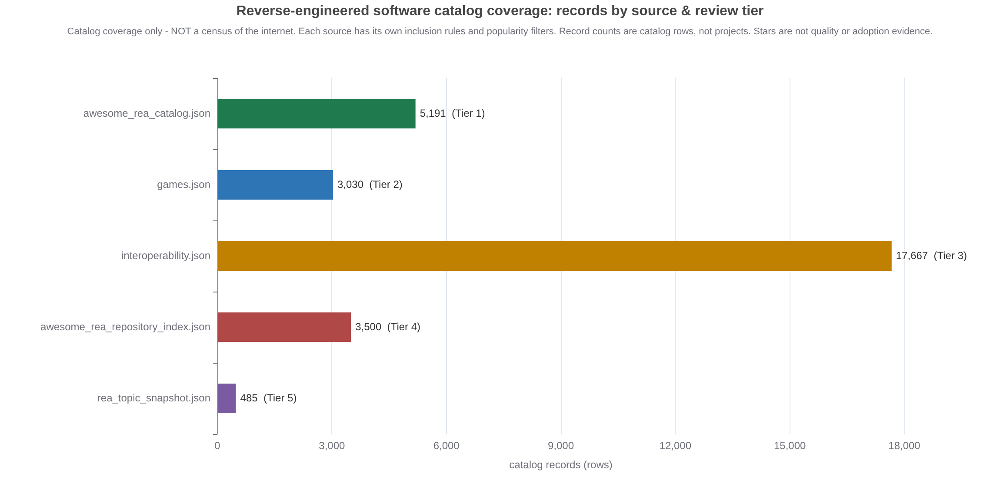
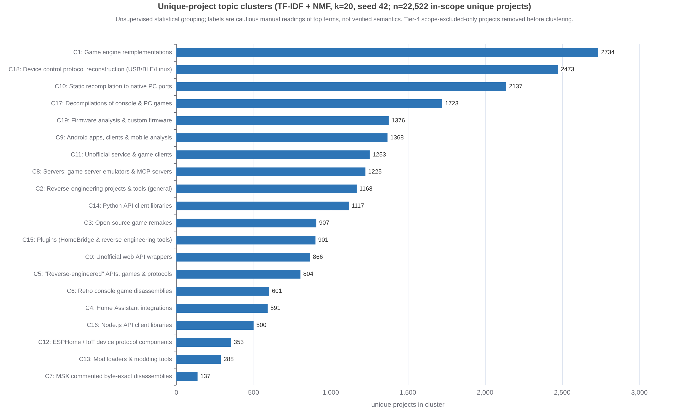

# Reverse-Engineered Software Landscape

**Report date:** 2026-11-20 (correction pass of the same-day first release). **Companion artifact:** `reverse_engineered_software_landscape.xlsx` (nine sheets; Summary counts are live COUNTIF/COUNTIFS/AVERAGEIFS formulas over the data sheets). **Character:** an audit-friendly, metadata-only analysis of five public catalogs of reverse-engineered, decompiled, recompiled, reimplemented, and interoperable software. Throughout, **observed data** (counts from the workbook) is separated from **original synthesis/recommendations** (labeled as such).

---

## 1. Research questions and headline results

This report answers five research questions about the public landscape of reverse-engineered software as represented in five independent catalogs:

1. **Coverage** — How much material do the catalogs contain, and how much overlap exists between them?
2. **Evidence quality** — How do the sources differ in review depth, and what evidence tier does each record deserve?
3. **Composition** — What kinds of projects dominate (games, device/IoT integrations, unofficial API clients, tooling), and in what languages and licenses?
4. **Structure** — Does the landscape decompose into coherent thematic clusters when analyzed with unsupervised text methods?
5. **Use boundaries** — What can this dataset legitimately support, and where are the legal, security, and methodological limits?

**Headline observed results.** The five sources contribute **29,873 source occurrences**, all kept row-for-row in the workbook's Source_Records sheet — including 191 Tier-4 rows that the upstream scan itself flags `scope_status=excluded`. Deduplication by repository-root group URL (GitHub/GitLab tree/blob subpaths resolve to their `owner/repo` root; every member URL, title, and record key is preserved on the merged row) yields 22,711 distinct groups, of which **189 are excluded-only projects** (no in-scope occurrence anywhere) and are removed from the analytical sheets. The analytical population is therefore **22,522 in-scope unique projects**, collapsing **7,160 duplicate in-scope occurrences** (24.0% of records). **5,139 projects (22.8% of in-scope uniques) appear in more than one source**, giving them cross-source corroboration; the 2 remaining projects that overlap an excluded Tier-4 row carry `has_excluded_occurrence=1`. Unsupervised clustering (TF-IDF + NMF, k=20, fixed seed) over the in-scope projects produces 20 clusters; the representative audit flags **five mixed or approximate groupings (C5, C8, C9, C15, and C19)** and treats the remaining clusters as coherent or broadly coherent at the audited representatives. The single largest thematic mass is game reconstruction: the Tier-2 games catalog alone holds 3,030 link-checked records, and "Game Decompilations & Reimplementations" is also the largest category (6,071 records) in the Tier-3 community catalog.

**What these numbers are not (observed limitation, stated up front):** catalog record counts measure *catalog coverage*, not the internet — each source has its own inclusion rules, popularity thresholds, and sampling biases, and absence from this dataset proves nothing about whether a project exists. Stars are visibility/bookmarking metadata, not evidence of quality, correctness, safety, or adoption; several sources pre-filtered by stars, compounding popularity bias. The deliverable contains metadata and URLs only — **no ROMs, copyrighted assets, or decompiled source code** — and no code from any listed project was executed during this analysis.

## 2. Acquisition: five sources and five evidence tiers

### 2.1 Source inventory with provenance

| # | Source (file) | Records | Tier | Provenance and upstream | License/terms | Retrieved / updated |
|---|---|---|---|---|---|---|
| 1 | `awesome_rea_catalog.json` | 5,191 | **Tier 1** — source-reviewed curated catalog | [awesomerea.org](https://awesomerea.org) / [reacher-z/Awesome-REA](https://github.com/reacher-z/Awesome-REA); descriptions reviewed against primary sources, per-row `evidence_url` | Curated; per-row evidence links | Latest review 2026-11-09 |
| 2 | `games.json` | 3,030 | **Tier 2** — curated game catalog, multi-source, link-checked | Merged from 13 public lists/sites including [decomp.dev](https://decomp.dev/), [recompiledgames.com](https://recompiledgames.com/), [recomp.fyi](https://recomp.fyi/), [SamidyFR/Game-Decompilations](https://github.com/SamidyFR/Game-Decompilations), [CharlotteCross1998/awesome-game-decompilations](https://github.com/CharlotteCross1998/awesome-game-decompilations), [radek-sprta/awesome-game-remakes](https://github.com/radek-sprta/awesome-game-remakes), [BlueInterlude/awesome-recompilations](https://github.com/BlueInterlude/awesome-recompilations) and others; every link HTTP-checked 2026-11-19 | Curated aggregation of public lists | Generated 2026-11-19T12:04:56Z |
| 3 | `interoperability.json` | 17,667 | **Tier 3** — community catalog, GitHub-API-enriched | [awesome.alexgaoth.com](https://awesome.alexgaoth.com/) community catalog; data exported from [awesome.alexgaoth.com/data.json](https://awesome.alexgaoth.com/data.json); upstream repository [alexgaoth/awesome-reverse-engineered](https://github.com/alexgaoth/awesome-reverse-engineered); metadata enriched via the GitHub API per the catalog's documentation | Code MIT / data CC0 | Catalog updated 2026-11-19 |
| 4 | `awesome_rea_repository_index.json` | 3,500 | **Tier 4** — automated README-scan index, unreviewed | Automated scan attached to the Awesome-REA project ([awesomerea.org](https://awesomerea.org)); descriptions classified automatically; includes 191 `scope_status=excluded` rows retained and flagged (kept in Source_Records; excluded-only projects removed from analytics); per-row `readme_sha256` retained | Automated collection; kept separate from curated rows | Observed 2026-10-16; published 2026-10-20 |
| 5 | `rea_topic_snapshot.json` | 485 | **Tier 5** — GitHub topic-search sample, popularity-biased | GitHub repository search API: top 100 by stars for topics `reverse-engineering`, `decompilation`, `emulator`, `reimplementation`, `source-port` (485 unique after cross-topic overlap) | GitHub API per its documentation | Retrieved 2026-11-20T02:15:13Z |

*Table 1 — Five-source acquisition. Every input file's SHA-256, byte size, and row count are recorded in the workbook's Acquisition_Log sheet (e.g., `interoperability.json` SHA-256 `40d9bd58…f2fb492e`, 4,721,315 bytes, 17,667 rows), so each figure in this report can be traced to a hashed input. A sixth anticipated input (`rea_structured_downloads.json`) was absent from the work directory; the acquisition log records this gap explicitly rather than reconstructing silently.*

**Tier-1 metadata reconciliation (observed).** The catalog's own meta block reports `paper_count=442`, but the exported resources' `kind` field contains **no `paper` value** — the 5,191 exported rows split into case-study 4,025, tool 910, integration 97, documentation 49, learning-resource 49, collection 33, project 15, and research 13. The 442 papers are therefore separate source metadata (part of the upstream site's broader index), **not represented in this export's kind_type**, and no paper rows can be individually identified from the delivered file. Similarly, the export has no project activity field: its `verified_at` is a catalog *review* date and is reported only as `verified_at`, never as project activity. Evidence metadata in the export: `evidence_class` is 1 for 1,126 rows, 2 for 3,844, 3 for 186, **0 for 15 rows** (evidence_status=observed), and **blank for 20 rows**, which are exactly the 20 rows whose `evidence_status` is `unknown`.

**Tier-2 link-check disclosure (observed).** Every games-catalog link was HTTP-checked at generation time, and the per-row status is exported (`link_status` column): **3,028 rows returned HTTP 200; `grand-theft-auto-v` returned 401 and `super-mario-64-multiplayer` returned 403**, even though the upstream `link_ok` flag is `True` for all 3,030 rows. "Link-checked" means *checked*, not *all accessible*.

The tier model is the report's central evidence control. **Tier 1** rows were reviewed against primary sources by curators; **Tier 2** rows come from a curated merge with per-link HTTP checks; **Tier 3** rows are community-catalog entries whose metadata was enriched programmatically (accurate for GitHub fields, but inclusion is community-driven); **Tier 4** rows are machine-classified and unreviewed; **Tier 5** rows are a deliberately popularity-biased sample. Analyses below always state which tiers they draw on, and Tier 4/5 rows are never presented as curator-endorsed.

### 2.2 Topic-sample sampling frame (observed)

The Tier-5 snapshot sampled the top 100 repositories by stars in five GitHub topics whose full topic sizes were: `reverse-engineering` 16,616; `emulator` 8,291; `decompilation` 1,191; `reimplementation` 327; `source-port` 160 (GitHub search API `total_count` at retrieval, 2026-11-20). The sample therefore covers the most-starred slice of roughly 26,500 topic-tagged repositories — a visibility-weighted window useful for identifying prominent projects (median sampled stars 536; maximum 126,016), never for estimating topic composition.

## 3. Normalization, deduplication, and cross-source overlap

### 3.1 Method (observed)

Normalization trimmed text and canonicalized URLs — forcing HTTPS, lowercasing host and GitHub/GitLab path, and stripping `.git` suffixes, `www.`, trailing slashes, tracking parameters, and fragments — before deduplication. **Dedup rule:** GitHub and GitLab URLs are grouped by *repository-root identity* (`owner/repo`); tree/blob/other subpaths and anchors are treated as resources inside that repository, while all other URLs group by their full canonical form. Every member occurrence keeps its own row in Source_Records, and each Unique_Projects row lists all member `canonical_urls`, `titles`, and `source_record_keys` — so distinct curated case studies that share one repository (e.g., the Dinosaur-runner and Windows-Calculator case studies, both anchored in one evidence file in `morluto/rea`) are preserved as evidence, not silently dropped, while genuine root-vs-subpath duplicates (e.g., the interoperability catalog's `cyneprepou4uk/NES-Games-Disassembly` root listing versus the games catalog's 14 per-game `…/tree/main/<Game>` entries) collapse into one project. Row identity uses occurrence-stable IDs (`SR000001+`, load order) and unique-project IDs (`U00001+`, first-occurrence order) because source record keys are *not* unique — the games id `cyneprepou4uk-nes-games-disassembly` legitimately repeats 14 times. The Source_Records sheet keeps all 29,873 occurrences (one row per source × catalog entry, including the 191 flagged-excluded Tier-4 rows) so provenance is never lost; Unique_Projects holds the 22,522 in-scope deduplicated rows with per-source membership flags, best evidence tier, and aggregated metadata. Unique aggregation never propagates catalog review dates as project activity.

### 3.2 Deduplication and overlap results (observed)

| Metric | Value |
|---|---|
| Source records (all occurrences, incl. 191 excluded) | **29,873** |
| Distinct repository-root groups | **22,711** |
| Excluded-only groups removed from analytics | **189** |
| In-scope unique projects (Unique_Projects / Cluster_Assignments) | **22,522** |
| Duplicate in-scope occurrences collapsed | **7,160** (24.0% of records) |
| In-scope projects carrying an excluded occurrence | **2** |
| Projects present in more than one source | **5,139** (22.8% of in-scope uniques) |

*Table 2 — Deduplication results. Intra-source duplicate collapses include the Tier-1 catalog (5,191 records → 5,169 unique groups, including the 21 `morluto/rea` documentation/case-study URLs that resolve to one repository) and the games catalog (3,030 records → 3,017 unique groups, including the 14-row NES disassembly series).*

| Unique projects present in both → | interoperability | games | awesome_rea_catalog | repository_index | topic_snapshot |
|---|---|---|---|---|---|
| interoperability (17,667 in-scope) | — | 2,141 | 3,308 | 1,124 | 291 |
| games (3,017) | 2,141 | — | 1,328 | 198 | 113 |
| awesome_rea_catalog (5,169) | 3,308 | 1,328 | — | 482 | 187 |
| repository_index (3,311 in-scope) | 1,124 | 198 | 482 | — | 195 |
| topic_snapshot (485) | 291 | 113 | 187 | 195 | — |

*Table 3 — Cross-source overlap of in-scope unique projects (symmetric COUNTIFS over membership flags; diagonal = in-scope uniques per source). The curated Tier-1 catalog shares 3,308 projects with the Tier-3 community catalog — substantial corroboration — while the popularity-biased Tier-5 sample overlaps every source only lightly, as expected for a top-100-per-topic window.*

**Interpretation (original synthesis).** The overlap pattern is exactly what a healthy multi-source merge should show: the two curated sources (Tiers 1–2) overlap the broad community catalog far more than they overlap each other, indicating complementary rather than redundant curation; and 77.2% of in-scope unique projects are single-source, meaning the merge's value is coverage expansion, with the 5,139 multi-source projects forming a cross-corroborated core that is the safest starting set for downstream use.

## 4. Composition findings: review, categories, licenses, languages, activity

### 4.1 Review depth (observed)

By tier, the 29,873 records split as: Tier 3 community-catalog 17,667 (59.1%); Tier 1 source-reviewed 5,191 (17.4%); Tier 4 automated-scan 3,500 (11.7%, of which 191 rows are upstream-flagged as out of scope); Tier 2 link-checked games 3,030 (10.1%); Tier 5 topic sample 485 (1.6%). The practical consequence: **just over a quarter of records (27.5%, Tiers 1–2) carry human review or per-link verification**; the majority inherit community-catalog curation; and Tier 4 rows must be treated as unverified leads. Within the Tier-1 catalog, record kinds are dominated by 4,025 `case-study` entries alongside 910 `tool`, 97 `integration`, 49 `documentation`, and 49 `learning-resource` entries. The "Independent reconstruction cases" category contains 3,926 rows across all kinds: 3,923 case studies and three projects. Separately, the largest tooling-related *category* sizes across all kinds are native-analysis 251, game-analysis 150, debugging/dynamic-analysis 110, protocol-analysis 91, Android 89, and firmware 89; these category totals are not `kind=tool` counts.

### 4.2 Category composition of the largest source (observed)

The Tier-3 interoperability catalog (17,667 records, 20 top-level categories) is led by Game Decompilations & Reimplementations (6,071), Devices/IoT & Hardware (3,121), RE Tooling (1,170), Unofficial Web/App API Clients (986), Chinese & Asian Platforms (770), AI Tools & LLM Clients (752), Online Service Revivals (634), Automotive (536), Firmware & Embedded (536), File Formats (444), Drivers & Low-level Hardware (442), Network & Wire Protocols (430), Apple Ecosystem (347), Messaging & Social Apps (311), and Industrial & Building Automation (292). This composition confirms the landscape's two gravitational centers: **game reconstruction** and **device/protocol interoperability** (smart-home, automotive, and industrial integrations), with a newer AI/LLM-client category already at 752 records.

### 4.3 Licenses and languages (observed)

| License (all 29,873 records) | Records | | Primary language (interoperability + topic snapshot only) | Records |
|---|---|---|---|---|
| (blank — not collected / not reported) | 12,383 | | (blank — not recorded by those two sources) | 1,216 |
| MIT | 6,755 | | Python | 4,072 |
| GPL-3.0 | 3,539 | | C++ | 2,792 |
| NOASSERTION (see license_status) | 2,369 | | C | 2,618 |
| Apache-2.0 | 1,368 | | JavaScript | 1,081 |
| GPL-2.0 | 904 | | C# | 971 |
| AGPL-3.0 | 711 | | TypeScript | 926 |
| CC0-1.0 | 646 | | Assembly | 897 |
| BSD-3-Clause | 253 | | Rust | 701 |
| LGPL-3.0 | 182 | | Go | 576 |

*Table 4 — License and language distributions (COUNTIF over Source_Records). **Blank does not prove "no license"**: the 12,383 blanks decompose by the exported `license_status` field into 5,191 `not-collected` rows (the Tier-1 catalog simply has no license field) and 7,192 `not-reported` rows (sources that collect licenses but reported nothing for the row — absent or undetected). NOASSERTION (2,369) likewise decomposes into 2,225 `unrecognized` (license file present but unmappable) plus 144 topic-snapshot rows whose collector maps *missing and unrecognized together* (`unknown-missing-or-unrecognized`). Language is recorded only by the interoperability and topic-snapshot sources, so the language columns — including the 1,216-row blank — describe those 18,152 records, not all five sources.*

License-status totals (observed): declared 15,121; not-reported 7,192; not-collected 5,191; unrecognized (NOASSERTION) 2,225; unknown-missing-or-unrecognized (topic sample) 144.

Three audit-relevant readings (original synthesis grounded in the observed counts). First, **only 15,121 of 29,873 records (50.6%) carry a recognized, source-declared license**; the rest are blank (not collected or not reported) or unrecognized/unknown — meaning roughly half the cataloged landscape offers no machine-readable reuse grant *in these catalogs*, and "publicly visible" must not be read as "reusable." Blank and NOASSERTION are "unknown" signals, not evidence that no license exists. Second, the language mix — Python first, then C++/C, with a remarkable 897 Assembly records — reflects the dual nature of the field: high-level interoperability clients in Python/TypeScript, and low-level reconstruction work in C/C++/Assembly. Third, copyleft (GPL-2.0/3.0, AGPL-3.0, LGPL) collectively accounts for over 5,300 records, so embedding or redistribution decisions require per-project license reading, not assumptions.

### 4.4 Activity and health (observed)

The interoperability catalog's own health labels (based on GitHub activity enrichment) classify its 17,667 records as: **active 10,036 (56.8%)**, dormant 3,509, slow 2,479, archived 1,189 (6.7%), unknown 454. The games catalog classifies its 3,030 records as active 2,613, inactive 356, unknown 61, using an explicit inactivity cutoff of 2024-11-19. In the popularity-biased topic sample, no repository was archived at retrieval (a sampling artifact of sorting by stars, not a property of the topics). Observed last-activity dates — now restricted to real project activity (`pushed_at`/`last_commit`; the Tier-1 catalog contributes none because it has no activity field, and its review dates are kept only in `verified_at`) — span 2008-03-26 to 2026-11-20 across the **24,167 records** that carry one (17,213 interoperability + 2,969 games + 3,500 repository-index + 485 topic-sample rows). Because the remaining sources stamp enrichment or review dates into other fields, this report deliberately relies on the sources' *labeled* health classes rather than re-deriving recency from mixed-semantics date fields.

## 5. Game reconstruction: taxonomy and counts

### 5.1 Taxonomy (observed)

The Tier-2 games catalog classifies each record by reconstruction **type**, and the Tier-1 curated catalog independently classifies its game-reconstruction resources by **method**. The two vocabularies align conceptually but are counted separately because they are different sources with different granularity.

| Games catalog type (3,030 records) | Count | | Curated catalog method (5,191 resources) | Count |
|---|---|---|---|---|
| static-recomp | 1,009 | | static-recompilation | 761 |
| decompilation | 920 | | matching-decompilation | 583 |
| engine-remake | 409 | | engine-reimplementation | 467 |
| source-port | 364 | | port | 357 |
| disassembly | 238 | | decompilation | 343 |
| browser-port | 57 | | other | 321 |
| mod | 17 | | (no method — non-game resource kinds) | 2,359 |
| tool | 16 | | | |

*Table 5 — Game reconstruction taxonomy in the two game-aware sources. "Matching decompilation" denotes reconstructions verified to compile to a byte-identical or near-identical binary; "static recompilation" denotes binary translation to a native target; "engine remake/reimplementation" denotes a clean-room or documented-behavior rewrite that still requires the original game data.*

Platform coverage in the games catalog is led by PC (629), Xbox 360 (278), Nintendo 64 (227), PlayStation 1 (223), PlayStation 2 (173), GameCube (124), DOS (109), Game Boy Advance (90), and NES (80) — a spread from DOS-era to seventh-generation consoles. The catalog also carries an **AI-assisted flag**: 747 records (24.7%) are flagged AI-assisted and 2,283 are not, reflecting curators' per-project assessment, and a mean curator composite score of **3.25 out of 5** (a curated quality metric internal to that catalog, not a cross-landscape measure).

### 5.2 Interpretation (original synthesis)

The dominance of static recompilation (1,009 records) over traditional decompilation (920) in the 2026-11-19 games catalog is consistent with the maturation of platform-specific recompilation toolchains (the N64 and Xbox/Xbox 360 clusters visible in the platform counts), while the long tail of 238 disassemblies — including single-author, byte-exact, fully commented efforts such as the MSX series visible in cluster C7 — shows that manual assembly-level reconstruction remains an active craft practice rather than a superseded one. The 24.7% AI-assisted share is best read as a leading indicator to track across catalog regenerations, not as a stable proportion, since the flag's criteria are curator-defined.

## 6. Thematic clustering: method, clusters, and audit caveats

### 6.1 Method and its limits (observed)

Clustering used scikit-learn `TfidfVectorizer` (1–2 grams, min_df=3, max_df=0.5, sublinear_tf, 15,000 features) over cleaned project name + description text of the **22,522 in-scope unique projects** (excluded-only Tier-4 groups removed upstream), followed by non-negative matrix factorization (`NMF`, k=20, init=nndsvda, random_state=42, max_iter=600). Each unique project was assigned to its highest-weight cluster; per-cluster top terms and the five highest-weight representative projects were extracted, and **at least two representatives per cluster were manually audited** against their URLs/descriptions. These clusters are an unsupervised statistical grouping over short text: labels are cautious human readings of top terms and audited representatives, **not verified semantic truth**; the same corpus under a different k or seed would yield somewhat different boundaries. (Cluster IDs are not stable against the pre-correction run — the input population changed — so cluster numbers below refer to this release.)

### 6.2 The twenty clusters (observed counts; labels are cautious readings)

| Rank | Cluster | n | Cautious label | Audited representatives (evidence links) | Audit result |
|---|---|---|---|---|---|
| 1 | C1 | 2,734 | Game engine reimplementations | [Quake4Doom](https://github.com/kasreyn/quake4doom); [ForsakenX](https://github.com/forsakenx/forsaken) | Coherent (mild drift: Grit/Ballistica are general engines) |
| 2 | C18 | 2,473 | Device control protocol reconstruction (USB/BLE/Linux) | [douze (SSL 12 USB protocol)](https://github.com/xenicle/douze); [orba-protocol](https://github.com/holofermes/orba-protocol) | Coherent |
| 3 | C10 | 2,137 | Static recompilation to native PC ports | [Outpost Kaloki X](https://github.com/tekrantgaming/outpost-kaloki-x-recompiled); [Amped2-Recomp](https://github.com/bertibertig/amped2-recomp) | Coherent |
| 4 | C17 | 1,723 | Decompilations of console & PC games | [Cooking Mama decomp](https://github.com/liolu/cooking-mama-decomp); [MySims decomp](https://github.com/liolu/mysims-decomp) | Coherent (platform drift: Cuphead PC decomp) |
| 5 | C19 | 1,376 | Firmware analysis & custom firmware | [tpm-firmware](https://github.com/fishilico/tpm-firmware); [Gerbil](https://github.com/daumbrella/gerbil) | **Approximate** — firmware theme holds but spans analysis tools, custom firmware, and collections |
| 6 | C9 | 1,368 | Android apps, clients & mobile analysis | [openmw-android](https://github.com/xyzz/openmw-android); [blbl](https://github.com/cat3399/blbl) | **Mixed** — Android clients/ports mixed with Frida/APK mobile-analysis terms |
| 7 | C11 | 1,253 | Unofficial service & game clients | [QrisMerchantID](https://github.com/alfinai/qrismerchantid); [tokopedia-client](https://github.com/aqualaguna/tokopedia-client) | Coherent (game-client drift noted) |
| 8 | C8 | 1,225 | Servers: game server emulators & MCP servers | [uberstrok](https://github.com/ficture7/uberstrok); [PayCheck3](https://github.com/slejmur/paycheck3) | **Mixed** — game server emulators vs AI MCP servers |
| 9 | C2 | 1,168 | Reverse-engineering projects & tools (general) | [tera-re](https://github.com/alexrp/tera-re); [nike-sportband](https://gitlab.com/mamora/nike-sportband) | Coherent but broad (cross-domain) |
| 10 | C14 | 1,117 | Python API client libraries | [myPyllant](https://github.com/signalkraft/mypyllant); [pysnoo](https://github.com/rado0x54/pysnoo) | Coherent (pyspnego is a general auth library, mild drift) |
| 11 | C3 | 907 | Open-source game remakes | [sccopter (SimCopter)](https://github.com/fr0zi/sccopter); [Jactorio (Factorio)](https://github.com/jaihysc/jactorio) | Coherent |
| 12 | C15 | 901 | Plugins (HomeBridge & RE-tool plugins) | [homebridge-eightsleep](https://github.com/nfarina/homebridge-eightsleep); [homebridge-tahoma](https://github.com/dubocr/homebridge-tahoma) | **Mixed** — second sub-theme of IDA Pro/Ghidra plugins |
| 13 | C0 | 866 | Unofficial web API wrappers | [opentable](https://github.com/sosedoff/opentable); [downdetector-api](https://github.com/davideviolante/downdetector-api) | Coherent |
| 14 | C5 | 804 | "Reverse-engineered" APIs, games & protocols | [reverse-engineered-grammarly-api](https://github.com/c0nn3r/reverse-engineered-grammarly-api); [iwd2-re](https://github.com/alexbatalov/iwd2-re) | **Mixed** — shared wording spans API, game, protocol and patch targets |
| 15 | C6 | 601 | Retro console game disassemblies | [Dragster-Disassembly](https://github.com/celestialamber/dragster-disassembly); [Sutte Hakkun](https://github.com/pizdex/suttehakkun) | Coherent |
| 16 | C4 | 591 | Home Assistant integrations | [ariston-remotethermo-ha-v3](https://github.com/fustom/ariston-remotethermo-home-assistant-v3); [home-assistant-rivian](https://github.com/bretterer/home-assistant-rivian) | Coherent |
| 17 | C16 | 500 | Node.js API client libraries | [node-screenlogic](https://github.com/parnic/node-screenlogic); [JimmyJohns](https://github.com/mmahler2/jimmyjohns) | Coherent |
| 18 | C12 | 353 | ESPHome / IoT device protocol components | [esphome-abl-emh1](https://github.com/jrv/esphome-abl-emh1); [esphome-fastcon](https://github.com/dennispg/esphome-fastcon) | Coherent |
| 19 | C13 | 288 | Mod loaders & modding tools | [CCLoader](https://github.com/ccdirectlink/ccloader); [ResoniteModLoader](https://github.com/resonite-modding-group/resonitemodloader) | Coherent |
| 20 | C7 | 137 | MSX commented byte-exact disassemblies | [Demonia disassembly](https://github.com/antxiko/demonia-disassembly); [Hinotori disassembly](https://github.com/antxiko/hinotori-disassembly) | Coherent — but dominated by one author's series |

*Table 6 — All 20 clusters by size (counts are COUNTIF formulas in the workbook). Representative audit: five mixed or approximate groupings (C5, C8, C9, C15, C19); the remainder are coherent or broadly coherent at the audited representatives. Cluster sizes sum to 22,522.*

### 6.3 Reading the map (original synthesis)

The cluster structure independently corroborates the category findings of Section 4: game reconstruction spans at least seven clusters (C1, C10, C17, C3, C6, C13, C7 — roughly 8,500 projects — plus parts of C8/C9/C11), and device/service interoperability spans another seven (C18, C12, C4, C11, C0, C14, C16 — roughly 7,000), while firmware, mobile analysis, tooling, and general reverse engineering occupy the remainder. The five mixed or approximate clusters share a failure mode worth remembering when reusing this map: **NMF groups by shared vocabulary, so "reverse engineered," "server," "plugin," "Android," and firmware terms can merge genuinely different crafts.** The single-author MSX cluster (C7) and the liolu Nintendo-DS series atop C17 also demonstrate that prolific individual authors, not only technical themes, shape this landscape. For any decision about a specific project, the cluster label is a discovery hint; the project's own repository, license, and tier remain the evidence.

## 7. Limitations, including REA-index and fork handling

**Not a census.** Every figure in this report measures the coverage of five catalogs with distinct inclusion rules — a curated resource directory, a 13-list game merge with per-link checks, a community interoperability catalog, an automated README scan, and a top-100-by-stars topic sample. Nothing here estimates the true population of reverse-engineered software, and absence from the dataset is not evidence of a project's non-existence. The Tier-5 sample is explicitly popularity-biased; the Tier-3 catalog reflects its community's submission patterns; the Tier-2 games catalog applies its own star thresholds for some upstream lists (e.g., recomp.fyi entries with ≥10 stars).

**Awesome-REA index (Tier 4) limitations.** The repository index is an automated README scan: of 3,500 scanned candidates, 3,309 browse-scope rows and 191 explicitly `scope_status=excluded` rows are all retained in Source_Records (flagged in `scope_status`/`scope_excluded`, not deleted), but the 189 projects with no in-scope occurrence are removed from Unique_Projects and clustering, and the 2 excluded rows that overlap in-scope projects are surfaced via `has_excluded_occurrence`. README scans failed for 44 attempted repositories, 252 candidates were never attempted, and descriptions were machine-classified without human review. Per-row `readme_sha256` values support later verification, but Tier-4 rows are leads, not curated facts, and are kept visually and analytically separate from Tier-1 rows throughout.

**Fork and identity limitations.** Deduplication is by **repository-root group URL**: GitHub/GitLab tree/blob subpaths and anchors merge into their repository (all member URLs/titles/record keys preserved on the unique row), which fixes root-vs-subpath duplicates but also means distinct curated resources living in one repository (documentation pages, the Dinosaur/Calculator case studies) count as one project. Forks with distinct repository URLs still count as distinct projects, GitHub fork networks were not resolved, and renamed or transferred repositories may survive under two group URLs if the catalogs captured them at different times. Identity across forges (e.g., a GitLab mirror of a GitHub project) is not merged. Occurrence counts therefore measure *catalog listings*, not independent engineering efforts; the 5,139 multi-source projects are corroborated listings, which is a weaker claim than independently verified projects.

**Metadata-semantics limitations.** Language fields exist only for the interoperability and topic-snapshot sources; `last_activity` is a real push/commit date only where the source records one (the Tier-1 catalog has none — its `verified_at` review dates are never treated as activity); license fields carry per-source provenance (`license_status`): blank means not-collected (Tier 1) or not-reported (elsewhere), the topic snapshot cannot distinguish missing from unrecognized (NOASSERTION), and none of these prove the absence of a license; the games catalog's link check found 2 of 3,030 links returning 401/403 despite `link_ok=True`; the games AI-assisted flag and 0–5 curator score are curator-defined metrics internal to that catalog; and stars are reported only as catalog metadata — no quality, correctness, safety, maintenance-commitment, or adoption inference is drawn from them anywhere in this report.

**Clustering limitations.** Cluster assignments derive from short English-leaning text (names/descriptions), so non-English descriptions (visible, for example, in the Chinese & Asian Platforms category) are under-modeled; k=20 is a design choice; and five clusters (C5, C8, C9, C15, C19) require mixed/approximate-label caution after the representative audit. Cluster labels must not be quoted as project classifications without consulting the row-level data.

## 8. Rights and security boundaries

**Rights.** This report and workbook contain metadata and URLs only — no ROMs, game assets, decompiled source code, or copied documentation. Inclusion of a project in an upstream catalog, or in this analysis, is **not a legal clearance**: reverse-engineering legality varies by jurisdiction, purpose, target, and method, and interoperability, security research, preservation, and competitive uses can be treated differently; license text, trademarks, platform terms of service, and anti-circumvention rules all apply per project and per use. **A repository's own license does not resolve derivative rights**: a reconstruction project's MIT/GPL/CC0 tag covers, at most, that project's new code — it does not license decompiled proprietary code, game assets, ROM/BIOS images, trademarks, or leaked/restored source that the project depends on or reproduces. The observed license distribution (Section 4.3) reinforces this operationally: with roughly half of records lacking a machine-readable license grant in these catalogs, **reuse rights must be established project by project**, and blank, NOASSERTION, or unknown license status means "unknown," not "permitted" — and equally does not prove "unlicensed." Nothing here advises downloading, distributing, or running reconstructed binaries or game content.

**Security.** Cataloged projects — especially unofficial API clients, private-server emulators, mod loaders, firmware tools, and MCP servers — are **unvetted third-party code**. This analysis executed no project code. Practical consequences (original recommendations): treat every listed repository as untrusted supply-chain content; review source, build scripts, and dependencies before any execution; run any dynamic inspection inside an isolated environment; never enter real service credentials into unofficial clients; note that private-server emulators and unofficial API clients may violate the target service's terms even where their code is lawful to read; and treat game-reconstruction downloads from unofficial mirrors as potential malware carriers. The workbook's evidence tiers apply to *catalog metadata accuracy*, not to the safety of the listed code — a Tier-1 row means the catalog entry was reviewed, not that the project is safe to run.

## 9. Practical tool-use guidance (original recommendations)

| Task | Recommended practice with this dataset | Boundary |
|---|---|---|
| Discovery | Start in Unique_Projects filtered to `n_sources ≥ 2` (the 5,139 cross-corroborated projects), then widen to single-source rows | Cluster labels are hints; confirm at the repository |
| Evaluation | Read the project license (with `license_status`), health label, last-activity date, and tier together; prefer Tier 1–2 rows for curated descriptions | Stars never substitute for review; health labels are point-in-time |
| Audit trail | Cite the workbook row plus the Acquisition_Log SHA-256 of the source file; re-pull the upstream catalog before relying on a stale row | Catalogs regenerate; rows from 2026-11-19/20 decay |
| Game reconstruction research | Use the games catalog's type taxonomy (Table 5) and curator score as *their* metrics; check decomp.dev/recompiledgames.com upstream for current status | Do not infer legality or asset rights from a listing; a repo license does not cover the original game's assets |
| Tooling selection | Prefer active, licensed projects in the C2/C18/C19 tooling and protocol clusters; verify current releases on the official repository | Never execute unreviewed binaries from catalog links |
| Reuse/redistribution | Filter to explicit OSI licenses (MIT/Apache-2.0/BSD/GPL per your policy) and read the actual LICENSE file at the pinned commit | Blank/NOASSERTION/unknown = unknown, not permission — and not proof of absence |

*Table 7 — Tool-use guidance. All rows are original recommendations; the dataset supports them but does not itself perform any vetting.*

## 10. Evidence separation and provenance statement

**Observed data** in this report comprises: all record/unique/overlap counts (Tables 1–3), tier assignments, category, license (including `license_status`), language, link-status, and health distributions (Section 4), game taxonomy counts, AI-flag and curator-score figures (Section 5), cluster sizes, terms, representatives, and audit notes (Section 6), acquisition metadata including SHA-256 hashes, and the sampling-frame totals of Section 2.2 — each traceable to the companion workbook's formula-driven Summary or to the hashed input files. **Original synthesis/recommendations** comprise: the overlap interpretation (§3.2), the license/language readings (§4.3), the game-landscape interpretation (§5.2), the cluster-map reading (§6.3), the security and reuse practices (§8–9), and all framing language — these are analysis judgments, not catalog facts, and are labeled as such where they appear. Verification dates: Tier-1 review 2026-11-09; Tier-2 link-check 2026-11-19; Tier-3 catalog update 2026-11-19; Tier-4 observation 2026-10-16; Tier-5 retrieval 2026-11-20. The dataset is an immutable snapshot; refreshes should re-pull upstream catalogs and re-run normalization, deduplication, and clustering rather than editing rows in place.

---

**Disclaimer.** This report is for general informational and research purposes only. It is not legal advice, not a license or rights determination, not a security assessment of any listed project, and not an endorsement of any catalog entry. Reverse engineering, interoperability, and reuse of third-party software involve jurisdiction-specific legal constraints; consult qualified counsel before acting on any project identified here. Catalog metadata is point-in-time and may be stale, incomplete, or superseded upstream.
